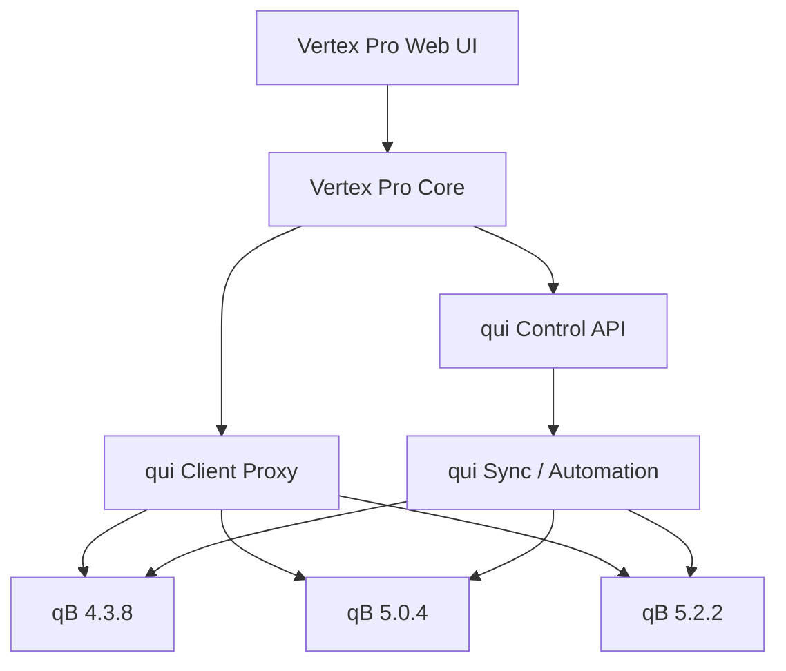
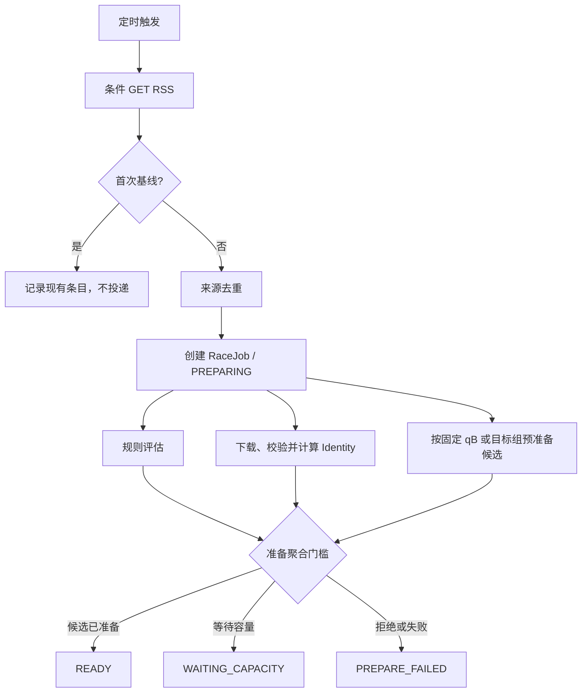
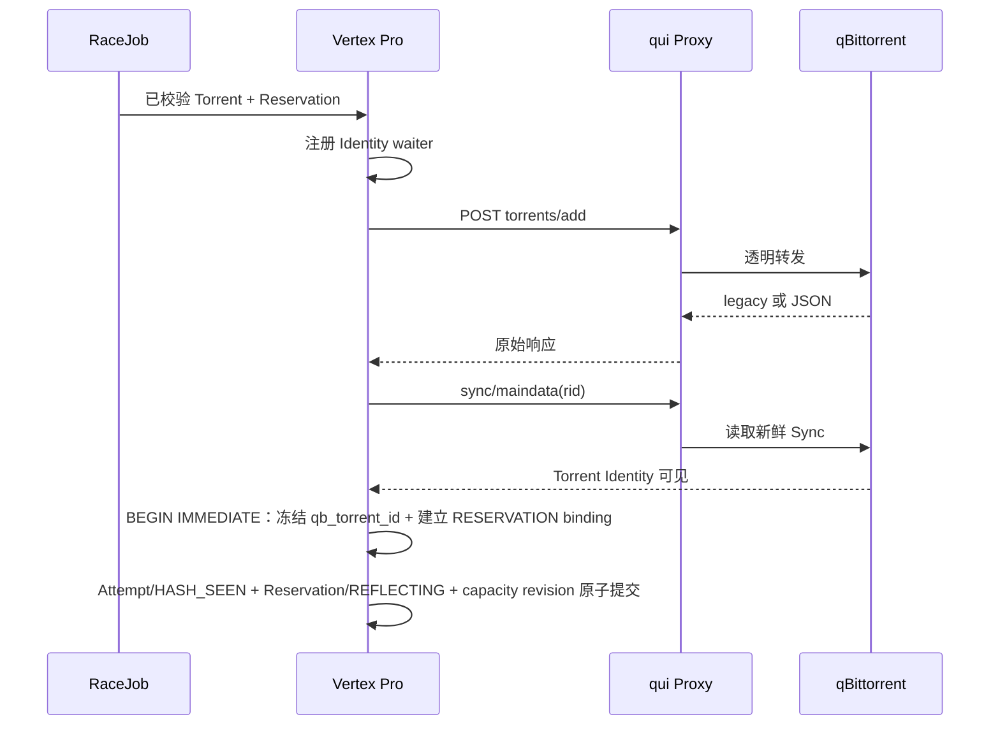
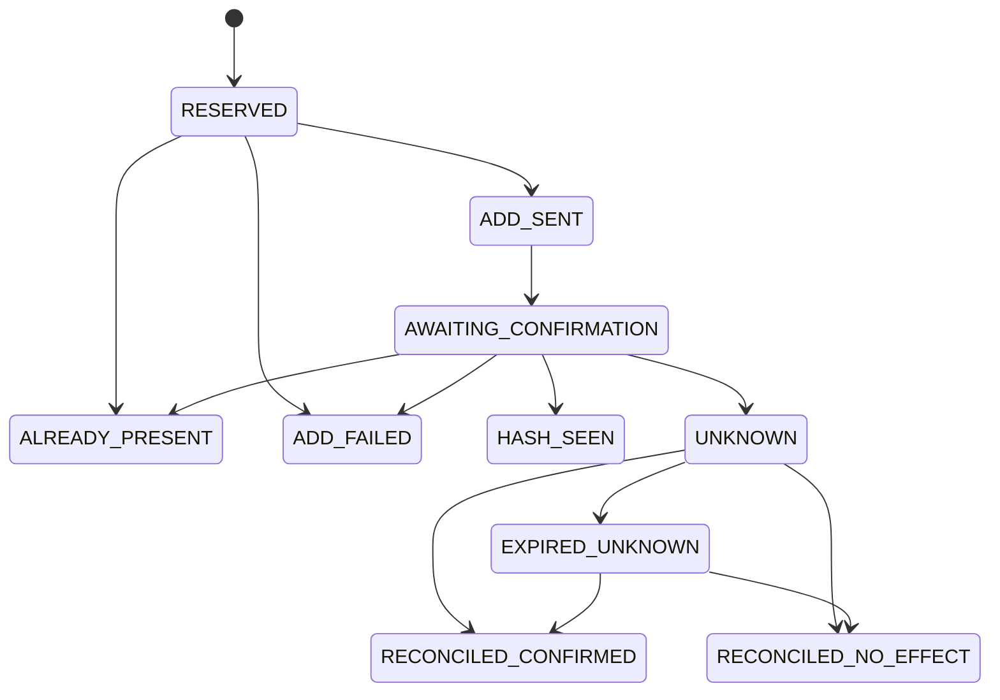

# Vertex Pro V1 完整重设计方案

文档状态：`DESIGN-RC8 / FROZEN-CANDIDATE`  
编制日期：2026-08-24  
最后修订：2026-09-05  
目标版本：Vertex Pro V1  
qBittorrent 支持矩阵：`4.3.8`、`5.0.4`、`5.2.2`  
qui 定位：唯一 qBittorrent 接入层与生命周期管理平台
Vertex Pro V1 项目许可证：`GPL-2.0-or-later`  
qui Query Builder 复用模式：`DIRECT_GPL_REUSE`
规则编辑器复用状态：计划复用，尚未导入代码（`PLANNED_NOT_IMPORTED`）

规范关系：

- 本文件是 Vertex Pro V1 的完整设计候选，统一产品边界、三版本兼容、状态语义、容量账本、持久化和验收标准。
- 在 G1、G2、第 24 节验收和 C1 实现合同一致性全部通过并执行 G3 前，本文件不得标记为 `FROZEN-V1`，也不得覆盖现有已冻结专项方案。
- 冻结前若与 `VERTEX_PRO_RSS_RACE_V1_PLAN.md` 的既有投递事实、UNKNOWN、SyncWatcher 或 Reflection 不变量冲突，以既有 `FROZEN-V1` 为准。
- 冻结时必须通过单独 ADR 明确 supersede 关系并归档旧规范，禁止两个文件同时声称自己是状态机唯一规范源。
- 用户可见产品与规则编辑器合同见 `VERTEX_PRO_V1_USER_RULES_CONTRACT.md`；该合同约束 V1 页面、用户状态和 qui-style 规则体验，不改变本文的投递事实、容量或恢复不变量。
- 许可证选择已经确定：Vertex Pro V1 以 `GPL-2.0-or-later` 发布，允许在遵守上游许可和通知义务的前提下直接改造 qui Query Builder；首次导入代码前必须固定上游 tag/commit，并更新规划通知 `docs/产品方案设计/THIRD_PARTY_NOTICES.md`。代码仓库初始化后，另在仓库根目录维护发布所需的 `THIRD_PARTY_NOTICES.md`。

RC8 修订摘要：

- 删除第二套 `ADD_DISPATCHED / CONFIRMING / OBSERVING / COMPLETED` 主状态，恢复 FROZEN-V1 投递术语；补回三个并行准备子状态，并保持投递后的事实、Reservation 和观测状态正交。
- 取消简化 future-liability 容量替代方案，保留 allocation/capacity epoch、Reservation、终态 Reflection 和 uncertainty debit。
- 补齐 SubmitIntent、Sync 状态/快照、waiter、容量 epoch、Reflection 和 reconciliation 持久化结构。
- 增加多规则命中关联表、规则版本快照和确定性聚合规则。
- V1 只冻结 `CONSERVATIVE_TERMINAL`：下载期间保留完整 Reservation，只在完成或权威删除终态加新鲜物理空间快照后释放；Managed Agent/`VERIFIED_ALLOCATED_BYTES` 整体移入 V2。
- 修正网络边界：qB 控制和数据访问只能经 qui；RSS/Torrent 仅访问已登记 PT 站点，V1 不增加 Agent 证据网络平面。
- 收紧 `PREPARING -> WAITING_CAPACITY` 聚合条件，并冻结 Reservation 完成、转 UNMANAGED 和 qB 删除后的 binding 生命周期。
- 明确 Identity 多来源、SnapshotStore、容量投影/历史代际和 unmanaged liability 的 SQLite 持久化边界。
- 形式化 `AVAILABLE`、StorageTarget 验证证据、UNKNOWN 人工处理、SQLite 部分索引、`/api/v1`、幂等、分页和 SSE 首版协议。
- 冻结 SyncWatcher 首次确认 Identity 时的 `qb_torrent_id`、task binding、Reservation、Attempt、RaceJob 和容量 revision 原子事务，并明确基线重复、幂等重放和歧义处理。
- 补齐 `EXPIRED_UNKNOWN` 的两条人工对账闭环，明确 Reservation 释放或转入 Reflection 的事务语义。
- 增加通用异步命令查询接口、`api_commands` 持久化合同和 `command.state.changed` SSE 事件，确保断线与事件过期后仍可查询结果。
- 正式冻结 `attempt_state` 枚举、转换及其与 RaceJob 的事务关系；关闭旧 Attempt 与重新 Placement 分成两个阶段，新 Attempt 只能由 `READY -> RESERVED` Reservation 事务创建。
- 将 `amount_left` 改为 `KNOWN/UNKNOWN` 显式证据模型；Identity 已确认但字段非法时仍原子落 binding 和投递事实，同时容量 fail closed，禁止把 UNKNOWN 当作 0。
- 冻结 `owner_kind=RESERVATION` 的跨表约束：StateMachine 事务负责业务不变量，SQLite 双向触发器负责拒绝引用非 `ACTIVE/REFLECTING` Reservation，并规定终态转换的语句顺序。
- 冻结 `race_jobs.current_attempt_id` 与 `placement_attempts.job_id` 循环外键的迁移、连接初始化和 `READY -> RESERVED` 插入顺序；V1 不依赖延迟外键或关闭外键检查。
- 将正式冻结收敛为四项前置证据加一次 G3 规范切换：真实协议、容量/恢复、第 24 节验收、实现合同一致性全部通过后才允许激活 supersede ADR；此前允许实现，但不得伪造 `VERIFIED` 或 `FROZEN-V1`。
- 统一 ADR 激活合同：只有 G1、G2、第 24 节验收和实现合同一致性检查全部通过，才允许执行 G3 并把 ADR 从 `PROPOSED` 改为 `ACCEPTED`。
- 冻结 SubmitIntent 与 Attempt 的单向一对一存储关系：`submit_intents.attempt_id` 是唯一权威关联并带 `UNIQUE + FOREIGN KEY`；`placement_attempts` 不保存反向物理列，API 所需 `submit_intent_id` 通过唯一关联派生。
- 增加 Attempt 目标事实不可变防线：`attempt_id/job_id/identity_key/attempt_no/instance_id/storage_target_id/allocation_epoch/reserved_bytes/started_at` 创建后禁止更新，绕过 StateMachine 的直接 SQL 同样失败。
- 固定 C1 implementation note、生成命令、报告路径、JSON 字段、SHA-256 格式、退出码和 `C1_PASS` 判定，避免 G3 使用临时口头报告。
- 补充首版用户产品合同：主页优先展示 qui 中全部 qB 的实时状态；RSS 自动化规则采用 qui-style 条件/动作构建器；明确单条规则内的 AND/OR 组合与同一种子命中多条规则后的确定性聚合是两个不同层次。
- 冻结 qui 复用许可决策：Vertex Pro V1 采用 `GPL-2.0-or-later`，规则编辑器选择 `DIRECT_GPL_REUSE`；复用范围、上游版本固定、版权/SPDX、许可证、修改记录和第三方通知成为验收要求。

配套决策记录：`docs/产品方案设计/ADR-0001_VERTEX_PRO_V1_SPEC_SUPERSEDE.md`。该 ADR 在真实验证完成前保持 `PROPOSED`，不会提前取代或归档既有规范。

配套实现合同：`docs/产品方案设计/CONTRACT_CONSISTENCY_V1.md`。该文件只规定实现验证与证据格式，不增加产品能力或改变第 26 节不变量。
- 配套代码实施手册：`docs/实施流程/VERTEX_PRO_V1_CODE_IMPLEMENTATION_PLAYBOOK.md`；它只规定施工顺序、模块边界、测试、Gate 和发布流程，不改变本文业务语义。
- 配套实施进度表：`docs/实施流程/IMPLEMENTATION_STATUS_V1.md`；它只记录实施项状态和证据，不重新定义产品或状态机。

阅读说明（非规范性内容）：Vertex Pro 是部署在用户本机/内网的个人下载管理器（定位类似 Radarr、Sonarr），只与用户自行配置的 RSS/Atom 订阅源和用户自己的 qBittorrent 实例交互，不面向任何第三方系统。本文中的“kill -9”均指对 Vertex Pro 自身进程的 SIGKILL 崩溃模拟，用于验证启动恢复；“真实实例”指用户自有或实验室自部署的 qB/qui（与 mock 相对）；“Add/投递”指经 qui Proxy 向用户自有 qB 添加一个下载任务；安全设计章节（凭据、Secret、SSRF 防护）均为防御性设计。详细术语对照见 `docs/实施流程/IMPLEMENTATION_STATUS_V1.md` 第 0 节。

---

## 0. 最终结论

### 产品定位

> **Vertex Pro = qui 风格的多 qB 总览 + 原版 Vertex 风格的 RSS 自动刷流 + 删除后仍可查询的历史记录。**

这一定义是 V1 的产品入口。用户首先看到的是 qui 中全部 qB 的当前状态和实时数据；用户配置的是类似原版 Vertex 的 RSS 自动规则；用户查看历史时，即使种子已经被 qui 或 qB 删除，也仍能查询它曾经去过哪个下载器、最后状态、删除时间和累计上传数据。

Vertex Pro 不直接连接任何 qBittorrent，也不保存 qBittorrent 用户名、密码或 Cookie。所有 qBittorrent 访问统一经过 qui。

但 qui 的 Client Proxy 本质上仍是 qBittorrent WebAPI 的透明代理。Vertex Pro 经以下地址调用 Add、Sync 时，仍会收到目标 qBittorrent 的原始参数语义和响应格式：

```text
/proxy/{proxyKey}/api/v2/torrents/add
/proxy/{proxyKey}/api/v2/sync/maindata
```

因此最终设计采用：

```text
qui 控制面 API
  负责实例、健康、实时传输数据和管理信息

qui Client Proxy
  负责 qB 认证、共享会话、实例路由和透明转发

Vertex Pro 最小兼容层
  只处理 Add 参数、Add 响应、Torrent Identity 和确认差异
```

V1 的核心边界固定如下：

- Vertex Pro 负责 RSS 发现、规则判断、种子准备、实例选择、容量准入、Add、事实确认和竞速观测。
- qui 负责 qB 实例管理、认证会话、常规操作、自动删种、生命周期策略和手工管理 UI。
- qBittorrent 负责 Tracker、Peer、下载、上传、磁盘写入和做种。
- Vertex Pro 不删除种子、不暂停或恢复种子、不主动 reannounce、不替代 qui。
- V1 每个 Torrent Identity 只投递到一台 qB；不做多实例同时 fan-out。
- Add 的 HTTP 成功仅表示“可能产生副作用”，只有新鲜 qB 快照出现预期 Identity 才算投递成功。

---

## 1. 产品目标

### 1.1 主要目标

1. 比传统 Vertex 更快、更可审计地完成 PT RSS 新种发现与投递。
2. 使用 qui 统一管理分布在不同节点、不同版本的 qBittorrent。
3. 支持 qBittorrent 4.3.8、5.0.4 和 5.2.2。
4. 避免因重复 Add、响应丢失、缓存延迟或 qB 重启造成重复投递。
5. 在并发新种到来时防止磁盘空间逻辑超卖。
6. 记录从 RSS 发现到 Hash 可见、Tracker 工作、Peer 出现和首个上传字节的完整时间线。
7. 提供全部下载器及单实例的实时速度和日、周、月流量统计。
8. 保留 qui 的强项：qB 管理、删种策略、Tracker 工具、备份和人工操作。
9. 保持原版 Vertex 的核心使用路径：添加站点 RSS、设置种子大小等条件、选择 qui 中的目标 qB，然后自动投递。
10. 首屏以类似 qui 的多实例总览清晰显示全部 qB 的在线状态、实时上传/下载速度、任务数和空间；竞速内部术语不暴露给普通用户。

### 1.2 V1 非目标

V1 不实现：

- qBittorrent 实例增删改和登录会话管理。
- 自动删除、自动暂停、自动恢复或长期保种策略。
- 主动 reannounce。
- 跨站点 Tracker 合并或 cross-seed。
- 同一 Torrent 向多台 qB 同时投递。
- 按 PT 站点倍率计算真实收益。
- AI 预测、长期上传收益模型或复杂带宽成本优化。
- 多租户权限系统；V1 按单管理员产品设计。

### 1.3 首版用户合同

用户完成一次 RSS 自动投递配置时，只需要理解以下流程：

```text
添加站点/RSS
  -> 设置条件（最小/最大体积、标题、分类等）
  -> 选择目标 qB 或 qB 组
  -> 设置分类、标签、保存路径等添加参数
  -> 预览命中结果
  -> 启用规则
```

以下约束属于 V1 产品合同：

- 目标 qB 来自 qui 已登记实例；用户不在 Vertex Pro 再录入 qB 地址、用户名或密码。
- `FIXED_INSTANCE` 规则选择某一台 qB 后，实例暂时不可用时进入等待或失败提示，不能静默改投其他 qB。
- `INSTANCE_GROUP` 规则才允许 Vertex Pro 在用户选定的组内做 Placement。
- 首页默认显示全部 qB 实例卡片和实时状态，不以 RaceJob、Reservation 或 Capacity Epoch 作为首页信息架构。
- RSS/种子历史列表只显示用户关心的摘要：种子名称、来源站点、目标下载器和当前状态。
- 点进历史详情后，显示命中规则、添加确认时间线、失败原因、累计上传量、分享率、发现/添加时间，以及删除发现时间。
- Candidate、Placement、Reservation、Reflection、SubmitIntent、Capacity Epoch 等术语只用于后端、日志和高级诊断，不作为普通用户状态。
- qB 种子被 qui 删除后，Vertex Pro 保留最后一次已知状态、累计上传量、分享率和删除发现时间；历史记录不得随 qB 当前列表消失。

产品职责对用户的表达固定为：

```text
qui        = qB 管理、种子生命周期和手工操作
Vertex Pro = qui 风格的多 qB 总览、原版 Vertex 风格的 RSS 自动刷流、以及删除后仍可查询的持久化历史
```

---

## 2. 总体架构



### 2.1 推荐部署拓扑

```text
中心节点
  ├── Vertex Pro
  ├── qui
  ├── SQLite / 后续 PostgreSQL
  └── 反向代理（可选）

WireGuard / 私有网络
  ├── 德国 qB
  ├── 荷兰 qB
  └── 其他 qB
```

网络约束：

- Vertex Pro 对 qBittorrent 的控制面、状态面和数据面访问只能经过 qui；禁止直连任何 qB WebAPI。
- RSS 和 `.torrent` 下载只允许访问配置中已登记的 PT 站点 host，并经过固定出站 allowlist、DNS/IP 校验和重定向复核。
- V1 不部署 Managed Agent、存储 sidecar 或第三条容量证据网络通道。
- 远程 qB WebUI 只允许 qui 所在节点或私有网段访问。
- Vertex Pro 不持有远程 qB 凭据。
- 每台 qB 使用独立 qui Client Proxy Key。
- qui 控制面 API Key 与 Client Proxy Key 分开保存和轮换。

### 2.2 职责矩阵

| 能力 | Vertex Pro | qui | qBittorrent |
|---|---:|---:|---:|
| RSS 拉取与规则 | 主责 | 不负责 | 不负责 |
| 种子下载与 bencode 校验 | 主责 | 不负责 | 不负责 |
| qB 登录和 Cookie | 不负责 | 主责 | 服务端 |
| qB 实例路由 | 选择逻辑 | Proxy Key 落地 | 被管理 |
| Add 请求 | 发起 | 透明转发 | 执行 |
| Add 版本适配 | 最小适配 | 不保证归一化 | 原始协议 |
| Hash 事实确认 | 主责 | 转发 Sync、更新缓存 | 提供事实 |
| 容量准入 | 主责 | 提供数据入口 | 提供磁盘与任务状态 |
| 删除与生命周期 | 不负责 | 主责 | 执行 |
| Tracker/Peer 实际行为 | 只读观测 | 缓存/工具 | 主责 |
| 下载器统计 | 采样、汇总、展示 | 提供传输信息 | 产生计数 |

### 2.3 两类 API 客户端

Vertex Pro 内部明确拆分两个客户端，禁止混用凭据和语义。

#### QuiControlClient

使用：

```text
X-API-Key: ${QUI_API_KEY}
```

典型接口：

```text
GET /api/instances
GET /api/instances/{instanceID}/transfer-info
GET /api/instances/{instanceID}/capabilities（若当前 qui 版本提供）
```

用途：

- 实例清单与别名。
- qui 连接健康。
- 实时速度和累计流量。
- 非竞速热路径的控制面信息。

#### QbProxyClient

使用每实例独立 Proxy URL：

```text
http://qui:7476/proxy/{proxyKey}
```

典型接口：

```text
GET  /api/v2/app/version
GET  /api/v2/app/webapiVersion
GET  /api/v2/app/buildInfo
GET  /api/v2/app/processInfo              # 仅支持时
POST /api/v2/torrents/add
GET  /api/v2/sync/maindata?rid={rid}
GET  /api/v2/torrents/trackers?hash={id}
```

用途：

- qB 能力探测。
- 原始 Add。
- 权威 SyncWatcher。
- 只读竞速观测。

---

## 3. qBittorrent 兼容设计

### 3.1 固定支持矩阵

以下矩阵是 V1 的**预期兼容合同**，不是阶段 0 通过前的既成事实。三个 Profile 初始均为 `EXPECTED`；只有固定 qui 版本的真实 Proxy 链路全部通过并保存验证报告后，才能转为 `VERIFIED`。任何 `EXPECTED` 或 `FAILED` Profile 都不能让实例进入 `AVAILABLE`。

| 能力 | qB 4.3.8 | qB 5.0.4 | qB 5.2.2 |
|---|---|---|---|
| WebAPI | 2.8.2 | 2.11.2 | 2.15.1 |
| Add 启动字段 | `paused=false` | `stopped=false` | `stopped=false` |
| Multipart 文件字段 | `torrents` | `torrents` | `torrents` |
| Add 成功响应 | `Ok.` | `Ok.` | JSON counts |
| Add 失败响应 | `Fails.` | `Fails.` | 409 或 JSON failure |
| Pending / 202 | 无 | 无 | 有 |
| 独立 `infohash_v1/v2` | 无 | 有 | 有 |
| V2 / Hybrid | Vertex 禁止 | 依赖 libtorrent 2.x | 依赖 libtorrent 2.x |
| `getFreeSpaceAtPath` | 无 | 无 | 无，2.15.1 尚未提供 |
| 无内容成功响应 | 旧式 200 | 旧式 200 | 需接受 204 |
| `app/processInfo` | 无 | 无 | 有 |
| qui 官方基线 | 低于 4.3.9 | 支持 | 支持 |

### 3.2 能力驱动，不按版本散落判断

禁止在业务代码中到处出现：

```text
if qb_version == "4.3.8"
```

启动时通过 Proxy 探测，并生成持久化的 `InstanceCapabilities`：

```text
instance_id
qb_app_version
webapi_version
libtorrent_version
add_start_field           # paused | stopped
add_response_format       # legacy_text | json_counts
identity_mode             # legacy_v1 | dual_hash
supports_v2
supports_hybrid
supports_process_info
supports_path_free_space
empty_success_accepts_204
tracker_schema            # legacy | extended
qui_support_level         # official | vertex_managed
profile_verification_state # EXPECTED | VERIFIED | FAILED
verified_qui_version
verification_report_digest
profile_verified_at
detected_at
```

探测规则：

```text
WebAPI <= 2.8.2
  add_start_field=paused
  add_response_format=legacy_text
  identity_mode=legacy_v1

WebAPI 2.11.2
  add_start_field=stopped
  add_response_format=legacy_text
  identity_mode=dual_hash

WebAPI >= 2.14.0
  add_start_field=stopped
  add_response_format=json_counts
  identity_mode=dual_hash
```

`supports_v2` 和 `supports_hybrid` 还必须结合 `/app/buildInfo` 中的 libtorrent 主版本判断。V1 只在明确为 libtorrent 2.x 时允许投递 v2/hybrid。

### 3.3 三个验收 Profile

```text
QB_438
  WebAPI 2.8.2
  paused
  legacy_text
  legacy_v1
  vertex_managed compatibility

QB_504
  WebAPI 2.11.2
  stopped
  legacy_text
  dual_hash

QB_522
  WebAPI 2.15.1
  stopped
  json_counts
  dual_hash
  accepts 204
  process launch time available
```

每个 Profile 的真实验证报告至少保存：

```text
profile_id
qb_build_fingerprint
webapi_version
libtorrent_version
qui_version
proxy_route_fingerprint
add_fixture_digest
sync_fixture_digest
tracker_fixture_digest
transfer_info_fixture_digest
test_suite_revision
verification_state
verified_at
```

`fixture_digest` 只指向脱敏后的金色响应；不得保存 Cookie、Proxy Key、私人 announce URL 或原始 `.torrent`。更换 qui 版本、qB 构建、Proxy 路由实现或测试套件主版本后，旧报告立即失效并回到 `EXPECTED`。

### 3.4 4.3.8 特殊约束

qui 官方兼容基线是 qBittorrent 4.3.9+。因此 4.3.8 定义为 Vertex Pro 自维护兼容版本：

- 只允许 v1 Torrent。
- 必须通过真实 qui Proxy 集成测试后才标记 `AVAILABLE`。
- 固定经验证的 qui 版本；qui 升级前跑回归测试。
- qB 4.3.8 的 40 位 `sync/maindata.torrents` map key 可作为受限的 v1 确认证据。
- 不声称 qui 上游正式保证 4.3.8 的所有 UI 和高级功能。

---

## 4. 核心领域模型

### 4.1 Site

表示一个 PT 站点：

```text
site_id
name
base_url
timezone
rate_limit
cookie_secret_ref
enabled
```

### 4.2 Feed

```text
feed_id
site_id
url_secret_ref
poll_interval
jitter
etag
last_modified
baseline_mode
enabled
```

### 4.3 Rule

```text
rule_id
name
feed_id / site_id
priority
enabled
current_version_id
created_at
updated_at
```

每次保存业务配置都创建不可变 `RuleVersion`，Rule 只保存可变入口与当前版本指针：

```text
rule_version_id
rule_id
revision
condition_schema_version
condition_tree_json
action_schema_version
action_set_json
target_mode                 # FIXED_INSTANCE | INSTANCE_GROUP
target_instance_id
target_group_id
participation_window
created_at
```

`condition_tree_json` 使用可嵌套的 `AND/OR` 条件树；`action_set_json` 保存目标 qB、分类、Tags、保存路径策略和允许的 Add 参数。已创建 RaceJob 永远引用命中时的版本快照。

目标约束固定为异或：`FIXED_INSTANCE` 必须有 `target_instance_id` 且 `target_group_id=NULL`；`INSTANCE_GROUP` 必须有 `target_group_id` 且 `target_instance_id=NULL`。

### 4.4 TorrentSource

RSS 中的来源事实：

```text
source_id
site_id
feed_id
guid
detail_url
torrent_url_secret
title
published_at
discovered_at
source_fingerprint
```

### 4.5 TorrentArtifact

实际下载并校验后的 `.torrent`：

```text
artifact_id
sha256_file
byte_size
content_size
file_count
identity_kind
info_hash_v1
info_hash_v2
identity_key
secure_path
validated_at
```

### 4.6 Canonical Torrent Identity

```text
v1      -> v1:{40hex}
v2      -> v2:{64hex}
hybrid  -> hybrid:{40hex}:{64hex}
```

`identity_key` 是 Vertex Pro 内部唯一物理投递标识。qB 的 `hash` 或 map key 单独保存为 `qb_torrent_id`，不得与 Canonical Identity 混为一列。

### 4.7 RaceJob

一个逻辑竞速任务：

```text
job_id
source_id
identity_key
job_state
rule_state
torrent_state
placement_state
observation_state
preparation_revision
rule_error_code
torrent_error_code
placement_wait_reason
rule_aggregation_revision
winning_rule_match_id
effective_target_mode
effective_target_instance_id
effective_target_group_id
effective_add_params_json
final_candidate_recheck_revision
final_candidate_recheck_at
current_attempt_id
participation_deadline
observation_deadline
created_at
updated_at
```

RaceJob 不直接保存单一 `rule_id`。同一来源命中多条规则时，所有命中必须进入关联表，RaceJob 只保存确定性聚合后的快照；规则后续修改不得改变已经创建的 Job。

“单条规则内多个条件”与“一个来源命中多条规则”必须严格区分：前者由该规则自己的 AND/OR 条件树计算一个布尔结果；后者才进入 `RaceJobRuleMatch` 和第 4.8 节聚合。实现不得把嵌套条件错误展开为多条业务规则。

`current_attempt_id` 只指向当前仍占用本 Job 投递链的 Attempt；没有当前 Attempt 时必须为空。关闭旧 Attempt 并回到 `READY/WAITING_CAPACITY/EXPIRED` 时清空它；新的 Attempt 只能在第 8.5 节 Reservation 事务中创建并原子写回。

`rule_state`、`torrent_state`、`placement_state` 是持久化的并行准备子状态，不是从 `job_state=PREPARING` 推导出的临时变量。三个 Worker 可独立推进并通过 `preparation_revision` 做乐观并发控制；主状态只表达聚合里程碑，不能强制把三个准备步骤串行执行。`identity_key` 在 Torrent READY 前允许为空，规则聚合字段在 MATCHED 前允许为空；一旦写入 Attempt 就必须冻结为非空快照。

### 4.8 RaceJobRuleMatch

保存每一条命中规则及其当时版本：

```text
rule_match_id
job_id
rule_id
rule_version_id
rule_revision
priority
matched_at
match_reason_json
target_mode
target_instance_id
target_group_id
add_params_snapshot_json
constraint_snapshot_json
is_winner
```

约束：

```text
UNIQUE(job_id, rule_id, rule_version_id)
```

聚合规则固定如下：

1. 按 `priority DESC, rule_revision DESC, rule_id ASC` 选择唯一 winner。
2. `target_mode`、固定实例/目标组、`category`、保存路径策略、参与窗口等单值参数取 winner 的版本快照。
3. Tags 对全部命中取去重并集，但不能覆盖系统保留标签。
4. 安全限制、允许的 qB Profile、Storage 标签等约束取交集；交集为空时 Job 进入 `PREPARE_FAILED`，不得放宽约束。
5. 聚合结果、输入规则版本和算法版本一起持久化，重启后禁止重新按当前规则计算。
6. winner 的 `target_mode=FIXED_INSTANCE` 时，唯一候选就是该固定实例；容量不足或离线只允许等待、过期或显式失败，禁止为了“提高成功率”静默改投。
7. 不同规则给出互斥的固定 qB 时，按第 1 条只采用 winner；UI dry-run 必须同时展示全部命中规则、winner 和最终目标，避免用户误以为会投递多份。

### 4.9 PlacementAttempt

一次确定目标实例的投递尝试：

```text
attempt_id
job_id
identity_key
attempt_no
instance_id
storage_target_id
attempt_state
dispatch_state
side_effect_fact
allocation_epoch
qb_torrent_id
confirmation_sync_generation
confirmation_snapshot_revision
confirmation_evidence_digest
reserved_bytes
started_at
confirmed_at
finished_at
```

`submit_intent_id` 不作为 `placement_attempts` 的物理列重复保存。领域对象或 API 需要展示时，通过 `submit_intents.attempt_id = placement_attempts.attempt_id` 的唯一关联派生；该派生结果必须恰好一行。数据库一对一合同见第 15.5.2 节。

`attempt_state` 正式枚举为：

```text
RESERVED
ADD_SENT
AWAITING_CONFIRMATION
HASH_SEEN
ALREADY_PRESENT
ADD_FAILED
UNKNOWN
RECONCILED_CONFIRMED
RECONCILED_NO_EFFECT
EXPIRED_UNKNOWN
```

Attempt 没有 `READY` 或 `WAITING_CAPACITY` 状态；这两个状态只属于 RaceJob。一个 Attempt 创建时即为 `RESERVED`，关闭后保留原终局作为不可复用审计记录。完整转换与 RaceJob 映射见第 10.3 节。

### 4.10 SubmitIntent

每次 Attempt 只有一个不可复用的外部 Add 意图：

```text
submit_intent_id
attempt_id
instance_id
identity_key
request_fingerprint
target_fingerprint
dispatch_state
pre_add_sync_generation
pre_add_snapshot_revision
pre_add_snapshot_digest
pre_add_identity_fact       # ABSENT | PRESENT
pre_add_qb_torrent_id
created_at
dispatch_started_at
response_fact_at
```

`pre_add_identity_fact=PRESENT` 时 `pre_add_qb_torrent_id` 必填，并禁止开始网络 dispatch；`ABSENT` 时该字段为空。没有可验证的新鲜 Add 前完整合并快照时，不得创建可发送的 SubmitIntent。

物理存储关系固定为 `submit_intents.attempt_id TEXT NOT NULL UNIQUE REFERENCES placement_attempts(attempt_id) ON DELETE RESTRICT`。它同时表达“每个 SubmitIntent 只属于一个 Attempt”和“一个 Attempt 最多一个 SubmitIntent”；每个合法 Attempt 必须拥有一个 SubmitIntent 的“至少一个”要求，由第 8.5 节同一 `BEGIN IMMEDIATE` 事务、发布 current Attempt 前的触发器以及启动一致性检查共同保证。V1 不保存第二条反向外键。

### 4.11 Instance

```text
instance_id
alias
qui_instance_id
proxy_key_secret_ref
expected_profile
enabled
health_state
capability_revision
storage_target_id
```

### 4.12 StorageTarget

V1 固定为“一台 qB 一个受管文件系统”：

```text
storage_target_id
instance_id
managed_root
filesystem_key
physical_free_source=qb_default_save_path
safety_margin_bytes
snapshot_max_age
storage_verification_state
capacity_state
capacity_epoch
uncertainty_debit_bytes
unmanaged_future_liability_bytes
enabled
```

---

## 5. RSS 发现流水线



### 5.1 Fetcher 规则

- 每个 Feed 同时最多一个请求在途。
- 同站点多个 Feed 共享 `SiteRateLimiter`。
- 使用 `ETag` 和 `If-Modified-Since`。
- 轮询加入随机 jitter，避免所有站点同秒请求。
- HTTP 304 不创建任何任务。
- 429、403、Cloudflare 页面和登录失效分别分类，不当成空 RSS。
- 连续失败指数退避，但不得永久覆盖用户配置的正常轮询周期。
- 首次启用 Feed 默认只建立基线，不回刷历史条目。

### 5.2 来源去重

优先级：

1. `site_id + guid`
2. `site_id + torrent_id`（能可靠解析时）
3. 规范化详情 URL
4. 标题、发布时间、大小组合指纹

来源去重只避免重复处理 RSS 条目；最终物理去重以 Torrent Identity 为准。

### 5.3 站点秘密保护

- RSS Token、Cookie、passkey 和下载 URL 不进入普通日志。
- UI 默认掩码显示。
- 错误事件只记录 host、HTTP 状态和内部 source_id。
- 原始响应只在明确开启诊断模式时短期保存，并自动清理。

### 5.4 并行准备协调器

一个非基线、非重复的来源创建 RaceJob 后，`RuleEvaluator`、`ArtifactDownloader` 和 `CandidatePreparer` 可同时执行：

```text
rule_state:
  PENDING -> RUNNING -> MATCHED | REJECTED

torrent_state:
  PENDING -> FETCHING -> READY | FAILED

placement_state:
  PENDING -> PREPARED | WAITING_CAPACITY
```

并行性约束：

- CandidatePreparer 可以先根据 Site、固定 qB/目标组、Profile 和实例健康生成候选集合；Torrent 尚未 READY 时不得猜测容量所需字节。
- Torrent READY 后将准确 `content_size` 写入不可变 Artifact，再触发候选容量复核。
- `placement_state=PREPARED` 只表示存在可进入最终事务复核的候选，不表示容量已经锁定。
- 任一 Worker 通过条件更新 `WHERE preparation_revision=?` 发布结果；更新成功后递增 revision 并触发聚合器。
- 重启后 `PENDING/RUNNING/FETCHING` 工作按幂等输入重新排队；已持久化的 `MATCHED/READY/PREPARED` 不重复执行。

只有满足以下条件，才允许进入 Reservation 事务：

```text
rule_state == MATCHED
&& torrent_state == READY
&& placement_state == PREPARED
&& final_candidate_recheck == AVAILABLE
```

其中 `final_candidate_recheck` 不是持久化的长期状态，而是第 8.5 节同一 `BEGIN IMMEDIATE` 事务内针对最新 capability、snapshot、capacity revision 和准确 Torrent 大小计算出的判定结果。判定失败时不得创建半成品 Reservation：容量原因回到 `placement_state=WAITING_CAPACITY`，配置或安全原因进入 `PREPARE_FAILED`。

---

## 6. 规则引擎

### 6.1 qui-style 用户规则编辑器

V1 Rules 页面采用与 qui Automation 相同的低代码思路：用户通过“条件 + 动作”创建规则，不要求编辑 JSON。

条件编辑器必须支持：

- 任意层级的 `AND/OR` 条件组。
- 添加、删除、复制和拖拽排序条件或条件组。
- 按字段类型提供合法运算符和值编辑器。
- 规则启用/禁用、优先级排序、复制和版本化保存。
- dry-run：选择近期 RSS 项目预览命中/未命中原因，不执行 Add。
- 聚合预览：同一 RSS 项命中多条规则时，显示所有命中规则、winner、最终 qB 和最终 Add 参数。

V1 首屏可以提供“简单模式”，直接呈现最常用字段：站点/RSS、最小体积、最大体积、标题条件、目标 qB；“高级条件”展开后仍使用同一棵条件树，不维护第二套规则模型。

V1 动作只允许：

- 选择固定 qB（`FIXED_INSTANCE`）或 qB 组（`INSTANCE_GROUP`）。
- 设置 qB 分类、Tags、保存路径策略和受白名单约束的 Add 参数。
- 设置参与窗口和规则优先级。

删除、暂停、恢复、移动已下载内容、限速、reannounce 和长期保种仍由 qui Automation 负责；不得因为复用了 qui 的 Query Builder，就把两套产品的动作职责混在一起。

许可实现固定为 `DIRECT_GPL_REUSE`：允许直接改造 qui `web/src/components/query-builder/` 相关代码，但首次导入前必须固定上游 tag/commit，保留原版权和 `SPDX-License-Identifier: GPL-2.0-or-later`，并同步维护项目 `LICENSE`、修改记录、`docs/产品方案设计/THIRD_PARTY_NOTICES.md` 和代码仓库根目录的 `THIRD_PARTY_NOTICES.md`。qui 的 Automation 后端和生命周期动作不属于默认复用范围。

### 6.2 V1 支持条件

- 标题包含、排除和正则。
- 分类。
- Torrent 总大小范围。
- 发布时间和发现延迟。
- 免费、促销或 RSS 自带标签（站点能提供时）。
- 发布者或制作组（站点能可靠提供时）。
- 实例版本/标签限制。
- 参与窗口。

通用运算符至少包含：等于、不等于、包含、不包含、正则、数值大于/小于/区间、集合包含和字段存在。站点未提供某字段时结果为 `UNKNOWN`，不得按空字符串或 0 参与数值判断。

### 6.3 规则执行原则

- 同一 Feed 的 RSS 只拉取一次，再 fan-out 给多条规则。
- 规则必须纯函数化：同一输入和规则版本产生同一结果。
- 保存命中与拒绝原因，便于审计。
- 同一来源命中多条规则时只创建一个物理 RaceJob，并为每个命中写入 `race_job_rule_matches`。
- 聚合必须遵循第 4.8 节的 winner、Tags 并集和安全约束交集规则；不得由 map 遍历顺序或最后写入者决定结果。
- RaceJob 保存聚合输入和输出快照，不能只保存一个 `rule_id` 后在运行时回查可变规则。
- 规则修改不追溯重新投递已经完成或已过参与窗口的条目。

### 6.4 多规则聚合的用户语义

V1 冻结两个层次：

1. **规则内组合**：一条规则中的条件组自由使用 AND/OR，最终只产生一个 `MATCHED/REJECTED` 结果。
2. **规则间聚合**：同一 RSS 来源可同时命中多条独立规则，但一个 Torrent Identity 在 V1 只产生一个物理投递 Job。

规则间冲突按第 4.8 节确定性处理。用户界面不得只显示“命中 3 条”，而必须明确显示：

```text
命中规则：Rule A、Rule B、Rule C
胜出规则：Rule A（优先级最高）
最终下载器：qB-A
最终参数：category=race, tags=[vertex-pro, free]
```

任何聚合失败都应在 dry-run 或历史中给出人类可读原因；禁止依赖数据库返回顺序、map 遍历顺序或“最后保存者覆盖”。

### 6.5 参与窗口

```text
participation_deadline = discovered_at + rule.participation_window
```

- 未开始 Add 且超过窗口：`EXPIRED`。
- 已经发出 Add：即使窗口随后到期，也继续确认和对账。
- `UNKNOWN` 不得因为窗口到期而释放 Reservation 或改投其他实例。

---

## 7. Torrent 获取、校验与 Identity

### 7.1 下载校验

必须检查：

- HTTP 状态和 Content-Type。
- 响应体大小上限。
- 不是 HTML 登录页或 Cloudflare 页面。
- bencode 可完整解析且无尾随垃圾。
- 顶层存在 `info` dictionary。
- 文件路径不存在绝对路径、`..` 穿越和 NUL 字符。
- 总大小、文件数和单文件大小在配置上限内。
- 私种标记和 Tracker 信息按站点策略校验。

### 7.2 Hash 计算

- v1：对原始 bencode 中 `info` 字典的精确字节序列计算 SHA-1。
- v2：按 BEP 52 对 canonical `info` 数据计算 SHA-256。
- hybrid：同时保存 v1 和 v2。
- 不允许“解析后重新编码再算 v1”，避免 key 顺序或编码差异改变 Hash。

### 7.3 跨站相同 Identity

不同 PT 站可能产生相同 infohash，但拥有不同 announce/passkey。V1 不自动合并 Tracker，也不创建第二条物理投递：

- 同站重复：`task_state=ALREADY_PRESENT`，`duplicate_kind=SAME_SOURCE`。
- 跨站重复：不创建第二条投递链，记录 `duplicate_kind=CROSS_SITE_DUPLICATE`。
- 已存在 qB Torrent 来自其他站：`task_state=ALREADY_PRESENT`，`duplicate_kind=OTHER_SOURCE`。
- 不声称第二个站点竞速成功。

---

## 8. 实例健康、Placement 与容量

### 8.1 InstanceHealthAggregator

实例只有满足以下布尔表达式才进入 `AVAILABLE`：

```text
AVAILABLE
  = instance.enabled
  && qui_instance_healthy
  && qb_proxy_reachable
  && capability_probe_valid
  && profile_contract_verified
  && connection_status == connected
  && snapshot_complete == true
  && snapshot_age <= snapshot_max_age
  && storage_verification_state == VERIFIED
  && capacity_state == TRUSTED
  && physical_free_valid == true
  && effective_free >= required_size
  && inflight < max_inflight
```

健康状态：

```text
DISCOVERING
AVAILABLE
DEGRADED
OFFLINE
INCOMPATIBLE
STORAGE_UNVERIFIED
SNAPSHOT_STALE
```

容量状态独立维护：

```text
TRUSTED
CAPACITY_UNCERTAIN
RECONCILING
```

`CAPACITY_UNCERTAIN`、`RECONCILING`、`STORAGE_UNVERIFIED`、`SNAPSHOT_STALE`、不完整基线或无效物理空间任一出现时，一律禁止新 Placement。UI 状态不能覆盖这些硬门槛。

### 8.2 Candidate 过滤

按顺序过滤：

1. 解析目标范围：`FIXED_INSTANCE` 只产生用户明确选择的一台实例；`INSTANCE_GROUP` 才展开为目标组成员。
2. 实例已启用。
3. 实例健康为 `AVAILABLE`。
4. Site 允许该 qB Profile。
5. Torrent Identity 类型受实例支持。
5. StorageTarget 与默认保存盘已验证为同一文件系统。
6. 快照未过期。
7. `capacity_state == TRUSTED`，且有效可用空间足够。
8. 单实例并发投递数未超过限制。

### 8.3 Reflection 容量账本

V1 只实现 `CONSERVATIVE_TERMINAL` Reflection。下载期间不猜测每个任务已经占用了多少物理字节；容量准入不得把“Hash 已出现”、`amount_left` 下降、预分配或总 `physical_free` 下降直接等同于某个 Reservation 已经物化。

每个 Reservation 至少维护：

```text
reservation_id
attempt_id
instance_id
storage_target_id
reserved_bytes
reflected_physical_bytes
unreflected_reserved_bytes = max(0, reserved_bytes - reflected_physical_bytes)
allocation_epoch
qb_snapshot_generation
capacity_snapshot_generation
last_amount_left_state
last_valid_amount_left
last_amount_left_error_code
reservation_state
release_reason
released_unconsumed_bytes
released_at
revision
```

有效空间计算固定为：

```text
effective_free
  = physical_free
  - safety_margin
  - sum(ACTIVE/REFLECTING.unreflected_reserved_bytes)
  - unmanaged_future_liability_bytes
  - uncertainty_debit_bytes
```

其中：

- `physical_free` 来自与 StorageTarget 同文件系统且通过验证的最新物理空间快照。
- `unmanaged_future_liability_bytes` 只覆盖没有 Vertex Reservation 的 qB 下载任务；V1 对其使用完整合并快照中的合法 `amount_left` 保守计提。
- `uncertainty_debit_bytes` 只覆盖尚未被 Reservation 或 unmanaged liability 覆盖的额外风险。
- 同一字节禁止同时计入 Reservation、unmanaged liability 和 uncertainty debit；风险归属迁移必须在同一事务中一增一减。

V1 Reflection 规则：

1. `reflected_physical_bytes` 在同一 `allocation_epoch` 内只能单调增加。
2. `HASH_SEEN` 只把 Reservation 从 `ACTIVE` 转为 `REFLECTING`，不得直接释放。
3. 下载中 `reflected_physical_bytes` 固定保持 0；即使 qB 已预分配、`physical_free` 已下降或 `amount_left` 已减少，也保留完整 Reservation，接受暂时双重保守扣减。
4. 只有新鲜权威 qB 快照确认完成态且 `amount_left_state=KNOWN && amount_left=0`，并随后取得同文件系统的新鲜有效 `physical_free`，才能把 Reflection 一次推进到 `reserved_bytes` 并释放。
5. qB Torrent 被权威确认删除且取得删除后的新鲜有效 `physical_free` 时，可以终止其未来负债并释放；残留文件已经包含在当前 `physical_free` 中。
6. 不得按总空间变化、Add 顺序、下载进度或 `amount_left` 比例在多个 Reservation 之间分摊 Reflection。
7. 若出现 Identity/owner 歧义、快照字段非法、删除事实不确定、负债覆盖缺口或容量证据矛盾，进入 `CAPACITY_UNCERTAIN`；不得以超时或估算强制释放。

`amount_left` 证据状态固定为：

```text
KNOWN
  完整合并快照中存在合法非负整数；amount_left 保存该值

UNKNOWN
  完整合并快照仍缺失、负数、溢出、类型错误或没有可信旧值；
  amount_left=NULL，并保存规范化 error code
```

UNKNOWN 的 `amount_left_error_code` 只允许：

```text
MISSING_IN_FULL_SNAPSHOT
NEGATIVE_VALUE
INTEGER_OVERFLOW
TYPE_MISMATCH
NO_TRUSTED_PRIOR_VALUE
SCHEMA_INCOMPATIBLE
```

- 原始增量 Sync 中字段缺失表示本轮未变化，必须从不可变合并快照继承旧值；存在可信旧值时仍为 `KNOWN`，不能误改为 UNKNOWN。
- 完整基线或完整合并快照无法得到合法值时，binding 仍必须保存为 `amount_left_state=UNKNOWN`，不得按 0、不得丢弃已经确认的 Identity；StorageTarget 原子进入 `CAPACITY_UNCERTAIN`。
- Reservation owner 的完整 Reservation 已覆盖该任务未来风险，UNKNOWN 不额外重复计入 unmanaged liability；但在恢复合法字段或完成安全 reconciliation 前仍禁止新 Placement。
- UNMANAGED owner 为 UNKNOWN 时不进入 `unmanaged_future_liability_bytes` 的已知值求和；若有可信 `total_size` 上界，则在 binding 持久化 `uncertainty_debit_kind=UNKNOWN_AMOUNT_LEFT_BOUND` 和对应 debit；否则记为 `UNBOUNDED_AMOUNT_LEFT` 并保持 fail closed。
- `amount_left` 是未来负债证据之一；只有 `amount_left_state=KNOWN && amount_left=0` 与明确完成态、新鲜物理空间快照共同成立时才能触发 `TERMINAL_COMPLETED`。权威删除路径按第 8.7.5 节独立处理。

### 8.4 StorageTarget 硬约束

当前三个目标 qB 版本都不提供按任意路径查询空间的 WebAPI。因此：

- V1 一台 qB 只配置一个 StorageTarget。
- `managed_root` 必须和 qB 默认保存路径位于同一文件系统。
- qB 的其他保存路径也必须位于同一文件系统，或者从 Vertex Placement 中排除该实例。
- 不能确认文件系统一致时，实例状态为 `STORAGE_UNVERIFIED`。
- `free_space_on_disk` 为负数、缺失或过期时 fail closed。

配置中的 `same_filesystem_attested: true` 不是事实证据。每个 StorageTarget 必须关联一条持久化的验证记录：

```text
verification_id
storage_target_id
verification_method       # OPERATOR_DEVICE_EVIDENCE（V1）
qb_default_save_path
managed_root
filesystem_id / device_id / mount_fingerprint
evidence_digest
verified_by
verified_at
configuration_revision
verification_state
```

对于当前三个 qB 版本，没有按任意路径查询空间的 WebAPI。V1 可以接受管理员核验的设备或挂载证据，但不能只接受布尔声明；qB 默认路径、容器挂载或 StorageTarget 配置变化后，旧证据立即失效并回到 `STORAGE_UNVERIFIED`。

### 8.5 Reservation 事务

在 SQLite `BEGIN IMMEDIATE` 短事务中：

1. 读取 RaceJob 的 `preparation_revision`、三个准备子状态和准确 `content_size`。
2. 要求 `rule_state=MATCHED && torrent_state=READY && placement_state=PREPARED`；否则立即退出且不写任何投递实体。
3. 读取实例最新 capability、Sync snapshot 和 capacity revision，执行 `final_candidate_recheck`。
4. 要求 RaceJob 当前为 `READY`、`current_attempt_id IS NULL`，最终候选仍为 `AVAILABLE`、`capacity_state=TRUSTED`、Storage 已验证、`effective_free >= required_size` 且 Job 尚无活动 Attempt。
5. 创建新的 PlacementAttempt（初始 `attempt_state=RESERVED`）、SubmitIntent 和 `ACTIVE` Reservation，并冻结目标、Identity、请求指纹、`allocation_epoch`、Add 前 `sync_generation/snapshot_revision/identity_fact` 和全部输入 revision。
6. 同事务设置 `race_jobs.current_attempt_id=<new>`、`job_state=RESERVED`，写入 `final_candidate_recheck_revision/at`，增加实例 inflight。
7. 提交事务后才允许注册 waiter 和执行网络请求；若冻结的 Add 前快照已存在 Identity，则不得发送 Add，直接走第 8.7.3 节的 `ALREADY_PRESENT` 原子分支。

第 5～6 步的 SQL 语句顺序属于 V1 合同，用于在不使用延迟外键的情况下满足全部引用：RaceJob 必须已经存在且处于 `READY/current_attempt_id=NULL`；先插入引用该 Job 的 PlacementAttempt，再插入以 `attempt_id` 唯一引用它的 SubmitIntent，然后插入 Reservation，最后更新 RaceJob 的 `current_attempt_id` 与 `job_state=RESERVED`。PlacementAttempt 行不保存 `submit_intent_id`，不得在两张表中维护重复指针。所有写入仍属于同一个 `BEGIN IMMEDIATE` 事务，对事务外不可见；任一步失败都整体回滚。

若任一 revision 已变化则重新计算，不使用 CandidatePreparer 的旧评分或旧空间结果。容量不足时原子把 `placement_state` 改为 `WAITING_CAPACITY`；Profile、Identity 或 Storage 安全条件失效时进入 `PREPARE_FAILED`。

Reservation 状态转换：

```text
ACTIVE
  ├── ADD_FAILED / RECONCILED_NO_EFFECT -> RELEASED(NO_EFFECT)
  ├── ALREADY_PRESENT                  -> RELEASED(ALREADY_PRESENT；先确保 UNMANAGED binding)
  ├── UNKNOWN                          -> ACTIVE
  └── HASH_SEEN / RECONCILED_CONFIRMED -> REFLECTING
                                            |
                                            ├── 完成态 + amount_left KNOWN=0 + 新鲜 physical_free
                                            |     -> RELEASED(TERMINAL_COMPLETED)
                                            └── 权威删除 + 删除后新鲜 physical_free
                                                  -> RELEASED(TERMINAL_QB_REMOVED)
```

`release_reason` 固定为 `NO_EFFECT | ALREADY_PRESENT | TERMINAL_COMPLETED | TERMINAL_QB_REMOVED`。任何释放都要求 `released_unconsumed_bytes = reserved_bytes - reflected_physical_bytes`；`TERMINAL_COMPLETED` 因而必须为 0，其他原因如有尚未消费的 Reservation 字节必须如实保存，不得伪造成 reflected bytes。

Worker 租约到期、进程重启、观测窗口结束和 participation deadline 到期都不能单独释放 Reservation。

受控重试固定为两个事务阶段，禁止合并成“回到 READY 时已经存在新 Reservation”：

```text
阶段 A：关闭旧投递链
  old Attempt -> ADD_FAILED / RECONCILED_NO_EFFECT
  old Reservation -> RELEASED(NO_EFFECT)
  old waiter -> CLOSED
  race_jobs.current_attempt_id = NULL
  RaceJob -> READY（窗口仍有效）或 EXPIRED（窗口已结束）
  不创建新 Attempt、SubmitIntent 或 Reservation

阶段 B：重新 Placement
  从 READY 重新运行 Candidate/容量复核
  不可用 -> WAITING_CAPACITY，仍不创建 Attempt
  AVAILABLE -> 执行本节 Reservation 事务
             创建全新的 Attempt/SubmitIntent/Reservation
             allocation_epoch 递增
             RaceJob -> RESERVED
```

旧 Attempt 只保留为审计记录，禁止复用或重新进入可发送状态。`CONFIRM_NO_EFFECT_AND_RETRY` 只授予重新调度资格，不保证立即创建新 Attempt。

### 8.6 Capacity reconciliation 与重启恢复

发生不可归因容量变化时：

1. 原子设置 `capacity_state=CAPACITY_UNCERTAIN`，停止新 Placement。
2. 保留全部 ACTIVE/REFLECTING Reservation，不因超时清除。
3. 从 `rid=0` 建立完整 qB 基线，枚举目标文件系统上的全部 qB Torrent。
4. 核对 Reservation、未管理任务负债、物理空间和外部变化；未覆盖风险进入 `uncertainty_debit_bytes`。
5. 连续两次新鲜容量快照稳定、每个 qB Torrent owner 唯一、全部未来负债被 Reservation/unmanaged/uncertainty bucket 覆盖，且不存在任何 `amount_left_state=UNKNOWN` 或未量化风险后，递增 `capacity_epoch`，原子发布新账本并恢复 `TRUSTED`。UNKNOWN 对象若已经按权威删除闭环移除 binding，则不再阻塞。
6. 任一条件不满足则保持 `RECONCILING` 并告警，不以超时强行恢复。

### 8.7 CONSERVATIVE_TERMINAL 算法（V1 implementation note）

#### 8.7.1 V1 唯一模式

V1 没有 Managed Agent、`AllocatedBytesEvidenceClient` 或逐路径 allocated-bytes 网络接口。Reflection 模式不可配置，固定为：

```text
CONSERVATIVE_TERMINAL
  下载期间 reflected_physical_bytes = 0
  Reservation 保留完整 reserved_bytes
  只在完成或权威删除终态加新鲜 physical_free 后释放
```

这会在 qB 预分配或已写入部分数据时暂时双重保守扣减，但不会逻辑超卖。任何按物理总变化比例拆分、按进度估算或按 `amount_left` 递减部分核销的实现都不属于 V1。

#### 8.7.2 qB 任务唯一归属

每个 StorageTarget 的完整合并快照必须把每个 qB Torrent 原子分类为且仅分类为一种：

```text
RESERVATION
  Identity 命中一个 ACTIVE/REFLECTING Reservation

UNMANAGED
  不命中任何活动 Reservation

AMBIGUOUS
  同时命中多个 Reservation、Identity 不完整或无法确定保存文件系统
```

- `AMBIGUOUS` 立即触发 `CAPACITY_UNCERTAIN`，不得选择“最像”的 Reservation。
- Add 后 qB 对象尚未绑定 `qb_torrent_id` 时，以 Canonical Identity 对活动 SubmitIntent/Reservation 做临时唯一归属，避免短暂落入 unmanaged bucket。
- qB 对象从 `UNMANAGED` 绑定到 Reservation 时，在同一事务中删除其 unmanaged liability 并建立 Reservation owner；同一字节不得同时存在于两个 bucket。
- `ALREADY_PRESENT` 不属于本次 Add 副作用。释放 Vertex Reservation 前，必须先幂等确保该 qB 对象只有一条 `UNMANAGED` binding：合法字段写为 `KNOWN` 并纳入 unmanaged 聚合；非法字段写为 `UNKNOWN`，同事务建立 uncertainty 保护并进入 `CAPACITY_UNCERTAIN`。

#### 8.7.3 首次 Identity 确认与 binding 原子事务

SyncWatcher 先在数据库事务外完成 qui/qB 网络请求并构建不可变合并快照；随后 StateMachine 只能用该快照的 `instance_id/sync_generation/snapshot_revision/digest` 作为确认输入。`HASH_SEEN` 和 `RECONCILED_CONFIRMED` 不允许先改 RaceJob、稍后再补 task binding。

首次确认前必须根据 Add 前基线和当前新鲜快照确定事实类型：

```text
Add 前基线已存在 Identity
  -> ALREADY_PRESENT
  -> 保持或创建 UNMANAGED binding
  -> 不得把该 qB Torrent 归因给本次 Reservation

Add 前基线不存在，Add 后首次出现 Identity
  -> HASH_SEEN
  -> 绑定本次 Reservation

UNKNOWN/EXPIRED_UNKNOWN 经后续新鲜快照确认已存在，且排除 Add 前已存在
  -> RECONCILED_CONFIRMED
  -> 绑定本次 Reservation
```

对 `HASH_SEEN` 或 `RECONCILED_CONFIRMED`，必须在一个 SQLite `BEGIN IMMEDIATE` 短事务中原子完成：

1. 重读 Attempt、SubmitIntent、Reservation、StorageTarget、Sync generation、snapshot revision 和 capacity revision，并验证输入快照仍是当前可用的新鲜权威快照。
2. 验证 Canonical Identity 只命中当前一条活动投递链，Reservation 仍为 `ACTIVE`，且 qB Torrent 的保存位置属于该 StorageTarget。
3. 解析并冻结 `qb_torrent_id`，写入 `placement_attempts.qb_torrent_id`、确认所用 snapshot generation/revision 和证据 digest。
4. 创建或更新 `capacity_task_bindings`，设置 `owner_kind=RESERVATION`、`reservation_id=<current>`、`amount_left_state`、可空 `amount_left`、规范化错误码和当前 snapshot 证据；Identity 已确定时不得因 `amount_left=UNKNOWN` 拒绝 binding。
5. 如果该 qB Torrent 已有同 Identity 的 `UNMANAGED` binding，只有在唯一归属已证明且不是 `ALREADY_PRESENT` 时才允许原子迁移；同事务从 `unmanaged_future_liability_bytes` 移除该 binding 的负债。
6. 将 `placement_attempts.side_effect_fact` 设置为 `OBSERVED_EFFECT`，关闭对应 waiter，并把 RaceJob 推进到 `HASH_SEEN` 或 `RECONCILED_CONFIRMED`。
7. 将 Reservation 从 `ACTIVE` 推进到 `REFLECTING`；V1 的 `reflected_physical_bytes` 仍保持 0。
8. 将 `observation_state` 推进到 `ACTIVE`，重算容量投影，递增并发布 capacity revision，并在同一事务写入 `race_events` 和可重放 `event_stream` 事件。

若 Identity 已唯一确认但 `amount_left_state=UNKNOWN`，上述事务仍完整提交 `qb_torrent_id`、RESERVATION binding、`HASH_SEEN/RECONCILED_CONFIRMED` 和 `REFLECTING`。同事务还必须把 StorageTarget 设置为 `CAPACITY_UNCERTAIN` 并发布告警；完整 Reservation 继续覆盖该任务，不增加重复 unmanaged liability。获得合法字段前不得按完成态 Reflection，也不得恢复新 Placement。

该事务必须可幂等重放：

```text
binding 已属于当前 Reservation，且 Identity/qb_torrent_id/快照证据一致
  -> 幂等补齐尚未推进的字段和事件，不重复扣减或重复创建 binding

同一 qb_torrent_id 已属于另一个 Reservation
多个活动 Reservation 同时匹配同一 Identity
qb_torrent_id 与已冻结 Identity 冲突
保存文件系统无法确定
  -> 不选择“最像”的 owner
  -> 不推进 HASH_SEEN/RECONCILED_CONFIRMED
  -> 保留现有 Reservation 与 binding
  -> 原子进入 AMBIGUOUS/CAPACITY_UNCERTAIN 并告警
```

`ALREADY_PRESENT` 使用单独的原子分支：先幂等建立或确认唯一 `UNMANAGED` binding；`KNOWN` 值纳入 unmanaged liability，`UNKNOWN` 值建立 uncertainty 保护并使容量 fail closed；随后再以 `ALREADY_PRESENT` 释放本次 Reservation。任何时刻都不得出现 qB 对象已可见但同时既无 binding、又未被临时 Identity 归属覆盖的零负债窗口。

#### 8.7.4 完成态释放与 owner 转换

只有同时满足以下证据，才能按“完成”释放：

1. binding 当前为 `owner_kind=RESERVATION`，且引用一个 `ACTIVE/REFLECTING` Reservation。
2. SyncWatcher 发布的新鲜、完整合并快照确认同一 `qb_torrent_id` 和 Canonical Identity 仍存在。
3. 该快照明确为完成态，且 `amount_left_state=KNOWN && amount_left=0`。
4. 随后取得同 StorageTarget、配置 revision 未变化的新鲜有效 `physical_free`。

在一个 `BEGIN IMMEDIATE` 事务中：

```text
# 先解除 RESERVATION owner，再释放 Reservation；顺序不可颠倒
binding.owner_kind = UNMANAGED
binding.reservation_id = NULL
binding.amount_left_state = KNOWN
binding.amount_left = 0
binding.amount_left_error_code = NULL
binding.snapshot_revision = completion_snapshot_revision

reservation.reflected_physical_bytes = reserved_bytes
reservation.unreflected_reserved_bytes = 0
reservation.reservation_state = RELEASED
reservation.release_reason = TERMINAL_COMPLETED
reservation.released_unconsumed_bytes = 0

recompute unmanaged_future_liability_bytes
publish capacity revision and events
```

完成后的 qB Torrent 已交由 qui 管理，因此 binding 转为 `UNMANAGED`。如果以后 qB 因 recheck 等原因重新报告合法 `amount_left>0`，必须按真实值增加 unmanaged liability，禁止沿用历史 0；如果字段变为 UNKNOWN，则转入第 8.7.6 节的不确定负债流程并 fail closed。

#### 8.7.5 权威删除与 binding 移除

以下任一事实可以确认 qB Torrent 已删除：

- 同一 Sync generation 中收到明确 `torrents_removed`，并从不可变合并快照移除；或
- qB/Sync generation 重建后，在实例已重新 connected 且 Profile 探针有效的前提下，`rid=0` 基线及随后一份新鲜完整合并快照连续确认该先前存在的 `qb_torrent_id` 和 Canonical Identity 均不存在。

仅凭增量响应字段缺失、Proxy 超时、Snapshot 陈旧、qui 页面暂时不可见或 qB 重启期间的空结果，不能确认删除。

确认删除后还必须取得删除事实之后的新鲜有效 `physical_free`。随后在一个事务中：

```text
bound_reservation_id = binding.reservation_id
bound_owner_kind = binding.owner_kind

# 先删除 owner binding，再把被引用 Reservation 推进到 RELEASED
delete capacity_task_binding

if bound_owner_kind == RESERVATION:
  reservation[bound_reservation_id].reservation_state = RELEASED
  reservation[bound_reservation_id].release_reason = TERMINAL_QB_REMOVED
  reservation[bound_reservation_id].released_unconsumed_bytes =
    reservation.reserved_bytes - reservation.reflected_physical_bytes

recompute unmanaged_future_liability_bytes
publish capacity revision and events
```

`TERMINAL_QB_REMOVED` 不得把未下载字节伪装为已经物理 Reflection；`reflected_physical_bytes` 保持原值，未消费部分单独写入 `released_unconsumed_bytes`。无论 qui 删除时是否同时删除文件，当前 `physical_free` 都已经反映实际磁盘结果，且 qB 不再产生未来写入负债。

若删除事实或删除后的物理快照不可信，保留 Reservation/binding 并进入 `CAPACITY_UNCERTAIN`。V1 没有 Agent allocated-bytes 回退语义。

#### 8.7.6 unmanaged liability 算法

```text
unmanaged_future_liability_bytes
  = sum(amount_left)
    for every owner_kind=UNMANAGED
    and amount_left_state=KNOWN qB torrent on this StorageTarget
```

- 只从 SyncWatcher 的完整合并快照计算，不从单次 raw delta 求和。
- 增量中 `amount_left` 缺失时继承可信旧值；完整合并快照仍无合法值时，binding 写 `UNKNOWN/NULL` 并进入 `CAPACITY_UNCERTAIN`，绝不按 0。
- UNMANAGED/UNKNOWN 若有可信 `total_size`，将完整 `total_size` 作为保守未来写入上界写入该 binding 的 `uncertainty_debit_bytes`；该值可能双重保守，但不得逻辑超卖。没有可信上界时设置 `uncertainty_debit_kind=UNBOUNDED_AMOUNT_LEFT`、数值 debit 保持 0，并写入 `UNBOUNDED_UNMANAGED_LIABILITY` reconciliation 事件；0 只表示无法量化，绝不表示无风险。
- 后续得到合法值时，在同一事务把 binding 改为 `KNOWN`，移除该任务对应 uncertainty debit，再把真实 `amount_left` 加入 unmanaged liability；不得出现重复扣减或零负债空窗。
- 已归属 ACTIVE/REFLECTING Reservation 的 qB Torrent 永远不进入 unmanaged 求和。
- 每个 qB Torrent 的 ownership 写入 `capacity_task_bindings`，`UNIQUE(storage_target_id, qb_torrent_id)` 保证只能有一个 owner。
- owner 转换、binding 删除、unmanaged 聚合、Reservation 释放和 capacity epoch 必须在同一事务发布。

#### 8.7.7 重启与 reconciliation

重启后按以下顺序恢复：

1. 读取 `storage_targets` 当前容量投影、未释放 Reservation、task bindings 和最后一个已发布 capacity epoch。
2. 校验 SnapshotStore digest；无有效完整快照时从 `rid=0` 重建，期间保持 `RECONCILING`。
3. 重新执行 qB Torrent 唯一归属，不按进程退出时间、Worker lease 或 observation deadline 释放任何 Reservation。
4. 所有 `ACTIVE/REFLECTING` Reservation 必须恢复为 `reflected_physical_bytes=0`；若持久化数据违反该 V1 不变量，进入 migration/reconciliation，不能直接信任或继续 Placement。
5. 确认不存在 UNKNOWN binding/未量化风险并原子发布新的 capacity epoch 后，才能恢复 `TRUSTED`。

#### 8.7.8 测试 oracle

| 场景 | 期望结果 |
|---|---|
| A/B 两个下载中 Reservation，physical free 合计下降 40 GiB | A/B Reflection 都保持 0，不按比例或顺序分配 |
| qB 预分配完整文件 | 保留完整 Reservation 到完成，允许保守双扣但不得超卖 |
| A 完成且 amount_left KNOWN=0，B 仍下载 | 仅 A 终态 Reflection、RELEASED 并转 UNMANAGED；B 不变 |
| Reservation owner 被权威确认删除 | 记录 `TERMINAL_QB_REMOVED` 和未消费字节，删除 binding，不伪造 Reflection |
| UNMANAGED owner 被权威确认删除 | 删除 binding 并重算 unmanaged liability |
| 增量字段缺失或 Snapshot 陈旧时任务“消失” | 不视为删除，不释放，进入等待或不确定状态 |
| 完成任务之后 amount_left 从 0 增加到 10 GiB | UNMANAGED liability 增加 10 GiB，不恢复旧 Reservation |
| 外部程序写入 20 GiB | `physical_free` 下降；任何 Reservation Reflection 都不增加 |
| 新 unmanaged Torrent 剩余 50 GiB | unmanaged liability 精确增加 50 GiB，Reservation 汇总不变 |
| Identity 已确认、Reservation owner 的 `amount_left` 非法 | 原子建立 UNKNOWN binding 并进入 HASH_SEEN/REFLECTING；容量不确定，Reservation 保持完整 |
| UNMANAGED owner 的 `amount_left` 非法 | 建立 UNKNOWN binding；有 total_size 时计 uncertainty debit，无上界时记录未量化风险；均禁止 Placement |
| UNKNOWN 后获得合法 `amount_left` | 原子转 KNOWN 并迁移 debit/liability；全部风险覆盖且 reconciliation 通过后才恢复 TRUSTED |
| 一对多 Identity 或损坏 SnapshotStore | 进入 `CAPACITY_UNCERTAIN/RECONCILING`，禁止 Placement |
| Vertex/qB 重启 | 重建结果与崩溃前最后已提交账本一致，不提前释放 |

### 8.8 Placement 评分

`FIXED_INSTANCE` 通过硬过滤后直接成为唯一目标，不运行跨实例评分。`INSTANCE_GROUP` 的候选通过硬过滤后使用简单、可解释的评分：

```text
score
  = instance_weight
  + free_ratio_weight
  - inflight_penalty
  - current_download_load_penalty
  - recent_add_latency_penalty
```

V1 不根据长期上传收益、Peer 历史或复杂预测评分。分数相同时使用稳定哈希打散，避免所有任务集中到第一台实例。

---

## 9. Add 请求与事实确认

### 9.1 完整时序



图中的最后两步必须遵守第 8.7.3 节，不能拆成“先确认 Hash、后异步补 binding”的两个提交。Add 前基线已存在时走 `ALREADY_PRESENT + UNMANAGED binding` 分支；Identity 或 owner 不唯一时走 `AMBIGUOUS/CAPACITY_UNCERTAIN`，不得进入 `HASH_SEEN`。

### 9.2 Add 请求契约

V1 强制：

- 一个请求只上传一个 `.torrent`。
- 一个请求对应一个 SubmitIntent、一个 PlacementAttempt 和一个 Reservation。
- 不使用 URL Add，Vertex 先下载完整 `.torrent` 后上传。
- 不允许 batch Add。

共同字段：

```text
torrents=@artifact.torrent
savepath={storage_target.managed_root}
category=vertex-pro
tags=vertex-pro,vertex-race,{sanitized-site-tag}
autoTMM=false
```

版本字段：

```text
qB 4.3.8: paused=false
qB 5.0.4: stopped=false
qB 5.2.2: stopped=false
```

### 9.3 AddResponseAdapter

统一结果：

```text
api_version
response_format
http_status
success_count
pending_count
failure_count
added_torrent_ids
dispatch_state
side_effect_fact
raw_body_digest
```

字段枚举固定如下：

```text
dispatch_state:
  NOT_STARTED
  STARTED

side_effect_fact:
  FAILED_NO_EFFECT
  POSSIBLE_EFFECT
  OBSERVED_EFFECT
```

`side_effect_fact` 是对外部副作用证据的分类，不是 RaceJob 主状态。`UNKNOWN`、`ADD_FAILED`、`HASH_SEEN` 等任务状态只能由第 10 节 StateMachine 根据规范化事实和新鲜快照推进。

映射规则：

| 原始结果 | 规范化事实 | 后续动作 |
|---|---|---|
| 请求确定未发出 | `FAILED_NO_EFFECT` | `ADD_FAILED`；窗口内关闭旧链并回到 READY，后续 Placement 才可创建全新 Attempt |
| legacy `Ok.` | `POSSIBLE_EFFECT` | 等待 Sync 确认 |
| legacy `Fails.` | `POSSIBLE_EFFECT` | 对比 Add 前基线与 Add 后新鲜快照 |
| JSON `success_count>0` | `POSSIBLE_EFFECT` | ID 仅作 hint，等待 Sync |
| JSON `pending_count>0` / HTTP 202 | `POSSIBLE_EFFECT` | 继续等待 |
| JSON 全失败 / HTTP 409 | `POSSIBLE_EFFECT` | 先识别基线重复；新鲜事实确认不存在后才转 `FAILED_NO_EFFECT` |
| 超时、断流、502/504 | `POSSIBLE_EFFECT` | 不重放，进入 UNKNOWN |
| Add 前新鲜基线已存在 Identity | `OBSERVED_EFFECT`（仅表示对象已存在，不归因于本次 Add） | `ALREADY_PRESENT`，不得声称本次 Add 成功 |
| Add 后首次出现 Identity | `OBSERVED_EFFECT` | `HASH_SEEN` 或 `RECONCILED_CONFIRMED` |

任何 qB 版本都不以 Add 响应作为最终成功证据。`added_torrent_ids` 只是定位 hint。

### 9.4 IdentityMatcher

#### 4.3.8：LEGACY_V1

仅在以下条件全部成立时确认：

```text
artifact.kind == v1
expected_info_hash_v1 为合法 40 位小写十六进制
snapshot map key 为合法 40 位小写十六进制
expected_info_hash_v1 == snapshot map key
```

#### 5.0.4 / 5.2.2：DUAL_HASH

```text
v1:
  expected_v1 == snapshot.infohash_v1

v2:
  expected_v2 == snapshot.infohash_v2

hybrid:
  expected_v1 == snapshot.infohash_v1
  && expected_v2 == snapshot.infohash_v2
```

hybrid 只匹配一个字段时记录 `IDENTITY_ANOMALY`，不能确认成功。

### 9.5 SyncWatcher

每个实例只有一个 SyncWatcher：

```text
instance_id
rid
generation
immutable_snapshot
pending_waiters
last_full_sync_at
last_incremental_sync_at
```

规则：

- 同一实例最多一个 `sync/maindata` 请求在途。
- Vertex Pro 启动后从 `rid=0` 建立完整基线，不信任上次进程留下的增量 RID。
- `full_update=true` 时，当前响应本身就是完整快照，直接原子替换。
- 快照构建完成前不向 waiter 发布半更新状态。
- 无 waiter 时低频同步；存在 Add waiter 时短时 burst。
- 建议 burst：前 3 秒每 250～500ms，随后每 1 秒，确认完成后降到 5 秒。
- 5.2.2 可使用 `app/processInfo.launch_time` 辅助识别 qB 重启。
- 旧版本通过 `full_update`、连接代际和完整基线识别重启。

### 9.6 UNKNOWN 与重试纪律

```text
NOT_DISPATCHED
  可以安全改投或重试

DISPATCH_STARTED / POSSIBLE_EFFECT
  禁止自动重放 POST
  禁止立即改投其他 qB
  保留 Reservation

RECONCILED_NO_EFFECT
  只有新鲜完整事实确认不存在后产生
  可在参与窗口和 retry budget 内把 RaceJob 重新放回 READY
  此时不创建新的 SubmitIntent、Attempt、Reservation

EXPIRED_UNKNOWN
  最终仍无法证明有无副作用
  不自动重投，需人工处理
```

`EXPIRED_UNKNOWN` 只允许以下两条受审计人工闭环：

```text
EXPIRED_UNKNOWN
  --新鲜权威快照证明无副作用-->
  RECONCILED_NO_EFFECT -> EXPIRED

EXPIRED_UNKNOWN
  --新鲜权威快照确认本次副作用已存在-->
  RECONCILED_CONFIRMED
```

- “证明无副作用”必须在同一事务把旧 Attempt 标记为 `RECONCILED_NO_EFFECT`、关闭 waiter、以 `NO_EFFECT` 释放旧 Reservation，并连续写入 `RECONCILED_NO_EFFECT -> EXPIRED` 审计事件；该终局不得创建新 Attempt，也不得恢复自动重试。
- “确认已存在”必须复用第 8.7.3 节的首次确认原子事务，绑定唯一 `qb_torrent_id`，让 Reservation 进入 `REFLECTING` 并开始观测；不得直接释放容量。
- 人工意见、qui 页面截图或陈旧快照不能单独形成确定事实。证据必须引用当前连接代际的新鲜完整合并 qB 快照；证据不足时保持 `EXPIRED_UNKNOWN`、Reservation 和 Identity 活动链不变。

任何后续 Placement 成功产生的重试都必须使用新的 `submit_intent_id`、`attempt_id`、`reservation_id`、请求指纹和递增后的 `allocation_epoch`。旧 Attempt 只保留为审计记录，不能重新进入可发送状态；RaceJob 处于 `READY/WAITING_CAPACITY` 时不存在半创建的新 Attempt。

---

## 10. 状态机

本节是本文件唯一状态定义。完整模型由一个 RaceJob 主状态、三个并行准备子状态、PlacementAttempt 状态，以及投递后的副作用事实、Reservation 状态和观测状态组成。八个字段分别持久化，禁止把它们重新压缩成串行 `PREPARING -> READY` 工作流或 `ADD_DISPATCHED / CONFIRMING / OBSERVING / COMPLETED` 第二套主状态。

### 10.1 RaceJob 主状态

```mermaid
stateDiagram-v2
    [*] --> DISCOVERED
    DISCOVERED --> PREPARING
    PREPARING --> READY: rule_state=MATCHED; torrent_state=READY; placement_state=PREPARED
    PREPARING --> WAITING_CAPACITY: rule_state=MATCHED; torrent_state=READY; placement_state=WAITING_CAPACITY
    PREPARING --> PREPARE_FAILED
    READY --> WAITING_CAPACITY
    READY --> RESERVED: 原子创建新 Attempt/Intent/Reservation
    WAITING_CAPACITY --> READY: 候选重新 PREPARED
    RESERVED --> ALREADY_PRESENT
    RESERVED --> ADD_FAILED
    RESERVED --> ADD_SENT
    ADD_SENT --> AWAITING_CONFIRMATION
    AWAITING_CONFIRMATION --> HASH_SEEN
    AWAITING_CONFIRMATION --> ALREADY_PRESENT
    AWAITING_CONFIRMATION --> ADD_FAILED
    AWAITING_CONFIRMATION --> UNKNOWN
    UNKNOWN --> RECONCILED_CONFIRMED
    UNKNOWN --> RECONCILED_NO_EFFECT
    UNKNOWN --> EXPIRED_UNKNOWN
    EXPIRED_UNKNOWN --> RECONCILED_CONFIRMED: 人工确认已存在
    EXPIRED_UNKNOWN --> RECONCILED_NO_EFFECT: 人工确认无副作用
    ADD_FAILED --> READY: 关闭旧链并重新排队
    RECONCILED_NO_EFFECT --> READY: 关闭旧链并重新排队
    READY --> EXPIRED
    WAITING_CAPACITY --> EXPIRED
    ADD_FAILED --> EXPIRED
    RECONCILED_NO_EFFECT --> EXPIRED
```



状态含义：

| 状态 | 含义 |
|---|---|
| `DISCOVERED` | RSS 新来源已保存 |
| `PREPARING` | 三个准备 Worker 并行推进；主状态不规定执行顺序 |
| `READY` | 准备聚合条件满足，等待同事务最终候选复核和 Reservation |
| `WAITING_CAPACITY` | 当前无可用空间或实例 |
| `RESERVED` | 已创建 Attempt、SubmitIntent 和 Reservation，尚未开始网络副作用 |
| `ADD_SENT` | Add dispatch 已开始，副作用可能发生 |
| `AWAITING_CONFIRMATION` | 等待权威 qB 新鲜快照 |
| `HASH_SEEN` | qB 新鲜快照确认 Identity |
| `ALREADY_PRESENT` | Add 前基线已存在 Identity，不认定为本次竞速成功 |
| `ADD_FAILED` | 已证明本 Attempt 没有副作用 |
| `UNKNOWN` | 请求可能产生副作用，继续对账 |
| `RECONCILED_CONFIRMED` | UNKNOWN 经新鲜事实确认已有副作用 |
| `RECONCILED_NO_EFFECT` | 已证明没有副作用，可受控重试 |
| `EXPIRED_UNKNOWN` | 无法最终证明，禁止自动处理 |
| `EXPIRED` | 尚未开始 Add，或已经证明无副作用后参与窗口结束 |
| `PREPARE_FAILED` | 规则拒绝、规则聚合失败、Artifact 失败或安全条件失效；以 reason code 区分正常不匹配与故障 |

约束：

- `ADD_SENT`、`AWAITING_CONFIRMATION`、`UNKNOWN` 不能因 participation deadline 到期直接转普通过期状态。
- `ADD_FAILED` 或 `RECONCILED_NO_EFFECT` 回到 `READY` 时，只关闭旧 Attempt/Reservation/waiter、清空 `current_attempt_id` 并授权重新调度；不得创建新 Attempt。
- 新 Attempt、SubmitIntent 和 Reservation 只能由 `READY -> RESERVED` 的第 8.5 节事务原子创建；最终候选不可用时进入 `WAITING_CAPACITY`，仍不得创建半成品 Attempt。
- 从 `EXPIRED_UNKNOWN` 人工进入 `RECONCILED_NO_EFFECT` 时，不适用上一条重试分支；必须在同一事务继续进入 `EXPIRED`，释放旧 Reservation 且不创建新 Attempt。
- 从 `EXPIRED_UNKNOWN` 人工进入 `RECONCILED_CONFIRMED` 时，必须执行第 8.7.3 节 binding 原子事务；证据不足时禁止转换。
- `HASH_SEEN` 与 `RECONCILED_CONFIRMED` 只确认投递副作用，不表示 Reservation 已释放或观测已经结束。
- `WAITING_CAPACITY` 不能直接创建 Reservation；候选重新满足准备条件后先原子恢复 `placement_state=PREPARED`，再由第 8.5 节最终事务复核。

### 10.2 三个并行准备子状态

```text
rule_state:
  PENDING | RUNNING | MATCHED | REJECTED

torrent_state:
  PENDING | FETCHING | READY | FAILED

placement_state:
  PENDING | PREPARED | WAITING_CAPACITY
```

允许的核心转换：

```text
rule_state:
  PENDING -> RUNNING
  RUNNING -> MATCHED | REJECTED

torrent_state:
  PENDING -> FETCHING
  FETCHING -> READY | FAILED

placement_state:
  PENDING -> PREPARED | WAITING_CAPACITY
  PREPARED -> WAITING_CAPACITY       # 最终复核失去容量
  WAITING_CAPACITY -> PREPARED       # 新鲜候选重新可用
```

聚合规则：

- `rule_state=REJECTED`：主状态进入 `PREPARE_FAILED`，`reason_code=RULE_REJECTED`；这是正常过滤结果，不计入系统故障率。
- `torrent_state=FAILED`：主状态进入 `PREPARE_FAILED`，记录安全脱敏的下载/校验错误码。
- `rule_state=MATCHED && torrent_state=READY && placement_state=WAITING_CAPACITY`：主状态进入或保持 `WAITING_CAPACITY`。
- 三者满足 `MATCHED/READY/PREPARED` 时，主状态可进入 `READY`，但仍不能在事务外声称容量可用。
- Reservation 前必须再次满足：

```text
rule_state == MATCHED
&& torrent_state == READY
&& placement_state == PREPARED
&& final_candidate_recheck == AVAILABLE
```

RaceJob 行保存三个状态、各自错误/等待原因和 `preparation_revision`；`race_events` 保存每次合法转换。重启恢复、Worker 重试和页面展示都读取这些持久化字段，不从 `job_state` 反推。

### 10.3 PlacementAttempt 状态机

`attempt_state` 只描述一条不可复用的 Placement/Add 尝试：



状态关系固定如下：

| RaceJob 状态 | current Attempt 约束 |
|---|---|
| `RESERVED/ADD_SENT/AWAITING_CONFIRMATION/UNKNOWN/HASH_SEEN/RECONCILED_CONFIRMED/EXPIRED_UNKNOWN` | `current_attempt_id` 必填；唯一当前 Attempt 的 `attempt_state` 必须与 Job 相同 |
| `ALREADY_PRESENT/ADD_FAILED/RECONCILED_NO_EFFECT` | 产生该事实的旧 Attempt 保留相同终局，但已关闭；释放对应 Reservation 后清空 `current_attempt_id` |
| `READY/WAITING_CAPACITY/EXPIRED/PREPARE_FAILED` | `current_attempt_id` 必须为空；可以存在历史 Attempt，但不存在半创建的新 Attempt |

事务不变量：

- 创建 Attempt 时 `attempt_no` 单调递增、初始状态固定为 `RESERVED`，并与新 SubmitIntent、ACTIVE Reservation、`RaceJob -> RESERVED` 同事务提交。
- 当 Job 和当前 Attempt 共享投递状态时，二者必须在同一 StateMachine 事务推进，禁止只改其中一行。
- `ADD_FAILED/RECONCILED_NO_EFFECT` 关闭事务只处理旧链并把 RaceJob 放回 `READY` 或 `EXPIRED`；后续是否产生新 Attempt 由独立 Placement 事务决定。
- 历史 Attempt 不得从 `ADD_FAILED/ALREADY_PRESENT/RECONCILED_NO_EFFECT` 回到任何可发送状态；`EXPIRED_UNKNOWN` 只允许冻结的两条人工对账转换。
- `HASH_SEEN/RECONCILED_CONFIRMED` 虽已确认 Add 事实，仍通过 Identity 活动链约束防止相同物理对象被再次投递；Reservation 和 observation 按独立状态轴继续推进。

### 10.4 投递后的三个状态轴

```text
side_effect_fact:
  FAILED_NO_EFFECT
  POSSIBLE_EFFECT
  OBSERVED_EFFECT

reservation_state:
  ACTIVE
  REFLECTING
  RELEASED

observation_state:
  NOT_STARTED
  ACTIVE
  CLOSED
  NOT_APPLICABLE
```

- `side_effect_fact` 由 AddResponseAdapter 和新鲜事实产生，只能作为 StateMachine 输入。
- `side_effect_fact` 仅在 `attempt_state=RESERVED && dispatch_state=NOT_STARTED` 时允许为 NULL；dispatch 开始或产生预存在事实后必须写入三个规范值之一。
- `reservation_state` 按第 8 节独立推进；`HASH_SEEN` 后通常仍为 `REFLECTING`。
- 只有 `HASH_SEEN` 或 `RECONCILED_CONFIRMED` 才启动 `observation_state=ACTIVE`。
- 观测窗口结束只设置 `observation_state=CLOSED`，表示停止高频观测并把生命周期交给 qui；不创建 `COMPLETED` 主状态，也不自动释放 Reservation。
- `ALREADY_PRESENT`、`ADD_FAILED`、`RECONCILED_NO_EFFECT` 和过期类结果通常将观测状态置为 `NOT_APPLICABLE`。

### 10.5 竞速成功的分层定义

禁止把不同事实都叫“成功”：

```text
DELIVERY_CONFIRMED
  qB 快照出现预期 Identity

TRACKER_PARTICIPATING
  Tracker 状态进入 Working/Updating 或获得有效 announce 事实

PEER_PARTICIPATING
  出现首个 Peer 或有效下载字节

UPLOAD_OBSERVED
  观察到 uploaded 增量 > 0
```

产品界面分别展示，不能仅凭 Hash Seen 声称已经刷到上传量。

---

## 11. qui 自动化与生命周期交接

### 11.1 Vertex 添加标记

建议：

```text
category=vertex-pro
tags=vertex-pro,vertex-race,vp-site-{site}
```

标签只表示来源，不自动产生保护效果。

### 11.2 qui 自动化要求

qui 的删种规则必须明确：

- 新增后竞速保护期内不删除，例如 10～30 分钟。
- 满足各 PT 站点最低做种时长、分享率和 H&R 要求。
- 避免仅因瞬时无 Peer 就立即删除。
- 磁盘紧张时优先处理满足最低约束的低价值任务。
- 自动化必须识别 `vertex-pro` 分类或标签。
- 手工立即删除属于管理员行为，Vertex 只记录 `REMOVED_EXTERNALLY`，不自动重新添加。

### 11.3 职责交接点

当已确认投递的 RaceJob 进入 `observation_state=CLOSED`：

- Vertex 停止高频 Tracker/Peer 观测。
- 保留低频存在性和统计采样。
- 后续暂停、删除、移动和做种策略完全由 qui/qB 管理。
- Vertex 不因 qui 删除而自动恢复种子。
- RaceJob 仍保留 `HASH_SEEN` 或 `RECONCILED_CONFIRMED` 的投递事实；Reservation 是否释放继续由 Reflection 账本独立决定。

---

## 12. Tracker、Peer 与竞速观测

### 12.1 数据来源

- `sync/maindata`：Torrent 状态、速度、上传/下载、Peer 数、剩余字节。
- `torrents/trackers`：Tracker 状态和消息；可由 qui 缓存接口提供。
- `sync/torrentPeers`：仅在需要更细 Peer 信息时按需启用。

### 12.2 Tracker 状态归一化

内部统一：

```text
UNKNOWN
DISABLED
NOT_CONTACTED
UPDATING
WORKING
ERROR
UNREACHABLE
```

- 4.3.8、5.0.4 使用 legacy 字段和状态值。
- 5.2.2 支持扩展 Tracker schema，包括状态 5/6 和 endpoints。
- Parser 必须容忍未知新增值，将其记录为 `UNKNOWN_RAW_{value}`，不能导致任务崩溃。

### 12.3 时间线指标

```text
rss_discovered_at
torrent_fetch_started_at
torrent_validated_at
placement_selected_at
add_dispatch_started_at
add_response_at
hash_seen_at
tracker_working_at
first_peer_at
first_download_byte_at
first_upload_byte_at
observation_finished_at
```

派生指标：

- RSS → Artifact 延迟。
- Artifact → Add dispatch 延迟。
- Add → Hash Seen 延迟。
- Hash Seen → Tracker Working 延迟。
- Hash Seen → First Peer 延迟。
- Hash Seen → First Upload 延迟。
- 每实例 p50/p95 Add 确认延迟。

### 12.4 观测频率

- Hash Seen 前由 SyncWatcher burst。
- Hash Seen 后前 1 分钟每 1～2 秒读取必要增量。
- 随后降到 5～10 秒，直到 observation deadline。
- 不为每个 RaceJob 单独进行全量 Torrent 列表轮询。
- 多任务共享实例快照，Tracker 详情按活跃 Hash 合并请求。

---

## 13. 下载器统计页

### 13.1 统计口径

维度：

```text
全部实例
单个 qB 实例
```

指标：

- 当前上传/下载速度。
- 今日上传/下载。
- 本周上传/下载。
- 本月上传/下载。
- 最近 30 天每日趋势。

这些指标表示 qB 记录的实际网络字节，不表示 PT 站点计费、倍率或魔力值收益。

### 13.2 数据来源

历史采样优先复用 SyncWatcher 的：

```text
server_state.alltime_ul
server_state.alltime_dl
server_state.up_info_speed
server_state.dl_info_speed
```

StatsSampler 读取的是 SyncWatcher 发布的完整合并快照，而不是单次增量响应。增量响应中字段缺失表示本轮未变化，应沿用快照旧值；只有 `rid=0` 完整基线仍缺少累计字段时，才回退到 qui：

```text
GET /api/instances/{instanceID}/transfer-info
```

回退时必须记录 `source=QUI_TRANSFER_INFO`；两个来源都不可用时本轮采样失败，不写入伪造的 0。

实时页面可使用：

```text
GET /api/instances/{instanceID}/transfer-info
```

### 13.3 增量规则

```text
upload_delta   = current_alltime_ul - previous_alltime_ul
download_delta = current_alltime_dl - previous_alltime_dl
```

- 首次只建立基线，不把历史累计计入今日。
- 仅正向差值进入小时桶。
- 计数下降记录 `COUNTER_RESET`，本轮 delta 为 0，并重建基线。
- 缺失采样不补零、不线性插值。
- 删除 Torrent 不影响 qB 实例累计流量。

### 13.4 时间边界

默认 `Asia/Shanghai`，但做成全局配置：

- 今日：当地 00:00 起。
- 本周：周一 00:00 起。
- 本月：当月 1 日 00:00 起。
- 数据库存 UTC；聚合和 UI 按配置时区转换。

---

## 14. 后端模块划分

```text
core/
  rss/
    SiteScheduler
    FeedFetcher
    SiteRateLimiter
    FeedParser

  rules/
    RuleCompiler
    RuleEvaluator

  torrent/
    ArtifactDownloader
    BencodeValidator
    IdentityCalculator

  qui/
    QuiControlClient
    QbProxyClient
    CapabilityDetector
    AddRequestAdapter
    AddResponseAdapter

  instances/
    InstanceHealthAggregator
    SyncWatcher
    SnapshotStore

  placement/
    CandidateFilter
    CapacityLedger
    PlacementScorer
    ReservationService

  race/
    RaceCoordinator
    StateMachine
    Reconciler
    RaceObserver

  stats/
    StatsSampler
    HourlyAggregator

  api/
    REST API
    SSE Event Stream
```

关键约束：

- AddResponseAdapter 不修改业务状态，只输出规范化事实。
- StateMachine 是状态变更唯一入口。
- SyncWatcher 是 qB Torrent 存在性事实唯一发布者。
- CapacityLedger 只消费不可变快照和事务内 Reservation。
- UI 不能直接调用 qui，也不持有任何 qui Key。
- V1 实时事件协议固定为 SSE；浏览器到服务端的命令继续使用 REST，不实现 WebSocket 双协议。

---

## 15. 数据库设计

### 15.1 V1 数据库

- SQLite WAL 模式。
- `busy_timeout` 和短写事务。
- 所有时间使用 UTC epoch 或带时区时间。
- 大型原始响应和 `.torrent` 文件不存数据库 BLOB。
- 后续横向扩展时可迁移 PostgreSQL。

### 15.2 核心表

```text
sites
rss_feeds
rules
rule_versions
feed_items
torrent_sources
torrent_artifacts
torrent_identities
source_identity_links
target_groups
target_group_instances
instances
instance_capabilities
profile_verification_runs
storage_targets
storage_verification_evidence
instance_sync_state
instance_snapshots
sync_waiters
race_jobs
race_job_rule_matches
placement_attempts
submit_intents
capacity_epochs
capacity_reservations
reservation_reflections
capacity_task_bindings
capacity_reconciliation_events
race_events
event_stream
api_commands
api_idempotency_records
instance_counter_samples
instance_traffic_hourly
stats_collection_events
system_events
```

### 15.3 恢复关键结构

以下结构不能只存在于进程内：

```text
race_jobs（当前投递关系）:
  job_id, job_state, current_attempt_id,
  rule_state, torrent_state, placement_state,
  observation_state, preparation_revision

submit_intents:
  submit_intent_id, attempt_id, instance_id, identity_key,
  request_fingerprint, target_fingerprint, dispatch_state,
  pre_add_sync_generation, pre_add_snapshot_revision,
  pre_add_snapshot_digest, pre_add_identity_fact,
  pre_add_qb_torrent_id,
  created_at, dispatch_started_at, response_fact_at

placement_attempts:
  attempt_id, job_id, identity_key, attempt_no,
  instance_id, storage_target_id,
  attempt_state, dispatch_state, side_effect_fact,
  allocation_epoch, qb_torrent_id, reserved_bytes,
  confirmation_sync_generation, confirmation_snapshot_revision,
  confirmation_evidence_digest,
  started_at, confirmed_at, finished_at

instance_sync_state:
  instance_id, sync_generation, rid, snapshot_revision,
  qb_process_launch_time, last_full_sync_at, last_success_at

instance_snapshots:
  instance_id, sync_generation, snapshot_revision,
  is_full, captured_at, server_state_digest, torrent_snapshot_ref,
  snapshot_sha256, snapshot_byte_size, snapshot_schema_version

sync_waiters:
  waiter_id, attempt_id, instance_id,
  expected_info_hash_v1, expected_info_hash_v2,
  registered_generation, confirmation_deadline,
  reconciliation_deadline, waiter_state

capacity_epochs:
  storage_target_id, capacity_epoch, capacity_state,
  physical_free, unmanaged_future_liability_bytes,
  uncertainty_debit_bytes,
  source_snapshot_revision, opened_at, reconciled_at

capacity_reservations:
  reservation_id, attempt_id, storage_target_id,
  reserved_bytes, reflected_physical_bytes,
  allocation_epoch, reservation_state, release_reason,
  released_unconsumed_bytes, released_at, revision

reservation_reflections:
  reflection_id, reservation_id, allocation_epoch,
  from_bytes, to_bytes, qb_snapshot_generation,
  capacity_snapshot_generation, evidence_kind,
  evidence_digest, occurred_at

capacity_task_bindings:
  storage_target_id, qb_torrent_id, identity_key,
  owner_kind, reservation_id,
  amount_left_state, amount_left, amount_left_error_code,
  uncertainty_debit_kind, uncertainty_debit_bytes,
  snapshot_generation, snapshot_revision, snapshot_digest,
  revision, updated_at

api_commands:
  command_id, command_type, subject_id,
  aggregate_type, aggregate_id, command_status,
  request_fingerprint, result_json,
  result_resource_type, result_resource_id,
  error_code, error_json,
  created_at, started_at, finished_at, expires_at, revision

api_idempotency_records:
  subject_id, method, canonical_route, idempotency_key,
  request_fingerprint, state, response_status,
  response_body_json, command_id, created_at, expires_at
```

状态轴的字段所有权固定为：`race_jobs` 保存 `job_state/rule_state/torrent_state/placement_state/observation_state`、`current_attempt_id`、原因字段和 `preparation_revision`；`placement_attempts` 保存正式 `attempt_state` 与 `side_effect_fact`；`capacity_reservations` 保存 `reservation_state`。Job/当前 Attempt 的镜像投递状态必须同事务更新，历史 Attempt 的终局不得被 RaceJob 后续重排覆盖。若 `sync_waiters` 选择从未完成 Attempt 派生，必须给出等价字段、唯一约束和确定性重建算法，不能只存在内存。

Attempt 与 SubmitIntent 的存储所有权固定为 `submit_intents.attempt_id`；`placement_attempts` 不保存 `submit_intent_id`。恢复、审计和 API read model 统一以该唯一外键连接，禁止调用方分别写入两套 ID 后再尝试对账。

### 15.4 Identity、Snapshot 与容量存储语义

#### Identity 多来源

- `UNIQUE(identity_key)` 明确属于 `torrent_identities.identity_key`。
- `torrent_sources` 保存每个站点/RSS 来源，不能因 Identity 相同而覆盖。
- `source_identity_links.source_id` 是主键并引用一个 `identity_id`；多个不同 `source_id` 可以引用同一 `identity_id`，从而保存跨站相同内容的全部来源事实。
- `torrent_artifacts` 保存下载文件事实；相同 Identity 可以关联多个 Artifact，但物理投递链仍受 `uq_identity_active_delivery_chain` 限制。

#### SnapshotStore

大型完整 Torrent 快照不放 SQLite BLOB。V1 固定使用本地持久化 SnapshotStore：

```text
/data/snapshots/{instance_id}/{sync_generation}-{snapshot_revision}.json.zst
```

写入顺序固定为：同目录临时文件写入、文件 `fsync`、原子 rename、目录 `fsync`，最后在 SQLite 短事务写入 `instance_snapshots`。`torrent_snapshot_ref` 只能保存 SnapshotStore 相对路径，禁止任意绝对路径；数据库同时保存 SHA-256、字节数和 schema version。

重启时先校验路径边界、文件存在性、字节数和 digest。任一失败都丢弃该基线、保持 waiter 和 Attempt 原状态，并从 `rid=0` 重建；不能把损坏快照当成空 Torrent 列表。只有当前完整合并快照需要保证同步恢复，历史快照可按保留策略删除，但其摘要和事件仍保留。

#### 当前投影与历史账本

- `storage_targets` 保存当前可读投影：`capacity_state`、当前 epoch、最新 physical free、unmanaged liability、uncertainty debit 和 revision。
- `capacity_epochs` 保存每次原子发布的历史账本快照；已关闭 epoch 不再修改。reconciliation 期间的瞬时状态写当前投影和事件，新 epoch 验证通过后插入历史行并切换投影指针。
- `capacity_reservations` 和 `reservation_reflections` 保存 Reservation 负债、释放原因及 `TERMINAL_COMPLETED` 一次性核销证据；`TERMINAL_QB_REMOVED` 只记录释放与未消费字节，不伪造 Reflection 行。
- `capacity_task_bindings` 保存 qB Torrent 的唯一 owner。`owner_kind=RESERVATION` 时 `reservation_id` 必填；`owner_kind=UNMANAGED` 时必须为空。
- `HASH_SEEN`/`RECONCILED_CONFIRMED` 的 `qb_torrent_id`、确认 snapshot 证据、Reservation owner binding、Attempt/RaceJob 状态和容量投影必须按第 8.7.3 节同事务落库；不得依赖进程内补偿任务最终补齐 owner。
- `owner_kind=RESERVATION` 只能引用同一 StorageTarget 上的 `ACTIVE/REFLECTING` Reservation。普通外键只能验证 ID 存在，不能验证状态和 StorageTarget；因此 StateMachine 必须在事务内重读并验证，15.5 节的 SQLite 触发器再做数据库级拒绝，二者都不得省略。
- `amount_left_state=UNKNOWN` 不妨碍确认 Identity 和建立 owner，但必须使容量 fail closed。`TERMINAL_COMPLETED` 释放时同事务先转 binding 为 `UNMANAGED`，再把 Reservation 推进到 `RELEASED`；权威删除时先删除 binding，再释放 Reservation。此语句顺序是触发器可执行合同，不只是伪代码排版。
- qB Torrent 经权威 Sync 删除事实和删除后新鲜物理快照确认时，同事务删除 binding；若仍有 Reservation，则以 `TERMINAL_QB_REMOVED` 释放并保存 `released_unconsumed_bytes`。
- `ALREADY_PRESENT` 释放前先确保唯一 `UNMANAGED` binding 已落库：KNOWN 值纳入聚合，UNKNOWN 值纳入 uncertainty/fail-closed 处理；任何 owner 转换都不得出现两个 owner 或零负债空窗。
- `storage_targets.unmanaged_future_liability_bytes` 只能由同一 revision 下 `owner_kind=UNMANAGED && amount_left_state=KNOWN` 的 binding 求和生成，不能由调用方直接赋值。
- UNKNOWN binding 必须保存规范化 `amount_left_error_code`、`uncertainty_debit_kind/bytes` 与 snapshot 证据；后续 UNKNOWN→KNOWN、binding debit 移除和 unmanaged liability 增加必须同事务发布。
- `storage_targets.uncertainty_debit_bytes` 是所有 binding 级有界 debit 与其他已持久化不可归因 debit 的聚合；`UNBOUNDED_AMOUNT_LEFT` 没有伪造数值，但其存在本身强制容量保持不可信。
- owner 迁移、unmanaged 聚合、Reservation reflection 和 capacity projection 必须在同一个 `BEGIN IMMEDIATE` 事务中发布。

### 15.5 关键约束与 SQLite DDL

```text
UNIQUE(feed_id, source_fingerprint)
UNIQUE(torrent_identities.identity_key)
UNIQUE(source_identity_links.source_id)
UNIQUE(job_id, attempt_no)
PRIMARY KEY(submit_intents.submit_intent_id)
UNIQUE(submit_intents.attempt_id)
UNIQUE(instance_id, sampled_at)
UNIQUE(instance_id, bucket_start)
UNIQUE(storage_target_id, capacity_epoch)
UNIQUE(job_id, rule_id, rule_version_id)
UNIQUE(storage_target_id, qb_torrent_id)
UNIQUE(reservation_id, allocation_epoch, to_bytes)
```

`race_jobs` 与 `placement_attempts` 的最小可执行表约束如下；实现迁移时还要加入第 4.7～4.10 节列出的外键和索引，但不得放宽这些 CHECK：

```sql
CREATE TABLE race_jobs (
  job_id TEXT PRIMARY KEY,
  source_id TEXT NOT NULL,
  identity_key TEXT,
  job_state TEXT NOT NULL CHECK (job_state IN (
    'DISCOVERED', 'PREPARING', 'READY', 'WAITING_CAPACITY',
    'PREPARE_FAILED', 'RESERVED', 'ADD_SENT', 'AWAITING_CONFIRMATION',
    'HASH_SEEN', 'ALREADY_PRESENT', 'ADD_FAILED', 'UNKNOWN',
    'RECONCILED_CONFIRMED', 'RECONCILED_NO_EFFECT',
    'EXPIRED_UNKNOWN', 'EXPIRED'
  )),
  rule_state TEXT NOT NULL DEFAULT 'PENDING'
    CHECK (rule_state IN ('PENDING', 'RUNNING', 'MATCHED', 'REJECTED')),
  torrent_state TEXT NOT NULL DEFAULT 'PENDING'
    CHECK (torrent_state IN ('PENDING', 'FETCHING', 'READY', 'FAILED')),
  placement_state TEXT NOT NULL DEFAULT 'PENDING'
    CHECK (placement_state IN ('PENDING', 'PREPARED', 'WAITING_CAPACITY')),
  observation_state TEXT NOT NULL DEFAULT 'NOT_STARTED'
    CHECK (observation_state IN ('NOT_STARTED', 'ACTIVE', 'CLOSED', 'NOT_APPLICABLE')),
  preparation_revision INTEGER NOT NULL DEFAULT 0
    CHECK (preparation_revision >= 0),
  rule_error_code TEXT,
  torrent_error_code TEXT,
  placement_wait_reason TEXT,
  rule_aggregation_revision INTEGER,
  winning_rule_match_id TEXT,
  effective_target_mode TEXT
    CHECK (effective_target_mode IN ('FIXED_INSTANCE', 'INSTANCE_GROUP')),
  effective_target_instance_id TEXT,
  effective_target_group_id TEXT,
  effective_add_params_json TEXT,
  final_candidate_recheck_revision INTEGER,
  final_candidate_recheck_at INTEGER,
  current_attempt_id TEXT REFERENCES placement_attempts(attempt_id),
  participation_deadline INTEGER NOT NULL,
  observation_deadline INTEGER NOT NULL,
  created_at INTEGER NOT NULL,
  updated_at INTEGER NOT NULL,
  CHECK (
    (effective_target_mode IS NULL
      AND effective_target_instance_id IS NULL
      AND effective_target_group_id IS NULL)
    OR
    (effective_target_mode = 'FIXED_INSTANCE'
      AND effective_target_instance_id IS NOT NULL
      AND effective_target_group_id IS NULL)
    OR
    (effective_target_mode = 'INSTANCE_GROUP'
      AND effective_target_instance_id IS NULL
      AND effective_target_group_id IS NOT NULL)
  ),
  CHECK (
    (job_state IN (
      'RESERVED', 'ADD_SENT', 'AWAITING_CONFIRMATION', 'UNKNOWN',
      'HASH_SEEN', 'RECONCILED_CONFIRMED', 'EXPIRED_UNKNOWN'
    ) AND current_attempt_id IS NOT NULL)
    OR
    (job_state NOT IN (
      'RESERVED', 'ADD_SENT', 'AWAITING_CONFIRMATION', 'UNKNOWN',
      'HASH_SEEN', 'RECONCILED_CONFIRMED', 'EXPIRED_UNKNOWN'
    ) AND current_attempt_id IS NULL)
  )
);

CREATE TABLE placement_attempts (
  attempt_id TEXT PRIMARY KEY,
  job_id TEXT NOT NULL REFERENCES race_jobs(job_id),
  identity_key TEXT NOT NULL,
  attempt_no INTEGER NOT NULL CHECK (attempt_no >= 1),
  instance_id TEXT NOT NULL,
  storage_target_id TEXT NOT NULL,
  attempt_state TEXT NOT NULL CHECK (attempt_state IN (
    'RESERVED', 'ADD_SENT', 'AWAITING_CONFIRMATION',
    'HASH_SEEN', 'ALREADY_PRESENT', 'ADD_FAILED', 'UNKNOWN',
    'RECONCILED_CONFIRMED', 'RECONCILED_NO_EFFECT', 'EXPIRED_UNKNOWN'
  )),
  dispatch_state TEXT NOT NULL
    CHECK (dispatch_state IN ('NOT_STARTED', 'STARTED')),
  side_effect_fact TEXT CHECK (
    side_effect_fact IS NULL OR side_effect_fact IN (
      'FAILED_NO_EFFECT', 'POSSIBLE_EFFECT', 'OBSERVED_EFFECT'
    )
  ),
  allocation_epoch INTEGER NOT NULL CHECK (allocation_epoch >= 0),
  qb_torrent_id TEXT,
  confirmation_sync_generation INTEGER,
  confirmation_snapshot_revision INTEGER,
  confirmation_evidence_digest TEXT,
  reserved_bytes INTEGER NOT NULL CHECK (reserved_bytes >= 0),
  started_at INTEGER NOT NULL,
  confirmed_at INTEGER,
  finished_at INTEGER,
  UNIQUE(job_id, attempt_no),
  CHECK (attempt_state != 'RESERVED' OR dispatch_state = 'NOT_STARTED'),
  CHECK (
    (attempt_state = 'RESERVED' AND side_effect_fact IS NULL)
    OR (attempt_state != 'RESERVED' AND side_effect_fact IS NOT NULL)
  ),
  CHECK (
    attempt_state NOT IN ('HASH_SEEN', 'RECONCILED_CONFIRMED')
    OR (
      qb_torrent_id IS NOT NULL
      AND confirmation_sync_generation IS NOT NULL
      AND confirmation_snapshot_revision IS NOT NULL
      AND confirmation_evidence_digest IS NOT NULL
      AND side_effect_fact = 'OBSERVED_EFFECT'
    )
  )
);

-- Attempt 的目标与容量事实创建后不可变；状态与观测字段由 StateMachine 推进。
CREATE TRIGGER ck_placement_attempt_target_immutable
BEFORE UPDATE OF
  attempt_id,
  job_id,
  identity_key,
  attempt_no,
  instance_id,
  storage_target_id,
  allocation_epoch,
  reserved_bytes,
  started_at
ON placement_attempts
BEGIN
  SELECT RAISE(ABORT, 'ATTEMPT_TARGET_IMMUTABLE');
END;

CREATE TABLE submit_intents (
  submit_intent_id TEXT PRIMARY KEY,
  attempt_id TEXT NOT NULL UNIQUE
    REFERENCES placement_attempts(attempt_id) ON DELETE RESTRICT,
  instance_id TEXT NOT NULL,
  identity_key TEXT NOT NULL,
  request_fingerprint TEXT NOT NULL,
  target_fingerprint TEXT NOT NULL,
  dispatch_state TEXT NOT NULL
    CHECK (dispatch_state IN ('NOT_STARTED', 'STARTED')),
  pre_add_sync_generation INTEGER NOT NULL
    CHECK (pre_add_sync_generation >= 0),
  pre_add_snapshot_revision INTEGER NOT NULL
    CHECK (pre_add_snapshot_revision >= 0),
  pre_add_snapshot_digest TEXT NOT NULL,
  pre_add_identity_fact TEXT NOT NULL
    CHECK (pre_add_identity_fact IN ('ABSENT', 'PRESENT')),
  pre_add_qb_torrent_id TEXT,
  created_at INTEGER NOT NULL,
  dispatch_started_at INTEGER,
  response_fact_at INTEGER,
  CHECK (
    (pre_add_identity_fact = 'ABSENT' AND pre_add_qb_torrent_id IS NULL)
    OR
    (pre_add_identity_fact = 'PRESENT' AND pre_add_qb_torrent_id IS NOT NULL)
  ),
  CHECK (
    (dispatch_state = 'NOT_STARTED' AND dispatch_started_at IS NULL)
    OR
    (dispatch_state = 'STARTED' AND dispatch_started_at IS NOT NULL)
  ),
  CHECK (pre_add_identity_fact != 'PRESENT' OR dispatch_state = 'NOT_STARTED')
);

-- SubmitIntent 的 attempt_id 是唯一权威关联；实例与 Identity 必须和 Attempt 一致。
CREATE TRIGGER ck_submit_intent_attempt_match_insert
BEFORE INSERT ON submit_intents
BEGIN
  SELECT RAISE(ABORT, 'SUBMIT_INTENT_ATTEMPT_FACT_MISMATCH')
  WHERE NOT EXISTS (
    SELECT 1
    FROM placement_attempts a
    WHERE a.attempt_id = NEW.attempt_id
      AND a.instance_id = NEW.instance_id
      AND a.identity_key = NEW.identity_key
  );
END;

CREATE TRIGGER ck_submit_intent_attempt_relation_immutable
BEFORE UPDATE OF attempt_id, instance_id, identity_key ON submit_intents
BEGIN
  SELECT RAISE(ABORT, 'SUBMIT_INTENT_ATTEMPT_RELATION_IMMUTABLE');
END;

CREATE TRIGGER ck_submit_intent_delete_forbidden
BEFORE DELETE ON submit_intents
BEGIN
  SELECT RAISE(ABORT, 'SUBMIT_INTENT_AUDIT_RECORD_DELETE_FORBIDDEN');
END;

-- current Attempt 只有在唯一 SubmitIntent 已落库且回指同一 Job 时才能发布。
CREATE TRIGGER ck_race_job_current_attempt_intent_insert
BEFORE INSERT ON race_jobs
WHEN NEW.current_attempt_id IS NOT NULL
BEGIN
  SELECT RAISE(ABORT, 'CURRENT_ATTEMPT_WITHOUT_MATCHING_SUBMIT_INTENT')
  WHERE NOT EXISTS (
    SELECT 1
    FROM placement_attempts a
    JOIN submit_intents s ON s.attempt_id = a.attempt_id
    WHERE a.attempt_id = NEW.current_attempt_id
      AND a.job_id = NEW.job_id
  );
END;

CREATE TRIGGER ck_race_job_current_attempt_intent_update
BEFORE UPDATE OF current_attempt_id, job_state ON race_jobs
WHEN NEW.current_attempt_id IS NOT NULL
BEGIN
  SELECT RAISE(ABORT, 'CURRENT_ATTEMPT_WITHOUT_MATCHING_SUBMIT_INTENT')
  WHERE NOT EXISTS (
    SELECT 1
    FROM placement_attempts a
    JOIN submit_intents s ON s.attempt_id = a.attempt_id
    WHERE a.attempt_id = NEW.current_attempt_id
      AND a.job_id = NEW.job_id
  );
END;

CREATE TABLE capacity_reservations (
  reservation_id TEXT PRIMARY KEY,
  attempt_id TEXT NOT NULL REFERENCES placement_attempts(attempt_id),
  storage_target_id TEXT NOT NULL,
  reserved_bytes INTEGER NOT NULL CHECK (reserved_bytes >= 0),
  reflected_physical_bytes INTEGER NOT NULL DEFAULT 0
    CHECK (reflected_physical_bytes >= 0 AND reflected_physical_bytes <= reserved_bytes),
  allocation_epoch INTEGER NOT NULL CHECK (allocation_epoch >= 0),
  reservation_state TEXT NOT NULL
    CHECK (reservation_state IN ('ACTIVE', 'REFLECTING', 'RELEASED')),
  release_reason TEXT
    CHECK (release_reason IS NULL OR release_reason IN (
      'NO_EFFECT', 'ALREADY_PRESENT',
      'TERMINAL_COMPLETED', 'TERMINAL_QB_REMOVED'
    )),
  released_unconsumed_bytes INTEGER
    CHECK (released_unconsumed_bytes IS NULL OR released_unconsumed_bytes >= 0),
  released_at INTEGER,
  revision INTEGER NOT NULL DEFAULT 0 CHECK (revision >= 0),
  CHECK (
    (reservation_state IN ('ACTIVE', 'REFLECTING')
      AND release_reason IS NULL
      AND released_unconsumed_bytes IS NULL
      AND released_at IS NULL)
    OR
    (reservation_state = 'RELEASED'
      AND release_reason IS NOT NULL
      AND released_unconsumed_bytes = reserved_bytes - reflected_physical_bytes
      AND released_at IS NOT NULL)
  ),
  CHECK (
    release_reason != 'TERMINAL_COMPLETED'
    OR (reflected_physical_bytes = reserved_bytes AND released_unconsumed_bytes = 0)
  ),
  CHECK (
    release_reason NOT IN ('NO_EFFECT', 'ALREADY_PRESENT')
    OR reflected_physical_bytes = 0
  ),
  CHECK (
    reservation_state = 'RELEASED'
    OR reflected_physical_bytes = 0
  )
);

CREATE TABLE capacity_task_bindings (
  binding_id TEXT PRIMARY KEY,
  storage_target_id TEXT NOT NULL,
  qb_torrent_id TEXT NOT NULL,
  identity_key TEXT,
  owner_kind TEXT NOT NULL
    CHECK (owner_kind IN ('RESERVATION', 'UNMANAGED')),
  reservation_id TEXT REFERENCES capacity_reservations(reservation_id),
  amount_left_state TEXT NOT NULL
    CHECK (amount_left_state IN ('KNOWN', 'UNKNOWN')),
  amount_left INTEGER CHECK (amount_left IS NULL OR amount_left >= 0),
  amount_left_error_code TEXT CHECK (
    amount_left_error_code IS NULL OR amount_left_error_code IN (
      'MISSING_IN_FULL_SNAPSHOT', 'NEGATIVE_VALUE', 'INTEGER_OVERFLOW',
      'TYPE_MISMATCH', 'NO_TRUSTED_PRIOR_VALUE', 'SCHEMA_INCOMPATIBLE'
    )
  ),
  uncertainty_debit_kind TEXT NOT NULL DEFAULT 'NONE' CHECK (
    uncertainty_debit_kind IN (
      'NONE', 'UNKNOWN_AMOUNT_LEFT_BOUND', 'UNBOUNDED_AMOUNT_LEFT'
    )
  ),
  uncertainty_debit_bytes INTEGER NOT NULL DEFAULT 0
    CHECK (uncertainty_debit_bytes >= 0),
  snapshot_generation INTEGER NOT NULL CHECK (snapshot_generation >= 0),
  snapshot_revision INTEGER NOT NULL,
  snapshot_digest TEXT NOT NULL,
  revision INTEGER NOT NULL CHECK (revision >= 0),
  updated_at INTEGER NOT NULL,
  CHECK (
    (owner_kind = 'RESERVATION' AND reservation_id IS NOT NULL)
    OR (owner_kind = 'UNMANAGED' AND reservation_id IS NULL)
  ),
  CHECK (
    (amount_left_state = 'KNOWN'
      AND amount_left IS NOT NULL
      AND amount_left_error_code IS NULL)
    OR
    (amount_left_state = 'UNKNOWN'
      AND amount_left IS NULL
      AND amount_left_error_code IS NOT NULL)
  ),
  CHECK (
    (uncertainty_debit_kind = 'NONE' AND uncertainty_debit_bytes = 0)
    OR
    (uncertainty_debit_kind = 'UNKNOWN_AMOUNT_LEFT_BOUND'
      AND uncertainty_debit_bytes > 0)
    OR
    (uncertainty_debit_kind = 'UNBOUNDED_AMOUNT_LEFT'
      AND uncertainty_debit_bytes = 0)
  ),
  CHECK (
    (amount_left_state = 'KNOWN' AND uncertainty_debit_kind = 'NONE')
    OR
    (amount_left_state = 'UNKNOWN' AND owner_kind = 'RESERVATION'
      AND uncertainty_debit_kind = 'NONE')
    OR
    (amount_left_state = 'UNKNOWN' AND owner_kind = 'UNMANAGED'
      AND uncertainty_debit_kind IN (
        'UNKNOWN_AMOUNT_LEFT_BOUND', 'UNBOUNDED_AMOUNT_LEFT'
      ))
  )
);

-- 外键只能保证 reservation_id 存在；以下触发器同时冻结 owner 状态和 StorageTarget。
CREATE TRIGGER ck_capacity_binding_reservation_insert
BEFORE INSERT ON capacity_task_bindings
WHEN NEW.owner_kind = 'RESERVATION'
BEGIN
  SELECT RAISE(ABORT, 'RESERVATION_OWNER_NOT_ACTIVE_OR_TARGET_MISMATCH')
  WHERE NOT EXISTS (
    SELECT 1
    FROM capacity_reservations r
    WHERE r.reservation_id = NEW.reservation_id
      AND r.storage_target_id = NEW.storage_target_id
      AND r.reservation_state IN ('ACTIVE', 'REFLECTING')
  );
END;

CREATE TRIGGER ck_capacity_binding_reservation_update
BEFORE UPDATE OF owner_kind, reservation_id, storage_target_id
ON capacity_task_bindings
WHEN NEW.owner_kind = 'RESERVATION'
BEGIN
  SELECT RAISE(ABORT, 'RESERVATION_OWNER_NOT_ACTIVE_OR_TARGET_MISMATCH')
  WHERE NOT EXISTS (
    SELECT 1
    FROM capacity_reservations r
    WHERE r.reservation_id = NEW.reservation_id
      AND r.storage_target_id = NEW.storage_target_id
      AND r.reservation_state IN ('ACTIVE', 'REFLECTING')
  );
END;

CREATE TRIGGER ck_capacity_reservation_owner_guard
BEFORE UPDATE OF reservation_state, storage_target_id
ON capacity_reservations
WHEN EXISTS (
  SELECT 1
  FROM capacity_task_bindings b
  WHERE b.owner_kind = 'RESERVATION'
    AND b.reservation_id = NEW.reservation_id
    AND (
      NEW.reservation_state NOT IN ('ACTIVE', 'REFLECTING')
      OR b.storage_target_id != NEW.storage_target_id
    )
)
BEGIN
  SELECT RAISE(ABORT, 'RESERVATION_OWNER_STATE_OR_TARGET_INVALID');
END;

CREATE TABLE api_commands (
  command_id TEXT PRIMARY KEY,
  command_type TEXT NOT NULL,
  subject_id TEXT NOT NULL,
  aggregate_type TEXT,
  aggregate_id TEXT,
  command_status TEXT NOT NULL
    CHECK (command_status IN ('ACCEPTED', 'RUNNING', 'SUCCEEDED', 'FAILED')),
  request_fingerprint TEXT NOT NULL,
  result_json TEXT,
  result_resource_type TEXT,
  result_resource_id TEXT,
  error_code TEXT,
  error_json TEXT,
  created_at INTEGER NOT NULL,
  started_at INTEGER,
  finished_at INTEGER,
  expires_at INTEGER NOT NULL,
  revision INTEGER NOT NULL DEFAULT 0 CHECK (revision >= 0),
  CHECK (expires_at > created_at),
  CHECK (
    (command_status IN ('ACCEPTED', 'RUNNING') AND finished_at IS NULL)
    OR
    (command_status = 'SUCCEEDED' AND finished_at IS NOT NULL AND error_code IS NULL)
    OR
    (command_status = 'FAILED' AND finished_at IS NOT NULL AND error_code IS NOT NULL)
  )
);
```

#### 15.5.1 循环外键、建表与连接初始化合同

`race_jobs.current_attempt_id -> placement_attempts.attempt_id` 与 `placement_attempts.job_id -> race_jobs.job_id` 是有意设计的循环外键：前者表达“当前链”，后者保存完整历史。V1 固定以下做法，不通过删除其中一个外键来规避迁移问题：

1. 每个 SQLite 连接在执行任何查询前运行 `PRAGMA foreign_keys = ON`，随后读取 `PRAGMA foreign_keys` 并要求结果为 `1`；连接池中新建的每条连接都要重复该初始化，不能只在 migration 连接上设置。
2. 新库 migration 在同一 schema 事务中先创建 `race_jobs`，再创建 `placement_attempts`，随后创建 SubmitIntent、Reservation、binding、索引和触发器。SQLite 允许表定义引用稍后创建的表；V1 不关闭 foreign keys，也不依赖 `DEFERRABLE`。
3. migration 提交后、服务开始接收流量前执行 `PRAGMA foreign_key_check`；只要返回任意一行即启动失败，并保留数据库供人工诊断。
4. 旧库需要重建表时使用新表、显式列映射和一次性 migration 事务；提交前执行等价关系检查，提交后再次执行 `foreign_key_check`。禁止在外键关闭状态下启动业务 Worker。

`READY -> RESERVED` 的规范写入顺序固定为：

```text
BEGIN IMMEDIATE
  assert RaceJob == READY && current_attempt_id IS NULL
  INSERT placement_attempts(job_id=<existing job>, state=RESERVED)
  INSERT submit_intents(attempt_id=<new attempt>)
  INSERT capacity_reservations(attempt_id=<new attempt>, state=ACTIVE)
  UPDATE race_jobs
    SET current_attempt_id=<new attempt>, job_state=RESERVED
  assert exactly one current Attempt, one SubmitIntent and one Reservation
COMMIT
```

因此每条即时外键在对应 SQL 语句执行时都已经有目标行，不需要延迟到 COMMIT。关闭旧链时反向遵守状态合同：先把旧 Attempt/Reservation/waiter推进到确定终局，再用一次 `UPDATE race_jobs` 同时清空 `current_attempt_id` 并设置 `READY/EXPIRED`；历史 Attempt 永不删除。

#### 15.5.2 SubmitIntent 与 Attempt 一对一合同

V1 选择单向外键，避免为了形式上的“双向关系”破坏 Attempt → SubmitIntent → Reservation 的即时写入顺序：

```text
权威关联：submit_intents.attempt_id
约束：NOT NULL + UNIQUE + REFERENCES placement_attempts(attempt_id)
反向查询：placement_attempts LEFT/INNER JOIN submit_intents USING (attempt_id)
禁止：placement_attempts.submit_intent_id 物理列
禁止：第二条反向外键、可空后补指针、DEFERRABLE 循环
```

约束分工固定如下：

- 外键保证 SubmitIntent 不会引用不存在的 Attempt，`UNIQUE(attempt_id)` 保证一个 Attempt 最多一个 SubmitIntent。
- `ck_submit_intent_attempt_match_insert` 保证新 SubmitIntent 的 `instance_id/identity_key` 与其 Attempt 一致；关联字段创建后不可修改。
- `ck_race_job_current_attempt_intent_*` 保证 RaceJob 发布非空 `current_attempt_id` 前，目标 Attempt 已经存在恰好一个 SubmitIntent 并回指同一 Job。
- 第 8.5 节的 `BEGIN IMMEDIATE` 保证 Attempt、SubmitIntent、Reservation 和 RaceJob pointer 要么一起提交，要么全部回滚，从而满足每个合法 Attempt“至少一个 SubmitIntent”。
- Attempt 和 SubmitIntent 均是审计记录；V1 不删除 SubmitIntent，也不复用 `submit_intent_id/attempt_id`。

提交前、migration 后和每次启动恢复时必须运行以下等价一致性检查，结果非零即启动失败并进入人工修复，不能自动制造 SubmitIntent：

```sql
SELECT a.attempt_id
FROM placement_attempts a
LEFT JOIN submit_intents s ON s.attempt_id = a.attempt_id
GROUP BY a.attempt_id
HAVING COUNT(s.submit_intent_id) != 1;
```

现有数据库若仍有 `placement_attempts.submit_intent_id`，migration 必须先验证它与 `submit_intents.submit_intent_id/attempt_id` 形成唯一一致配对，再重建 `placement_attempts` 去掉该列。存在缺失、多配、交叉指向或 Identity/instance 不一致时，migration 失败并保留原库；不得猜测、覆盖或合并 ID。

#### 15.5.3 Attempt 目标事实不可变合同

PlacementAttempt 创建时已经冻结投递目标、Identity 和容量准入事实。以下列创建后永久不可变：

```text
attempt_id
job_id
identity_key
attempt_no
instance_id
storage_target_id
allocation_epoch
reserved_bytes
started_at
```

允许 StateMachine 按第 10 节转换更新的列仅为：

```text
attempt_state
dispatch_state
side_effect_fact
qb_torrent_id
confirmation_sync_generation
confirmation_snapshot_revision
confirmation_evidence_digest
confirmed_at
finished_at
```

`ck_placement_attempt_target_immutable` 对不可变列使用 SQLite `BEFORE UPDATE OF` 触发器，任何包含这些列的 UPDATE——即使把值设置为原值——都以 `ATTEMPT_TARGET_IMMUTABLE` 中止。Repository 更新语句必须使用显式可变列 allowlist，禁止把完整对象回写到数据库。

schema migration 如确需改变旧行布局，只能在业务 Worker 停止、备份完成的受控 migration 中重建表并重新创建触发器；运行期不得删除/关闭触发器后修改目标事实。C1 必须检查触发器存在、SQL 与冻结版本一致，并执行每个不可变列的负向更新测试；任一更新未被拒绝即 `C1_FAIL`。

#### 15.5.4 Reservation owner 跨表约束

触发器是数据库防线，StateMachine 仍是唯一业务转换入口。任何 owner 创建或迁移必须在 `BEGIN IMMEDIATE` 中验证 Reservation、StorageTarget、Identity、snapshot/capacity revision；不能依赖触发器替代这些事实判断。

触发器强制以下两条最低不变量：

- 新建或更新 `RESERVATION` binding 时，被引用 Reservation 必须位于同一 StorageTarget 且状态为 `ACTIVE/REFLECTING`。
- Reservation 进入 `RELEASED` 时，不能仍有 `owner_kind=RESERVATION` 的 binding 指向它。

因此终态事务必须使用第 8.7.4～8.7.5 节规定的“先解除/删除 binding，后释放 Reservation”顺序。若任一触发器拒绝写入，整个状态机事务回滚、StorageTarget 进入 `CAPACITY_UNCERTAIN` 并记录不含敏感数据的 invariant violation；实现不得捕获后跳过约束继续提交。

一个 Attempt 永远只允许一个 Reservation；后续 Placement 真正产生重试时必须创建新 Attempt，因此 `capacity_reservations.attempt_id` 使用全局唯一约束，而不是只限制 ACTIVE 行：

```sql
CREATE UNIQUE INDEX uq_capacity_reservation_attempt
ON capacity_reservations(attempt_id);

CREATE UNIQUE INDEX uq_race_job_current_attempt
ON race_jobs(current_attempt_id)
WHERE current_attempt_id IS NOT NULL;

CREATE UNIQUE INDEX uq_capacity_task_owner
ON capacity_task_bindings(storage_target_id, qb_torrent_id);

CREATE UNIQUE INDEX uq_reservation_reflection_step
ON reservation_reflections(reservation_id, allocation_epoch, to_bytes);

CREATE INDEX ix_api_commands_subject_created
ON api_commands(subject_id, created_at DESC);

CREATE INDEX ix_api_commands_expires_at
ON api_commands(expires_at);
```

需要条件唯一时必须使用独立部分唯一索引，不能在 `CREATE TABLE` 中写 `UNIQUE(...) WHERE ...`：

```sql
CREATE UNIQUE INDEX uq_job_active_attempt
ON placement_attempts(job_id)
WHERE attempt_state IN (
  'RESERVED', 'ADD_SENT', 'AWAITING_CONFIRMATION',
  'UNKNOWN', 'HASH_SEEN', 'RECONCILED_CONFIRMED', 'EXPIRED_UNKNOWN'
);

CREATE UNIQUE INDEX uq_identity_active_delivery_chain
ON placement_attempts(identity_key)
WHERE attempt_state IN (
  'RESERVED', 'ADD_SENT', 'AWAITING_CONFIRMATION',
  'UNKNOWN', 'HASH_SEEN', 'RECONCILED_CONFIRMED', 'EXPIRED_UNKNOWN'
);

CREATE UNIQUE INDEX uq_attempt_active_waiter
ON sync_waiters(attempt_id)
WHERE waiter_state = 'ACTIVE';
```

`EXPIRED_UNKNOWN` 仍可能已经产生副作用，因此继续占用 Identity 的活动投递链，除非人工对账形成新的确定事实。

`uq_job_active_attempt` 与 `race_jobs.current_attempt_id` 共同保证一个 Job 最多一条当前投递链；StateMachine 还必须验证 current Attempt 的 `job_id` 回指同一 RaceJob，SQLite CHECK 不能替代该跨表不变量。关闭旧 Attempt 与创建新 Attempt 分属第 8.5 节定义的两个阶段。

`capacity_task_bindings.amount_left=NULL` 只在 `amount_left_state=UNKNOWN` 时合法，并且必须带规范化错误码；任何查询、聚合或 JSON 序列化都不得把 NULL 转成 0。UNKNOWN binding 可以保存已确认的 owner/Identity，但 StorageTarget 必须保持 `CAPACITY_UNCERTAIN/RECONCILING`，直至证据恢复或通过权威删除安全闭环。

`submit_intents.pre_add_identity_fact` 只允许 `ABSENT | PRESENT`，且必须引用同一行冻结的 Add 前 `sync_generation/snapshot_revision/digest`。没有新鲜完整基线时不得创建可发送的 SubmitIntent，更不能把 UNKNOWN 后第一次看到的对象默认归因为本次 Add。

`api_commands` 状态只允许：

```text
ACCEPTED -> RUNNING -> SUCCEEDED
                    -> FAILED
```

V1 不提供命令取消。每次状态推进、`revision` 增加和 `command.state.changed` 事件必须同事务提交。命令完成记录至少保留 7 天；`api_idempotency_records` 的 24 小时去重窗口与命令结果保留期相互独立。`result_json/error_json` 必须使用第 16 节安全结构，不得保存 Secret 或原始 Proxy/qB 响应中的敏感字段。

### 15.6 事件溯源

每次关键状态变化写领域审计 `race_events`，并在同一事务向统一 `event_stream` 追加一条可供 SSE 重放的安全事件。`event_stream.event_id INTEGER PRIMARY KEY AUTOINCREMENT` 是 V1 唯一的全局事件序列；不能分别使用 `race_events` 和 `system_events` 的局部 ID 拼接顺序。

`race_events`：

```text
event_id
job_id
attempt_id
event_type
from_state
to_state
reason_code
safe_metadata_json
occurred_at
```

`safe_metadata_json` 禁止包含完整 announce URL、Cookie、RSS Token、Proxy Key 和原始 `.torrent`。

`event_stream`：

```text
event_id
event_type
aggregate_type
aggregate_id
aggregate_revision
safe_data_json
occurred_at
expires_at
```

领域状态事务、`race_events` 和 `event_stream` 必须原子提交。若未来采用 outbox 发布器，outbox 仍必须位于同一 SQLite 事务，并以 event_id 幂等投递；SSE 不直接读取进程内消息队列。

---

## 16. Vertex Pro API 与页面

### 16.1 后端 API

```text
GET  /api/v1/dashboard
GET  /api/v1/sites
POST /api/v1/sites
GET  /api/v1/feeds
POST /api/v1/feeds/{id}/test
GET  /api/v1/rules
POST /api/v1/rules
POST /api/v1/rules/dry-run
GET  /api/v1/rules/{id}
PUT  /api/v1/rules/{id}
POST /api/v1/rules/{id}/duplicate
POST /api/v1/rules/{id}/dry-run
GET  /api/v1/jobs
GET  /api/v1/jobs/{id}
POST /api/v1/jobs/{id}/acknowledge-unknown
GET  /api/v1/commands/{command_id}
GET  /api/v1/instances
POST /api/v1/instances/{id}/probe
GET  /api/v1/stats/downloaders/summary
GET  /api/v1/stats/downloaders/timeseries
GET  /api/v1/stats/downloaders/realtime
GET  /api/v1/events/stream
```

V1 不公开删除、暂停、恢复或 reannounce API。

实时事件首版固定使用 SSE，具体合同见第 16.6 节：

- 服务端发送单向状态、时间线和告警事件。
- 支持 `Last-Event-ID` 从统一持久化 `event_stream` 续传。
- 使用心跳保持连接；断线由浏览器自动重连。
- 所有修改操作继续走带认证、CSRF 和幂等控制的 REST；V1 不实现 WebSocket。

### 16.2 通用 HTTP 与 JSON 合同

所有 `/api/v1` 接口固定遵守：

```text
Content-Type: application/json; charset=utf-8
X-Request-ID: 客户端可提供；缺失时服务端生成
时间字段: RFC 3339 UTC，例如 2026-08-24T12:34:56.123Z
字段命名: snake_case
ID: 不透明字符串，不允许客户端解析前缀生成业务含义
```

成功状态码：

| 场景 | HTTP |
|---|---:|
| GET 成功 | 200 |
| 创建资源成功 | 201 |
| 异步命令已持久化 | 202 |
| 成功且无响应体 | 204 |

失败状态码：

| HTTP | 使用场景 |
|---:|---|
| 400 | JSON 无法解析、未知查询参数或格式错误 |
| 401 | 未认证或会话过期 |
| 403 | 已认证但无权限、CSRF 失败 |
| 404 | 资源不存在；不得泄露 Secret 是否存在 |
| 409 | 当前状态冲突、Identity 活动链冲突、幂等键复用冲突 |
| 412 | `If-Match` revision 不一致 |
| 422 | JSON 可解析但字段或业务约束无效 |
| 429 | API 或站点级限流 |
| 503 | qui/qB 不可达、Snapshot 陈旧或容量状态不可用 |

所有可修改资源返回 `revision`，更新命令必须使用 `If-Match: "{revision}"` 或在 JSON 中提交规范明确的 expected revision。不得静默覆盖更新。

### 16.3 请求与响应示例

RaceJob 详情必须显式返回并行准备子状态，不能只返回主状态：

```http
GET /api/v1/jobs/job_01J6R8A7M9
```

```json
{
  "job_id": "job_01J6R8A7M9",
  "job_state": "WAITING_CAPACITY",
  "rule_state": "MATCHED",
  "torrent_state": "READY",
  "placement_state": "WAITING_CAPACITY",
  "placement_wait_reason": "INSUFFICIENT_EFFECTIVE_FREE",
  "current_attempt_id": null,
  "identity": {
    "kind": "v1",
    "identity_key": "v1:0123456789abcdef0123456789abcdef01234567"
  },
  "attempt": null,
  "participation_deadline": "2026-08-24T12:37:56.123Z",
  "revision": 7
}
```

当 `current_attempt_id` 非空时，`attempt` 对象必须返回同一 ID 的 `attempt_state/dispatch_state/side_effect_fact/reservation_state`；不得只返回 RaceJob 主状态，也不得用历史 Attempt 覆盖当前关系。

容量与 binding API 对 `amount_left` 使用显式证据对象，禁止把 UNKNOWN 序列化为 0：

```json
{
  "amount_left": {
    "state": "UNKNOWN",
    "bytes": null,
    "error_code": "MISSING_IN_FULL_SNAPSHOT",
    "uncertainty_debit_kind": "UNKNOWN_AMOUNT_LEFT_BOUND",
    "uncertainty_debit_bytes": 53687091200,
    "snapshot_revision": 1842
  }
}
```

UNKNOWN 人工命令：

```http
POST /api/v1/jobs/job_01J6R8A7M9/acknowledge-unknown
Idempotency-Key: 01J6R9K3WM7P8J8A6RZJFN8R3T
If-Match: "12"
Content-Type: application/json
```

```json
{
  "action": "CONFIRM_NO_EFFECT_AND_RETRY",
  "attempt_id": "attempt_01J6R8Q0ZA",
  "evidence": {
    "kind": "OPERATOR_QB_SNAPSHOT",
    "snapshot_revision": 1842,
    "note": "已在 qui 中核对该 Identity 不存在"
  }
}
```

```http
HTTP/1.1 202 Accepted
```

```json
{
  "command_id": "cmd_01J6R9N2DW",
  "job_id": "job_01J6R8A7M9",
  "target_attempt_id": "attempt_01J6R8Q0ZA",
  "status": "ACCEPTED",
  "revision": 0
}
```

该 `202` 响应不得返回或预分配 `new_attempt_id`。命令终态只负责关闭旧链并把仍可参与的 RaceJob 放回 `READY`；后续 Placement 若通过第 8.5 节复核，才产生新的 Attempt，并通过 Job 查询及 `attempt.state.changed` 对外可见。

该命令成功后的 `GET /api/v1/commands/{command_id}` 结果示例：

```json
{
  "closed_attempt_id": "attempt_01J6R8Q0ZA",
  "retry_authorized": true,
  "job_state": "READY"
}
```

关闭命令的结果永远不承诺 `new_attempt_id`。后续独立 Placement 成功后，客户端通过 RaceJob 的 `current_attempt_id`、Job 详情或 `attempt.state.changed` 获取新 Attempt。

Profile 探针是异步命令：

```http
POST /api/v1/instances/qb-de/probe
Idempotency-Key: 01J6RA01Q49X6NWQJCXZ0JV5M7
```

```json
{
  "profile": "QB_438",
  "mode": "FULL_PROXY_CONTRACT"
}
```

返回 `202` 和 `command_id`；所有异步命令响应同时返回：

```http
Location: /api/v1/commands/cmd_01J6RA3M8F
Retry-After: 1
```

探针结果持久化到 `profile_verification_runs`，不得仅写进日志。

异步命令状态查询：

```http
GET /api/v1/commands/cmd_01J6RA3M8F
```

```json
{
  "command_id": "cmd_01J6RA3M8F",
  "command_type": "PROFILE_VERIFICATION",
  "status": "SUCCEEDED",
  "aggregate": {
    "type": "instance",
    "id": "qb-de"
  },
  "created_at": "2026-08-24T12:34:56.123Z",
  "started_at": "2026-08-24T12:34:56.220Z",
  "finished_at": "2026-08-24T12:34:58.671Z",
  "result": {
    "resource_type": "profile_verification_run",
    "resource_id": "pvr_01J6RA7K2F",
    "profile": "QB_438",
    "verification_state": "VERIFIED"
  },
  "error": null,
  "revision": 2
}
```

合同固定如下：

- `status` 只允许 `ACCEPTED | RUNNING | SUCCEEDED | FAILED`；V1 不提供取消。
- `SUCCEEDED` 返回安全的 `result`；`FAILED` 返回与第 16.4 节相同形状的 `error`，HTTP 本身仍为 `200`，因为查询请求成功且失败的是异步命令。
- 命令不存在、已超过结果保留期，或当前主体无权访问时返回 `404 NOT_FOUND`，不得泄露其他用户命令是否存在。
- 发起者只能读取自己的命令；管理员可按权限读取实例级命令。客户端不得把 SSE 当作唯一完成通知，断线、页面刷新或 `stream.reset_required` 后必须用本接口恢复。
- 命令终态至少保留 7 天；每次状态改变递增 `revision` 并发布持久化 `command.state.changed`。

### 16.4 统一错误结构

任何非 2xx JSON 响应固定为：

```json
{
  "error": {
    "code": "CAPACITY_UNCERTAIN",
    "message": "目标存储的容量账本正在重新对账",
    "request_id": "req_01J6RA5B7P",
    "retryable": true,
    "details": {
      "storage_target_id": "qb-de-main",
      "capacity_state": "RECONCILING"
    }
  }
}
```

`message` 可本地化，客户端逻辑只能依赖稳定 `code`。V1 至少冻结以下错误码：

```text
INVALID_REQUEST
VALIDATION_FAILED
UNAUTHENTICATED
FORBIDDEN
NOT_FOUND
REVISION_CONFLICT
IDEMPOTENCY_KEY_REUSED
CURSOR_EXPIRED
JOB_STATE_CONFLICT
IDENTITY_ACTIVE_CHAIN_EXISTS
PROFILE_UNVERIFIED
INSTANCE_UNAVAILABLE
SNAPSHOT_STALE
STORAGE_UNVERIFIED
CAPACITY_UNCERTAIN
INSUFFICIENT_EFFECTIVE_FREE
QUI_UNREACHABLE
QB_PROXY_UNREACHABLE
RATE_LIMITED
INTERNAL_ERROR
```

`INTERNAL_ERROR` 的 `details` 不得包含堆栈、SQL、Secret、Proxy URL 或 announce URL；完整错误只进入受控内部日志。

### 16.5 列表分页与 POST 幂等

所有列表统一使用不透明 cursor：

```http
GET /api/v1/jobs?limit=50&cursor=eyJjcmVhdGVkX2F0Ijo...
```

```json
{
  "items": [],
  "page": {
    "next_cursor": null,
    "has_more": false,
    "limit": 50
  }
}
```

- 默认 `limit=50`，最大 `200`。
- Cursor 封装稳定排序键和过滤条件摘要；客户端不得解析或修改。
- RaceJob 默认按 `(created_at DESC, job_id DESC)` 排序，后续页使用 seek pagination，不使用大 offset。
- Cursor 与当前过滤条件不匹配返回 `400 INVALID_REQUEST`；已超过数据保留边界返回 `409 CURSOR_EXPIRED`。

所有产生写入或外部副作用的 POST 必须携带 `Idempotency-Key`：

```text
scope = authenticated_subject + HTTP method + canonical route + key
request_fingerprint = SHA-256(canonical JSON body + If-Match)
retention = 24h
```

- 同 scope、同 key、同 fingerprint：返回第一次已提交的状态码和响应体，不重复执行。
- 同 scope、同 key、不同 fingerprint：返回 `409 IDEMPOTENCY_KEY_REUSED`。
- Key 缺失返回 `400 INVALID_REQUEST`。
- 幂等记录必须在业务事务提交前建立为 `IN_PROGRESS`，崩溃恢复后按命令/SubmitIntent 状态重建结果；不能因进程重启重新执行外部 Add。

### 16.6 SSE 事件合同

连接：

```http
GET /api/v1/events/stream
Accept: text/event-stream
Last-Event-ID: 184233
```

V1 冻结事件类型：

```text
stream.ready
stream.reset_required
job.preparation.changed
job.state.changed
attempt.state.changed
command.state.changed
capacity.state.changed
instance.health.changed
stats.realtime
system.alert
```

持久化事件格式：

```text
id: 184234
event: job.preparation.changed
data: {"schema_version":1,"event_id":"184234","occurred_at":"2026-08-24T12:34:56.123Z","aggregate_type":"race_job","aggregate_id":"job_01J6R8A7M9","revision":8,"payload":{"rule_state":"MATCHED","torrent_state":"READY","placement_state":"PREPARED"}}

```

规则：

- `id` 使用持久化事件的单调递增整数；同一事件重放保持相同 ID。
- `job.*`、`attempt.*`、`command.*`、`capacity.*`、`instance.health.changed` 和 `system.alert` 持久化并可重放。
- `stats.realtime` 是瞬时事件，不写 `id`、不重放；断线后由 REST realtime endpoint 重建。
- 持久化 SSE 事件至少保留 7 天；单连接最多重放 5000 条。
- `Last-Event-ID` 在保留范围内时按 `event_id ASC` 重放后进入 live。
- ID 早于最老保留事件、晚于当前最大 ID 或需重放超过 5000 条时，发送一次 `stream.reset_required`，包含 `oldest_event_id/current_event_id`，随后关闭连接；客户端重新拉取 REST 快照再连接。
- 无 `Last-Event-ID` 时发送 `stream.ready`，只订阅连接后的 live 事件，不隐式回放全部历史。
- 每 15 秒发送 SSE 注释心跳 `: heartbeat <utc>`；心跳不是业务事件，不占 event ID。
- `data` 必须是单行 UTF-8 JSON，`schema_version=1`；新增可选字段保持向后兼容，破坏性变化必须发布 `/api/v2` 或新 schema version。

### 16.7 页面

1. **Dashboard / 下载器总览**：首屏像 qui 一样并列展示 A/B/C/D/E 等全部 qB 的在线状态、实时下载/上传速度、下载/做种任务数、空间和今日累计流量；异常实例一眼可见。
2. **Sites & RSS**：添加站点和 RSS、查看轮询健康、错误及最近发现。
3. **Automation Rules**：qui-style 条件/动作编辑器、规则排序、启停、dry-run、聚合预览和命中统计。
4. **History**：默认只展示种子名称、站点、目标下载器和用户状态；支持按站点、规则、下载器、状态筛选。
5. **History Detail**：点入后展示命中规则、最终聚合结果、添加/确认时间线、最后已知 qB 数据、累计上传量、分享率、发现/添加时间、删除发现时间和失败原因；内部诊断折叠在“高级信息”中。
6. **Downloader Detail / Stats**：单实例实时数据、当前种子和日周月/30 天趋势；数据仍来自 Vertex Pro 后端对 qui 的读取，浏览器不持有 qui Key。
7. **Exceptions**：UNKNOWN、容量不可信、兼容 Profile 未验证等需要人工处理的少量异常。
8. **Settings**：全局时区、限流、保留期和安全设置。

普通用户状态统一为：`等待规则`、`准备种子`、`等待下载器`、`正在添加`、`下载中`、`做种中`、`已完成`、`已删除`、`失败`、`需确认`。内部状态机可以更细，但列表和卡片必须通过固定映射输出这些状态，禁止直接显示 `RESERVED/REFLECTING/UNKNOWN_SIDE_EFFECT` 等实现术语。

### 16.8 UNKNOWN / EXPIRED_UNKNOWN 操作体验

UNKNOWN 页面只允许：

- 查看最后新鲜快照和对账时间线。
- 继续对账。
- 人工确认 qB 中不存在后，执行“标记无副作用并允许重试”。
- 人工确认已存在后，绑定到实际 qB Torrent。
- 停止自动对账并进入 `EXPIRED_UNKNOWN`；仍保留 Reservation、Identity 活动链和审计记录。

不提供“一键直接再 Add”。

`POST /api/v1/jobs/{id}/acknowledge-unknown` 的 action 与状态矩阵固定为：

| 当前状态 | action | 结果 |
|---|---|---|
| `UNKNOWN` | `CONTINUE_RECONCILIATION` | 保持 UNKNOWN，启动或续期对账命令 |
| `UNKNOWN` | `CONFIRM_NO_EFFECT_AND_RETRY` | 关闭旧链；窗口和预算有效时 RaceJob 回到 `READY`，仅授权后续重新 Placement |
| `UNKNOWN` | `CONFIRM_EFFECT` | 执行第 8.7.3 节原子 binding，进入 `RECONCILED_CONFIRMED` |
| `UNKNOWN` | `EXPIRE_UNRESOLVED` | 进入 `EXPIRED_UNKNOWN`，不释放 Reservation |
| `EXPIRED_UNKNOWN` | `CONFIRM_NO_EFFECT_AND_EXPIRE` | 原子执行 `RECONCILED_NO_EFFECT -> EXPIRED`，释放旧 Reservation，不重试 |
| `EXPIRED_UNKNOWN` | `CONFIRM_EFFECT` | 执行第 8.7.3 节原子 binding，进入 `RECONCILED_CONFIRMED` |

不在矩阵内的 action 返回 `409 JOB_STATE_CONFLICT`。所有确认 action 都必须携带当前 `If-Match`、`Idempotency-Key`、目标 `attempt_id` 和新鲜权威快照引用；服务端必须验证 snapshot 属于目标实例、当前 Sync generation、Identity 和允许的 freshness。操作员备注只能补充审计上下文，不能替代机器证据。

“标记无副作用并允许重试”必须执行一个受审计的关闭事务：

1. 将旧 Attempt 标记为 `RECONCILED_NO_EFFECT` 并记录人工证据。
2. 按第 8 节规则安全释放旧 Reservation。
3. 关闭旧 waiter、减少旧实例 inflight，并清空 `race_jobs.current_attempt_id`。
4. participation window 和 retry budget 仍有效时令 RaceJob 进入 `READY`；否则进入 `EXPIRED`。
5. 本事务不得创建新的 SubmitIntent、PlacementAttempt 或 Reservation，也不得预分配 `new_attempt_id`。

后续调度器从 `READY` 重新执行 Placement 和 `final_candidate_recheck`：容量不足时进入 `WAITING_CAPACITY` 且不创建 Attempt；只有 AVAILABLE 时才按第 8.5 节原子创建全新投递链并进入 `RESERVED`。

“人工确认已存在”必须进入 `RECONCILED_CONFIRMED`，绑定经新鲜快照验证的 qB Torrent，并让 Reservation 进入 `REFLECTING`；不能直接释放容量。

对 `EXPIRED_UNKNOWN` 执行“确认无副作用并结束”时，必须在一个事务中：

1. 验证新鲜完整快照证明目标 Identity 不存在，且不存在 owner/Identity 歧义。
2. 将旧 Attempt 记为 `RECONCILED_NO_EFFECT`，关闭 waiter 并保存人工与 snapshot 证据。
3. 以 `NO_EFFECT` 释放旧 Reservation，保存 `released_unconsumed_bytes`。
4. 清空 `race_jobs.current_attempt_id`，连续记录 RaceJob 的 `RECONCILED_NO_EFFECT -> EXPIRED` 状态事件并释放 Identity 活动链。
5. 发布 Attempt、Job、Capacity 和 Command revision；不得创建新的 SubmitIntent、Attempt 或 Reservation。

对 `EXPIRED_UNKNOWN` 执行“确认已存在”时，必须完成第 8.7.3 节全部事务步骤。若 qB Torrent 同时命中其他 Reservation、与冻结 Identity 冲突或证据陈旧，则保持 `EXPIRED_UNKNOWN` 并进入 `CAPACITY_UNCERTAIN`，不能由操作员强制选择 owner。

---

## 17. 配置示例

```yaml
app:
  timezone: Asia/Shanghai
  database: /data/vertex-pro.db
  artifact_dir: /data/artifacts
  snapshot_dir: /data/snapshots
  artifact_retention: 24h

qui:
  base_url: http://qui:7476
  api_key_env: QUI_API_KEY
  request_timeout: 10s

instances:
  - id: qb-de
    alias: 德国 qB
    qui_instance_id: 1
    proxy_key_env: QUI_PROXY_QB_DE
    expected_profile: auto
    allow_legacy_v1: true
    target_group: race-main
    storage_target: qb-de-main
    weight: 100

  - id: qb-nl
    alias: 荷兰 qB
    qui_instance_id: 2
    proxy_key_env: QUI_PROXY_QB_NL
    expected_profile: auto
    target_group: race-main
    storage_target: qb-nl-main
    weight: 100

storage_targets:
  - id: qb-de-main
    instance: qb-de
    managed_root: /data/torrents
    filesystem_key: qb-de-default
    physical_free_source: qb_default_save_path
    storage_verification:
      method: OPERATOR_DEVICE_EVIDENCE
      evidence_ref: fs-proof-qb-de-v1
      configuration_revision: 1
    safety_margin: 20GiB
    snapshot_max_age: 3s

  - id: qb-nl-main
    instance: qb-nl
    managed_root: /data/torrents
    filesystem_key: qb-nl-default
    physical_free_source: qb_default_save_path
    storage_verification:
      method: OPERATOR_DEVICE_EVIDENCE
      evidence_ref: fs-proof-qb-nl-v1
      configuration_revision: 1
    safety_margin: 20GiB
    snapshot_max_age: 3s

target_groups:
  - id: race-main
    instances: [qb-de, qb-nl]
    max_inflight_per_instance: 8
    placement_policy: balanced

race:
  default_participation_window: 3m
  confirmation_deadline: 15s
  reconciliation_deadline: 10m
  observation_window: 10m
  max_attempts: 2

sync:
  idle_interval: 5s
  burst_interval: 350ms
  burst_duration: 3s
  active_interval: 1s

stats:
  sample_interval: 60s
  raw_sample_retention: 30d
  hourly_retention: 180d

api:
  idempotency_retention: 24h
  max_page_size: 200

sse:
  durable_event_retention: 7d
  max_replay_events: 5000
  heartbeat_interval: 15s
```

秘密只通过环境变量或 Secret Manager 注入，不写入 YAML 明文。

---

## 18. 并发与限流

### 18.1 RSS

- 每 Feed 并发 1。
- 每 Site 共享令牌桶。
- Torrent 下载和 RSS 请求共享站点总限额，但可使用不同权重。

### 18.2 qB / qui

- 每实例一个 SyncWatcher。
- 每实例最多一个 Sync 请求在途。
- Add 使用独立有界队列。
- 每实例 `max_inflight` 控制未完成投递。
- 不为每个 Job 创建独立 qB 轮询循环。

### 18.3 数据库

- 状态转换、Reservation 和 inflight 计数使用短事务。
- 网络请求绝不放在数据库事务内部。
- Worker 通过租约领取任务；重启后可恢复。
- 任务处理必须幂等，SubmitIntent 全局唯一。

---

## 19. 故障与恢复矩阵

| 故障 | 行为 |
|---|---|
| RSS 304 | 正常无更新 |
| RSS 登录页/Cloudflare | Feed `AUTH_OR_CHALLENGE_FAILED`，不当空列表 |
| Torrent 非法 | `PREPARE_FAILED`，不 Placement |
| qui Control API 离线 | 停止新 Placement，现有任务保留 |
| qB Proxy 离线且未 Add | 可在窗口内选择其他实例 |
| Add 超时/断流 | `UNKNOWN`，不重放，保留 Reservation |
| legacy `Fails.` | 暂记 `POSSIBLE_EFFECT`；Sync 对账后决定 `FAILED_NO_EFFECT` 或 `OBSERVED_EFFECT` |
| JSON 200 但 Hash 不出现 | 继续对账；不得只信 success_count |
| qB 重启 | SyncWatcher 从完整快照重建后再恢复 AVAILABLE |
| qui 重启 | Proxy 恢复后重新探测健康和 qB 能力 |
| Vertex 重启 | 从数据库恢复任务；所有实例先 `rid=0` 全量基线 |
| qB 快照陈旧 | 实例 `SNAPSHOT_STALE`，禁止新 Placement |
| Identity 已确认但 `amount_left` 非法 | 仍原子建立 UNKNOWN binding 并推进 Hash 事实；StorageTarget `CAPACITY_UNCERTAIN`，Reservation 保持完整 |
| 空间不足 | `WAITING_CAPACITY`，不调用删除 |
| 旧 Attempt 已关闭但新 Placement 未执行/失败 | RaceJob 保持 `READY/WAITING_CAPACITY` 且 `current_attempt_id=NULL`；不恢复旧 Attempt、不产生半成品 Reservation |
| SnapshotStore 缺失或 digest 错误 | 保持 waiter/Attempt，`rid=0` 重建，不当空列表 |
| 完成态已出现但 physical_free 陈旧 | 保留 Reservation，等新鲜物理快照，不提前释放 |
| qB Torrent 疑似消失但无权威删除事实 | 保留 binding/Reservation，进入等待或 reconciliation |
| qui 自动删除活跃任务 | 记录 `REMOVED_EXTERNALLY`，不自动重加；按第 8.7.5 节确认删除、刷新 physical_free、释放并移除 binding |
| alltime counter 下降 | `COUNTER_RESET`，不产生负流量 |

### 19.1 重启恢复顺序

1. 打开数据库并完成 schema migration。
2. 恢复 Site、Feed、Rule、Instance、未完成 Job、三个准备子状态、正式 `attempt_state` 和 `current_attempt_id`；校验 Job/current Attempt 镜像关系，幂等重排未完成准备 Worker。
3. 通过 qui Proxy 重新探测每台 qB 能力。
4. 每实例执行 `sync/maindata?rid=0` 建立新鲜完整基线。
5. 校验 SnapshotStore digest，并恢复 `capacity_epoch`、ACTIVE/REFLECTING Reservation、KNOWN/UNKNOWN task bindings、Reflection 证据和未管理/不确定负债；不连续时进入 `CAPACITY_UNCERTAIN`。
6. 恢复 SubmitIntent、UNKNOWN Attempt 和 Sync waiter；旧 Reservation 不按 Worker 租约超时释放。
7. 只有完成以上步骤的实例才进入 `AVAILABLE`。
8. 恢复 RSS 调度和新 Placement。

---

## 20. 安全设计

### 20.1 凭据

- qui 控制面 API Key、Proxy Key、RSS Cookie、Token 和 passkey 全部使用 Secret 引用。
- Proxy Key 每实例、每调用方独立，便于撤销。
- UI 和前端永远拿不到 qui Key。
- 日志中所有 URL 先移除 query、userinfo 和 announce passkey。

### 20.2 `.torrent` 文件

- 目录权限 0700，文件权限 0600。
- 文件名使用随机 artifact_id，不使用原始标题。
- 默认完成 24 小时后清理；审计只保留安全 Hash 和元数据。
- 不提供无鉴权下载接口。
- 备份必须加密，因为 `.torrent` 可能包含私人 Tracker 信息。
- SnapshotStore 同样使用目录 0700、文件 0600；只保存恢复所需字段，不持久化 Cookie、Proxy URL 或完整 Tracker announce URL，并纳入加密备份和保留策略。

### 20.3 Web 安全

- 单管理员认证。
- Secure/HttpOnly/SameSite Cookie。
- CSRF 防护。
- 严格 Origin 和 Host 校验。
- API 请求审计。
- 默认只监听内网或反向代理后端地址。

### 20.4 操作边界

Vertex Pro 的 Proxy 白名单只允许：

```text
app/version
app/webapiVersion
app/buildInfo
app/processInfo（支持时）
sync/maindata
sync/torrentPeers（按需）
torrents/add
torrents/trackers
```

V1 不开放 `torrents/delete`、`stop`、`start`、`reannounce`、`setLocation`。

---

## 21. 可观测性

### 21.1 结构化日志

必须包含：

```text
request_id
job_id
attempt_id
instance_id
site_id
event_type
duration_ms
result_code
```

不得包含 Secret 和完整 Tracker URL。

### 21.2 Metrics

```text
vertex_rss_fetch_total
vertex_rss_fetch_duration_seconds
vertex_feed_items_discovered_total
vertex_torrent_prepare_duration_seconds
vertex_jobs_by_state
vertex_add_attempt_total
vertex_add_confirmation_duration_seconds
vertex_sync_full_update_total
vertex_sync_snapshot_age_seconds
vertex_instance_effective_free_bytes
vertex_reservation_unreflected_bytes
vertex_unmanaged_future_liability_bytes
vertex_amount_left_unknown_bindings
vertex_capacity_uncertainty_debit_bytes
vertex_capacity_state
vertex_reservation_terminal_release_total
vertex_binding_owner_transitions_total
vertex_profile_verification_state
vertex_unknown_attempts
vertex_first_upload_delay_seconds
vertex_stats_sample_failures_total
```

### 21.3 告警

- Feed 连续失败。
- qB/qui 离线。
- 实例快照陈旧。
- StorageTarget 未验证。
- UNKNOWN 超过 reconciliation deadline。
- 任一 `amount_left_state=UNKNOWN` binding 持续超过 freshness/reconciliation 门槛。
- 空间低于 safety margin。
- Add confirmation p95 明显恶化。
- qB 5.2.x JSON 成功但 Hash 长时间不出现。
- 4.3.8 兼容探针失败。

---

## 22. 测试策略

### 22.1 单元测试

- RSS 条件请求、基线和去重。
- 规则组合与 dry-run。
- bencode 恶意输入和原始 info bytes Hash。
- v1/v2/hybrid Identity。
- CapabilityDetector。
- 三种 Add Request Adapter。
- legacy 与 JSON Response Adapter。
- IdentityMatcher。
- 状态机所有允许/禁止转换。
- `attempt_state` 全部允许/禁止转换、Job/current Attempt 镜像约束和历史 Attempt 不可复用。
- `ADD_FAILED/RECONCILED_NO_EFFECT -> READY` 关闭事务不创建新 Attempt；独立 Placement 失败时保持无 Attempt，成功时才原子进入 RESERVED。
- 三个准备子状态并发交错、聚合门槛、revision 冲突和重启恢复。
- Reservation 事务拒绝任一未满足的准备组合，并在最终候选 revision 变化时重新计算。
- `CONSERVATIVE_TERMINAL` 下载期间 Reflection 固定为 0、预分配双重保守扣减和终态一次释放。
- 完成态 `RESERVATION -> UNMANAGED`、权威删除后 binding 移除、未消费字节审计和 unmanaged 聚合原子更新。
- 首次确认 Identity 时 Attempt、`qb_torrent_id`、RESERVATION binding、RaceJob、Reservation、capacity revision 和事件原子提交；重复消费同一快照保持幂等。
- Add 前已存在对象只走 `ALREADY_PRESENT/UNMANAGED`；一对多 Reservation、owner 冲突和 Identity 冲突进入 `AMBIGUOUS/CAPACITY_UNCERTAIN`。
- `amount_left` 增量缺失继承；完整基线缺失/负数/类型错误时仍落 UNKNOWN binding、保留 Hash 事实并 fail closed。
- Reservation/UNKNOWN 不重复计负债；UNMANAGED/UNKNOWN 的 total_size 上界、未量化风险和 UNKNOWN→KNOWN 原子迁移。
- 多规则命中快照、winner 选择、Tags 并集和安全约束交集。
- SQLite Identity 多来源、SnapshotStore digest、容量投影/历史 epoch、task owner 和部分唯一索引。
- SubmitIntent/Attempt/Reservation 不复用。
- REST 状态码、统一错误、cursor、revision 和 Idempotency-Key 合同。
- UNKNOWN 与 EXPIRED_UNKNOWN 的允许 action 矩阵、人工证据 freshness、Reservation 释放/Reflection 和禁止自动重试。
- 异步命令状态转换、`GET /api/v1/commands/{command_id}`、权限/保留期，以及 SSE 丢失后的 REST 恢复。
- SSE 事件类型、持久/瞬时边界、重放上限和 reset_required。
- alltime counter reset。

### 22.2 契约测试

使用固定响应 fixture：

```text
QB_438 / WebAPI 2.8.2
QB_504 / WebAPI 2.11.2
QB_522 / WebAPI 2.15.1
```

覆盖：

- `paused` 与 `stopped`。
- `Ok.` / `Fails.`。
- JSON 200、202、409。
- 200/204 无内容成功。
- legacy map key 和双 Hash 字段。
- `full_update` 和 rid 增量。
- 合并快照的 `amount_left` 合法、增量缺失继承和完整基线非法时的 KNOWN/UNKNOWN 归一化。
- qB 重启和响应字段缺失。
- Tracker legacy/extended schema。

### 22.3 真实集成测试

必须使用真实链路：

```text
Vertex Pro test harness
  -> 固定版本 qui
  -> qB 4.3.8
  -> qB 5.0.4
  -> qB 5.2.2
```

4.3.8 因低于 qui 官方基线，不能只靠 mock；每个 qui 升级候选都必须跑真实回归。三个 Profile 均须生成脱敏 `profile_verification_runs` 记录和 fixture digest，测试通过前保持 `EXPECTED`。

### 22.4 故障注入

- 请求 body 已发出但响应丢失。
- qui 在 Add 后重启。
- qB Add 返回成功但不出现 Torrent。
- SyncWatcher 已看到新 Identity，但在 binding/Attempt/RaceJob/Reservation/capacity 事务提交前和提交后分别崩溃。
- 同一确认快照被重复投递给 StateMachine，以及同一 qB Torrent 同时命中两个 Reservation。
- qB 在确认阶段重启。
- 同一 Torrent 重复 Add。
- qB 手工已有相同 Hash。
- qui 自动化在观测期删除。
- 外部任务突然大量写盘。
- qB 预分配导致物理空间先下降。
- 多个 Reservation 并发写盘时仍禁止部分分摊。
- 完成态先出现、physical_free 后到或始终陈旧。
- `torrents_removed` 权威删除、普通字段缺失、qB 重启空窗及 `rid=0` 确认删除。
- qui 删除 qB Torrent 时分别保留文件和删除文件。
- 完成后 `amount_left` 从 0 重新增加并转为 unmanaged liability。
- 完整 Sync 缺少或返回非法 `amount_left`。
- Identity 已确认而 `amount_left` 非法时，在 binding/HASH_SEEN 事务提交前后分别崩溃。
- 关闭旧 Attempt 已提交、RaceJob 已回 READY，但新 Placement 尚未开始或容量复核失败时崩溃。
- Vertex 在 Reservation 创建后崩溃。
- Sync 返回 `full_update=true`。
- qB 4.3.8 缺少独立 infohash 字段。
- 三个准备 Worker 在各个提交点崩溃、重复执行和乱序完成。
- SnapshotStore 写文件后、写数据库前崩溃，以及数据库已提交但文件损坏。
- 相同 Idempotency-Key 同/不同请求体、服务端提交后响应丢失。
- EXPIRED_UNKNOWN 人工确认无副作用、确认已存在、证据陈旧和 owner 歧义。
- 异步命令执行期间客户端断线、SSE 事件过期、命令成功/失败结果轮询和 7 天保留期清理。
- SSE cursor 过期、重放超过 5000 条和瞬时 stats 断线。

### 22.5 性能目标

在个人/小型集群目标规模：

- 100 个 Feed。
- 20 台 qB 实例。
- RSS burst 500 条目。
- 单实例 8 个并发未完成 Add。
- 同实例任意时刻 1 个 Sync 请求。
- 正常网络下 Add → Hash Seen p95 小于 5 秒。
- UI 查询不得触发 qB 全量扫描。

---

## 23. 实施路线

### 23.0 冻结门槛与变更纪律

RC8 起架构内容封板。阶段 0、schema migration、Go 接口和状态机实现可以并行启动，但 `FROZEN-V1` 只由以下门槛共同决定。G3 是规范切换动作，不是用来替代验证的前置证据：

| 门槛 | 必须交付的证据 | 未通过时允许的动作 | 未通过时禁止的动作 |
|---|---|---|---|
| G1 真实协议 | 固定 qui 构建与镜像 digest；qB 4.3.8/5.0.4/5.2.2 精确构建；脱敏请求/响应、fixture digest、`profile_verification_runs` | 修正版本 Profile、Adapter、测试 fixture | 将 Profile 标为 `VERIFIED`；让实例 `AVAILABLE` |
| G2 容量与恢复 | 预分配、并发写盘、外部写盘、qui 删除、qB/Vertex 重启、UNKNOWN binding、EXPIRED_UNKNOWN 的故障注入报告和账本 oracle | 修复实现缺陷；若证据推翻不变量则通过新 ADR 重开设计 | 提前释放 Reservation；以人工口头确认替代证据 |
| A24 V1 验收 | 第 24 节每项有可追溯 PASS 记录，无 P0 或未裁决不变量冲突 | 修复实现、补测试和证据 | 用“基本通过”替代逐项验收 |
| C1 实现合同一致性 | 按 `docs/产品方案设计/CONTRACT_CONSISTENCY_V1.md` 执行 `make verify-contracts`；schema migration、OpenAPI、状态枚举、错误码、触发器负向测试的机器报告及 digest | 修正实现或以新 ADR 裁决真实差异 | 带未裁决漂移执行规范切换 |
| G3 规范切换 | 前四项全部 PASS；ADR 改为 `ACCEPTED`；旧文档带 superseded banner；规范索引只指向一个状态机来源 | 继续以 RC8 为候选指导实现 | 把 RC8 标为 `FROZEN-V1` 或提前归档既有权威规范 |

执行条件形式化为：

```text
G3_ALLOWED = G1_PASS && G2_PASS && A24_PASS && C1_PASS
```

只有 `G3_ALLOWED=true` 才能执行 G3，并在同一版本控制事务中把 ADR 从 `PROPOSED` 改为 `ACCEPTED`、把 RC8 改为 `FROZEN-V1`。任一前置项后来被证明失实时，必须通过新 ADR 处理，不能静默重写历史证据。

C1 的规范输出固定为 `artifacts/contract-consistency/{git_commit}/report.json` 与同目录 `SHA256SUMS`；digest 字段固定使用 `sha256:<64 位小写十六进制>`。报告路径、原子发布、退出码和 G3 资格判定以配套 implementation note 为准，主文档不接受其他临时路径或人工格式作为替代证据。

普通实现 bug、字段命名和 Adapter 差异不能成为继续扩展架构的理由。只有 G1/G2 的真实证据直接推翻第 26 节不变量时，才能以新 ADR 重开相应部分；任何变更都必须附复现证据、迁移影响和回滚方案。

### 阶段 0：协议验证

- 固定 qui 的 release/commit、容器镜像 digest、配置 revision 和 Proxy 路径；报告不得只写“最新版本”。
- 搭建 qB 4.3.8、5.0.4、5.2.2 精确构建的隔离测试实例，记录 WebAPI version、OS/容器、文件系统和时钟信息。
- 对每个版本真实执行 `Vertex Pro test harness -> qui Client Proxy -> qB`，禁止用直连 qB 或 mock 代替兼容结论。
- 验证单 Torrent Add、重复 Add、非法 Torrent、Add 超时/断流/响应丢失、`rid=0` 完整 Sync、连续增量 Sync、删除事件、Tracker 和 transfer-info。
- 覆盖 `paused/stopped`、legacy/JSON、200/202/204/409、v1/v2/hybrid Hash、`amount_left` 字段/类型/增量继承和 Proxy 状态码/响应体透传；无法由真实版本产生的状态不能伪造为版本事实，只能作为 Adapter 故障 fixture 单独标注。
- 每个用例保存脱敏请求摘要、原始响应摘要、时序、断言结果和 SHA-256；形成三套金色 fixture 与 `profile_verification_runs` 报告，并绑定确切 qui/qB build digest。
- 只有某个 Profile 的全部必需用例通过，才能把该 Profile 从 `EXPECTED` 改为 `VERIFIED`。任一版本失败不自动否定其他版本，但该失败 Profile 对应实例必须保持 fail closed。
- 阶段 0 是产品 Profile 的验证门槛，不阻止 schema、纯函数 Adapter、状态机和测试工具编码；涉及真实实例准入的功能必须等对应 Profile 通过。

### 阶段 0B：容量与恢复故障验证

- 对 V1 唯一的 `CONSERVATIVE_TERMINAL` 执行可重复故障矩阵：qB 预分配、两个及以上 Reservation 并发写盘、外部程序写盘、字段缺失/非法、qui 权威删除、删除时磁盘回收延迟。
- 在 `RESERVED/ADD_SENT/AWAITING_CONFIRMATION/UNKNOWN/HASH_SEEN/REFLECTING/EXPIRED_UNKNOWN` 各关键点注入 qB 重启、qui 重启、Vertex Pro 自身进程 kill -9（崩溃模拟）、SQLite busy/事务回滚和 SnapshotStore 损坏。
- 验证首次 Hash binding、UNKNOWN->KNOWN、完成转 UNMANAGED、权威删除、两阶段重试和 EXPIRED_UNKNOWN 两条人工闭环；每个用例必须检查 Reservation、binding、容量投影、epoch/revision 和事件流的数据库 oracle。
- 所有场景都必须满足：不逻辑超卖、不自动重放 POSSIBLE_EFFECT、不提前释放、不重复负债、重启后可确定性恢复；无法对账时保持 `CAPACITY_UNCERTAIN/RECONCILING`。
- 测试报告记录初始数据、故障点、操作序列、最终 SQL 断言、日志/事件 digest 和重跑结果。G2 只有在全部 P0 用例稳定通过后才完成。

### 阶段 1：qui 接入与实例内核

- QuiControlClient。
- QbProxyClient。
- Secret 管理。
- CapabilityDetector。
- InstanceHealthAggregator。
- 每实例 SyncWatcher。

### 阶段 2：RSS、规则与 Artifact

- Site Scheduler、Fetcher 和限流。
- 基线、条件请求和来源去重。
- qui-style 条件/动作编辑器、不可变 RuleVersion、规则引擎、dry-run 和多规则聚合预览。
- `.torrent` 下载、安全校验和 Identity。
- 三个持久化准备子状态、并行 Worker、聚合器和 Reservation 前最终复核门槛。

### 阶段 3：Placement 与容量

- TargetGroup 和 CandidateFilter。
- StorageTarget 验证证据和失效规则。
- V1 固定 `CONSERVATIVE_TERMINAL`、capacity epoch、task binding、`amount_left KNOWN/UNKNOWN`、unmanaged liability 和 uncertainty debit。
- Reservation 事务、完成/删除终态释放、owner 转换、SnapshotStore 和 reconciliation。
- 简单 Placement 评分。

### 阶段 4：Add、确认与恢复

- 三版本 AddRequestAdapter。
- legacy/JSON AddResponseAdapter。
- IdentityMatcher。
- RaceJob/Attempt 状态机、`current_attempt_id` 不变量和两阶段受控重试。
- 首次确认 Identity 的 `qb_torrent_id`/binding/Reservation/状态/容量 revision 原子事务。
- UNKNOWN Reconciler 与 EXPIRED_UNKNOWN 人工闭环。
- 重启恢复和故障注入。

### 阶段 5：竞速观测与 qui 交接

- Tracker/Peer normalizer。
- 首个下载/上传边沿。
- Race 时间线。
- qui 自动化保护规则验证。

### 阶段 6：统计和 UI

- StatsSampler 和小时桶。
- 以多 qB 实时卡片为首屏的 Dashboard、Sites & RSS、Automation Rules、History、Downloader Detail/Stats 和 Exceptions 页面。
- `/api/v1` OpenAPI 3.1 合同、统一错误、cursor、幂等、异步命令查询和 revision 控制。
- SSE 固定事件 schema、`command.state.changed`、持久/瞬时边界、`Last-Event-ID` 续传和 reset_required。
- 数据质量展示。

### 阶段 7：RC 与冻结

- 完整三版本真实集成回归。
- 安全检查和 Secret 泄漏扫描。
- 性能和恢复测试。
- 运维手册、升级回滚和备份验证。
- G1、G2、第 24 节验收和实现合同一致性全部通过后，执行 G3 与 supersede ADR 激活，从 `DESIGN-RC8 / FROZEN-CANDIDATE` 转为 `FROZEN-V1`。

---

## 24. V1 验收标准

1. Vertex Pro 不直接连接 qB，只通过 qui Control API 和 Client Proxy；RSS/Torrent 出站仅访问已登记 PT host，V1 没有 Managed Agent 网络通道。
2. 启动时能正确识别 qB 4.3.8、5.0.4、5.2.2 的能力；阶段 0 前 Profile 为 `EXPECTED`，只有绑定固定 qui/qB 构建的真实报告通过后才为 `VERIFIED`。
3. 4.3.8 使用 `paused=false`，5.x 使用 `stopped=false`。
4. 4.3.8/5.0.4 正确解析 `Ok./Fails.`；5.2.2 正确解析 JSON、202、409。
5. 所有版本都只有 SyncWatcher 观察到预期 Identity 后才进入 `HASH_SEEN`。
6. 4.3.8 只接受 v1，并通过受限 legacy map key 确认。
7. 5.0.4/5.2.2 对 v1/v2/hybrid 使用独立 infohash 字段；hybrid 必须双匹配。
8. Add 超时、断流或响应丢失不会盲目重放或跨实例改投。
9. 一个请求、一个 Torrent、一个 SubmitIntent、一个 Attempt、一个 Reservation。
10. 一台实例只有一个 SyncWatcher 和一个在途 Sync 请求。
11. 实例重启或 Vertex 重启后先全量基线，再恢复新 Placement。
12. `effective_free` 同时扣除安全余量、ACTIVE/REFLECTING 未反射 Reservation、未管理任务负债和 uncertainty debit，且同一字节不会重复扣减。
13. `HASH_SEEN` 只让 Reservation 进入 `REFLECTING`；V1 固定 `CONSERVATIVE_TERMINAL`，下载期间 Reflection 为 0，只在完成/权威删除终态加新鲜物理快照后释放。
14. qB/qui 离线、快照陈旧、`capacity_state != TRUSTED` 或文件系统未验证时停止新 Placement。
15. 增量 Sync 缺少 `amount_left` 时正确继承合并快照；完整基线缺失、负数或类型不兼容时仍保存 `amount_left_state=UNKNOWN` binding 和已确认 Hash 事实，同时进入 `CAPACITY_UNCERTAIN`，不得按 0。
16. 预分配、外部写盘、并发删种和重启不会导致重复扣减、提前释放或逻辑超卖。
17. `rule_state/torrent_state/placement_state` 可并行推进并独立持久化；只有 `MATCHED/READY/PREPARED` 加事务内最终 `AVAILABLE` 复核才能创建 Reservation。
18. `RECONCILED_NO_EFFECT` 或人工确认无副作用只关闭旧链并使 RaceJob 回到 READY/EXPIRED；只有后续独立 Placement 得到 AVAILABLE 时才创建全新的 SubmitIntent、Attempt、Reservation 和 allocation epoch，并进入 RESERVED。
19. 多规则命中保存全部 rule version 和原因，并按确定性 winner、Tags 并集及安全约束交集生成聚合快照。
20. SQLite schema 包含三个准备子状态、正式 `attempt_state/current_attempt_id`、SubmitIntent、Sync 状态/快照、waiter、capacity epoch、KNOWN/UNKNOWN task binding 和 Reflection 证据，并使用合法的 CHECK 与部分唯一索引。
21. 并发任务不会逻辑超卖同一 StorageTarget。
22. Vertex 不调用删除、暂停、恢复和 reannounce。
23. qui 自动化在竞速保护期内不会删除新任务，并遵守站点最低做种规则。
24. 同站重复和跨站相同 Identity 不会创建第二条物理投递链。
25. UI 能区分投递确认、Tracker 参与、Peer 参与、首个上传、观测关闭和 Reservation 释放。
26. 下载器统计优先使用完整合并 Sync 快照，缺字段时按规定回退，且正确处理首次基线、计数重置、缺失小时和实例汇总。
27. Vertex API 使用 `/api/v1`，实现冻结的 JSON/错误码/状态码/cursor/revision/幂等合同；实时事件首版只使用 SSE，并按保留范围支持断线续传和 reset_required。
28. 4.3.8 必须通过真实 qui Proxy 集成测试，不以 mock 代替。
29. 日志、事件和错误中不泄露 RSS Token、Cookie、passkey、Proxy Key 或完整 announce URL。
30. 三版本测试矩阵、重启恢复、UNKNOWN 对账和容量故障注入全部通过。
31. 规则、Torrent 和 Placement Worker 以不同完成顺序、重复执行和崩溃恢复运行时，结果与单次正常执行一致且不会提前 Reservation。
32. 多个 Reservation 并发落盘、预分配或 `physical_free` 变化时，所有下载中 Reflection 仍为 0，不按比例、顺序、进度或 `amount_left` 部分分配。
33. `torrent_identities` 支持唯一 Identity，多个 `torrent_sources` 可经 `source_identity_links` 关联同一 Identity，且只形成一条活动物理投递链。
34. SnapshotStore 原子写入、digest 校验和 `rid=0` 恢复通过故障注入；损坏或缺失快照不会被当作空列表。
35. Idempotency-Key 在响应丢失/重试场景不重复执行命令；SSE cursor 过期、超量重放和瞬时 stats 断线均按第 16 节恢复。
36. `ADD_SENT/AWAITING_CONFIRMATION/UNKNOWN` 不会被普通参与窗口过期覆盖；RaceJob、Attempt、副作用事实、Reservation 和观测状态分别持久化并按第 10 节原子协同。
37. 完成态释放会把 binding 从 `RESERVATION` 原子转为 `UNMANAGED`；权威删除会原子删除 binding，且未下载字节记录为 `released_unconsumed_bytes` 而不是伪造 Reflection。
38. `HASH_SEEN/RECONCILED_CONFIRMED` 的 `qb_torrent_id`、RESERVATION binding、Attempt/RaceJob、Reservation、容量 revision 和事件在同一事务提交；Add 前重复保持 UNMANAGED，owner 歧义 fail closed。
39. `EXPIRED_UNKNOWN` 可由新鲜权威快照人工闭环为 `RECONCILED_NO_EFFECT -> EXPIRED` 或 `RECONCILED_CONFIRMED`；前者释放且不重试，后者进入 Reflection，证据不足时继续占用容量和 Identity 链。
40. 所有返回 `command_id` 的异步操作均可通过 `GET /api/v1/commands/{command_id}` 查询；命令状态与 `command.state.changed` 原子持久化，SSE 断线或过期不影响结果恢复。
41. `attempt_state` 枚举和转换全部受 StateMachine 约束；RaceJob 回到 READY/WAITING_CAPACITY 时没有当前或半创建 Attempt，`READY -> RESERVED` 是创建新投递链的唯一入口。
42. Identity 已确认而 `amount_left` 非法时，`qb_torrent_id`、UNKNOWN binding、HASH_SEEN/RECONCILED_CONFIRMED 和 Reservation/REFLECTING 仍原子提交；完成 Reflection 与恢复 TRUSTED 前必须获得合法证据或完成权威删除闭环。
43. 任意 `RESERVATION` binding 都只能引用同一 StorageTarget 上的 `ACTIVE/REFLECTING` Reservation；StateMachine 检查与 SQLite 触发器均能拒绝非法 owner，释放事务按“先解除 owner、后释放 Reservation”执行。
44. 每条 SQLite 连接均启用并验证 `foreign_keys=ON`；新库、升级 migration 和重启前的 `foreign_key_check` 返回零行；循环外键不依赖关闭外键或延迟约束。
45. `READY -> RESERVED` 在单个 `BEGIN IMMEDIATE` 中按 Attempt、SubmitIntent、Reservation、RaceJob pointer 顺序写入；任意注入失败均不留下 current pointer、孤儿 Attempt 或半成品 Reservation。
46. G1/G2 报告绑定确切 qui/qB 构建、fixture digest 和数据库 oracle；仅 mock、直连 qB、人工口头确认或未脱敏截图都不能作为正式冻结证据。
47. supersede ADR 激活与主文档改为 `FROZEN-V1`、旧规范加 superseded banner 和规范索引切换属于同一版本控制变更；变更前后均不存在两个同时生效的状态机规范源。
48. `submit_intents.attempt_id` 使用 `NOT NULL + UNIQUE + FOREIGN KEY` 形成唯一权威关联；`placement_attempts` 不保存反向 SubmitIntent 指针，发布 current Attempt 前数据库触发器能拒绝缺失或不匹配的 SubmitIntent。
49. migration、提交前和启动恢复的一对一检查不会返回孤儿 Attempt、多配 Intent 或 instance/Identity 交叉指向；故障注入在 Attempt、Intent、Reservation、Job pointer 任一步失败都整体回滚。
50. 只有 `G1_PASS && G2_PASS && A24_PASS && C1_PASS` 时才允许执行 G3；ADR 标头、决策正文、证据表和当前裁决使用完全相同的激活条件。
51. 对 `placement_attempts` 的每个冻结列执行直接 SQL UPDATE 都返回 `ATTEMPT_TARGET_IMMUTABLE`；状态机正常推进只更新可变列，不依赖关闭触发器。
52. `make verify-contracts` 按 implementation note 生成固定路径的 `report.json/SHA256SUMS`；退出码、报告状态、输入 digest、Git clean/commit 和全部 required check 同时满足时才产生 `C1_PASS`。
53. 新用户不理解内部状态机也能完成“添加 RSS、设置最小/最大体积、选择 qui 中的目标 qB、启用规则”，且 Vertex Pro 不要求重复录入 qB 凭据。
54. Rules UI 支持同一条件树中的嵌套 AND/OR、拖拽、复制、启停、优先级和无 Add 副作用的 dry-run；简单模式与高级模式读写同一规则模型。
55. `FIXED_INSTANCE` 不可用时不会静默改投；同一 RSS 项命中多规则时，dry-run、实际执行和重启恢复均展示并采用相同 winner、最终 qB 和最终参数。
56. Dashboard 能同时看清 qui 中全部 qB 的实时状态；History 默认使用用户状态，并在 qui 删除种子后保留最后上传量、分享率和删除确认时间；内部术语只在高级诊断出现。
57. Vertex Pro V1 项目许可证固定为 `GPL-2.0-or-later`，qui Query Builder 复用模式固定为 `DIRECT_GPL_REUSE`；首次导入前锁定上游 tag/commit，构建与发布验证版权/SPDX、完整许可证、修改说明和第三方通知，且实际复用范围不得越过经审查的文件清单。

---

## 25. V2 候选能力

V1 稳定后再考虑：

- qB WebAPI 2.15.2+ 的按路径空间查询。
- `VERIFIED_ALLOCATED_BYTES`、Managed Agent 与 `AllocatedBytesEvidenceClient`。
- 若实现 Agent，必须单独冻结部署拓扑、容器/宿主路径映射、mTLS 或签名证据、nonce/时间戳防重放、证据 freshness、版本探测、网络 allowlist、离线和升级恢复；已经部分核销后 Agent 失联必须进入 `CAPACITY_UNCERTAIN`，不能静默降级。
- 多 StorageTarget / 多文件系统。
- PostgreSQL 和多 Worker。
- 主备 Vertex Coordinator。
- 受控 reannounce 协议。
- 跨站 cross-seed 与 Tracker 合并安全模型。
- 多实例 fan-out 和站点并发约束。
- 更细的 Tracker endpoint、Peer ASN 和网络路径分析。
- 按站点实际计费数据对账。
- 长期上传收益和带宽成本评分。

---

## 26. 冻结不变量

以下规则一旦实现不得被普通功能绕过：

1. **qui 是唯一 qB 接入层，但 Client Proxy 不等于协议归一化层。**
2. **Add 响应不是最终成功证据，qB 新鲜快照才是。**
3. **POSSIBLE_EFFECT 不允许自动重放。**
4. **4.3.8 只支持 v1 的受限 legacy 确认。**
5. **Canonical Identity 与 qB Torrent ID 分离。**
6. **一个 Canonical Identity 同时最多一条活动物理投递链。**
7. **网络请求不放在数据库事务中。**
8. **空间准入必须使用新鲜磁盘数据、未反射 Reservation、未管理任务负债和 uncertainty debit。**
9. **同一字节不得同时计入 Reservation、未管理负债和 uncertainty debit。**
10. **HASH_SEEN 不释放 Reservation；V1 下载期间 Reflection 固定为 0，只能按完成或权威删除终态规则释放。**
11. **capacity_state 非 TRUSTED、快照陈旧或 StorageTarget 未验证时 fail closed。**
12. **重试授权只把 RaceJob 放回 READY；实际新投递只能经 READY→RESERVED 事务创建新的 SubmitIntent、Attempt、Reservation 和 allocation epoch。**
13. **RaceJob 主状态、三个准备子状态、attempt_state、副作用事实、Reservation 状态和 observation 状态分别持久化。**
14. **Reservation 前必须满足 MATCHED/READY/PREPARED，并在同一事务得到最终 AVAILABLE。**
15. **规则合并必须保留所有 rule version，并使用持久化的确定性聚合结果。**
16. **总 physical-free 变化不得按比例、顺序、进度或 amount_left 分摊给多个 Reservation。**
17. **每个 qB Torrent 在一个 StorageTarget 上只能属于一个 Reservation owner 或 unmanaged owner；完成后转 UNMANAGED，权威删除后移除 binding。**
18. **Profile 未经固定 qui/qB 真实链路验证时不得标记 VERIFIED 或让实例 AVAILABLE。**
19. **Vertex 不与 qui 争夺种子生命周期控制权。**
20. **竞速参与和实际上传分别记录，不制造虚假的成功指标。**
21. **Secret 和私人 Tracker 信息不得进入普通日志。**
22. **V1 不部署 Managed Agent、AllocatedBytesEvidenceClient 或绕过 qui 的 qB/容量证据网络通道。**
23. **HASH_SEEN/RECONCILED_CONFIRMED 必须与唯一 RESERVATION binding、qb_torrent_id、Reservation/容量 revision 同事务提交；歧义时 fail closed。**
24. **EXPIRED_UNKNOWN 不得自动释放或重投；只能凭新鲜权威快照进入冻结的两条人工闭环。**
25. **异步命令结果必须持久化并可经 REST 查询，SSE 不能作为唯一恢复通道。**
26. **Identity 确认不依赖 amount_left 合法性；UNKNOWN 必须显式落库、容量 fail closed，且永远不得按 0。**
27. **关闭旧 Attempt 与创建新 Attempt 是两个事务阶段；READY/WAITING_CAPACITY 不得存在半创建的新投递链。**
28. **RESERVATION owner 只能引用同 StorageTarget 的 ACTIVE/REFLECTING Reservation；终态必须先解除 owner，再释放 Reservation。**
29. **SQLite 每条连接都必须启用外键，migration 后 `foreign_key_check` 必须为空；循环外键不得通过关闭约束规避。**
30. **未经 G1、G2、第 24 节验收、实现合同一致性全部通过并执行 G3，不得把兼容假设标为 VERIFIED，也不得把候选设计标为 FROZEN-V1。**
31. **Attempt 与 SubmitIntent 只允许一条权威物理关联：submit_intents.attempt_id；禁止双向指针、孤儿记录和 ID 复用。**
32. **Attempt 的目标、Identity、容量准入和创建事实一经写入不可修改；实现合同证据只能由固定命令、路径和 SHA-256 格式生成。**

---

## 27. 参考依据

- [qui Reverse Proxy](https://getqui.com/docs/features/reverse-proxy/)
- [qui API Overview](https://getqui.com/docs/api/overview/)
- [qui qBittorrent Compatibility](https://getqui.com/docs/advanced/compatibility/)
- [qBittorrent WebAPI Changelog](https://github.com/qbittorrent/qBittorrent/blob/master/WebAPI_Changelog.md)
- [qBittorrent 4.3.8 Add 实现](https://github.com/qbittorrent/qBittorrent/blob/release-4.3.8/src/webui/api/torrentscontroller.cpp)
- [qBittorrent 5.0.4 Add 实现](https://github.com/qbittorrent/qBittorrent/blob/release-5.0.4/src/webui/api/torrentscontroller.cpp)
- [qBittorrent 5.2.2 Add 实现](https://github.com/qbittorrent/qBittorrent/blob/release-5.2.2/src/webui/api/torrentscontroller.cpp)
- [qBittorrent Add 返回成功但任务未出现的问题记录](https://github.com/qbittorrent/qBittorrent/issues/24367)

---

## 28. 方案裁决

该方案已完成 RC1～RC8 架构评审修订，当前状态为 `DESIGN-RC8 / FROZEN-CANDIDATE`。V1 已移除 Agent 容量证据平面，只保留 `CONSERVATIVE_TERMINAL`；并行准备、正式 Attempt 状态机、两阶段受控重试、首次确认 binding 原子事务、`amount_left KNOWN/UNKNOWN`、EXPIRED_UNKNOWN 人工闭环、终态 binding 生命周期、SQLite 持久化边界、SubmitIntent 单向一对一、Attempt 目标不可变、跨表 owner 防线、循环外键迁移，以及异步命令 REST/SSE 合同已经收口，可以指导阶段 0、schema/OpenAPI 落地和模块编码。但在正式冻结的四项前置证据通过前不能标记 `FROZEN-V1`。冻结前必须验证：

- qB 4.3.8 经所选 qui 版本的真实兼容性。
- 5.0.4 的 legacy Add 与双 Hash 快照。
- 5.2.2 的 JSON Add、202/409、204 和双 Hash 快照。
- qui 缓存与 Vertex SyncWatcher 并存时的可见性和延迟。
- qui 自动化不会在竞速保护期误删新任务。
- `CONSERVATIVE_TERMINAL` 在预分配、并发写盘、完成、qui 删除、字段缺失和重启场景下不部分猜测、不提前释放并能完成 reconciliation。
- 关闭旧 Attempt 的事务不会创建新投递实体；RaceJob 重新 Placement 只有得到 AVAILABLE 才通过 `READY -> RESERVED` 创建新 Attempt/Intent/Reservation。
- SyncWatcher 首次确认 Identity 时，`qb_torrent_id`、唯一 RESERVATION binding、Attempt/RaceJob、Reservation、容量 revision 和事件按第 8.7.3 节原子提交；Add 前重复和 owner 歧义分支不会错误归因。
- Identity 已确认但 `amount_left` 非法时，UNKNOWN binding 和投递事实仍落库，容量保持 fail closed，并能通过字段恢复或权威删除安全闭环。
- `EXPIRED_UNKNOWN` 的无副作用终结和已存在确认两条人工闭环均要求新鲜权威快照，并正确释放 Reservation 或进入 Reflection。
- 完成态 owner 转 UNMANAGED、权威删除移除 binding、未消费字节审计和 unmanaged liability 重算符合第 8.7、15.4 节。
- 三个准备 Worker 在乱序、重复和崩溃恢复时仍满足 Reservation 聚合门槛。
- RaceJob/attempt_state 映射、SubmitIntent、Sync waiter、多规则聚合、SnapshotStore、容量 task owner/amount_left_state 和 SQLite 约束与第 10、15 节一致。
- SubmitIntent 只通过 `submit_intents.attempt_id` 唯一关联 Attempt；创建、迁移、提交前和启动恢复检查不会产生孤儿、多配或交叉指向。
- Attempt 冻结列的直接更新全部被触发器拒绝；C1 报告由固定命令输出到固定路径，SHA-256、Git commit 和检查集均满足 implementation note。
- 每连接 `foreign_keys=ON`、循环外键建表/写入顺序、跨表 owner 触发器和 `foreign_key_check` 在新建、升级、回滚、崩溃恢复中均符合第 15.5 节。
- REST 幂等、异步命令查询、revision/cursor、错误码，以及 `command.state.changed` 和 SSE 重放/重置行为与第 16 节一致。

完成 G1、G2、第 24 节验收和实现合同一致性检查后，才允许按配套 ADR 执行 G3，并将本文件转为唯一 `FROZEN-V1`；届时旧专项与产品方案标记为 superseded/archived，不再并行定义状态和容量语义。除非真实证据推翻第 26 节不变量，RC8 之后不再追加架构范围；后续工作转入验证、migration、Go 接口、状态转换和故障测试。
