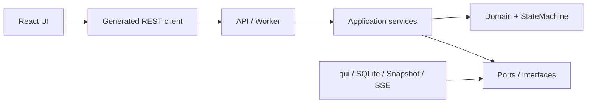
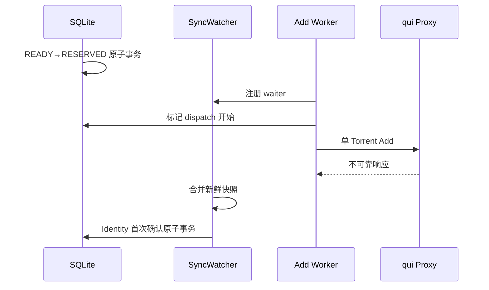

# Vertex Pro V1 代码实施手册

文档状态：`IMPLEMENTATION-PLAYBOOK-V1 / MANDATORY-BY-RC8`  
最后修订：2026-08-25  
对应主规范：`docs/产品方案设计/VERTEX_PRO_COMPLETE_REDESIGN_V1_RC8_FINAL.md`  
对应产品合同：`docs/产品方案设计/VERTEX_PRO_V1_USER_RULES_CONTRACT.md`  
对应一致性合同：`docs/产品方案设计/CONTRACT_CONSISTENCY_V1.md`  
仓库目标路径：`docs/实施流程/VERTEX_PRO_V1_CODE_IMPLEMENTATION_PLAYBOOK.md`

---

## 0. 使用方式

本手册是 Vertex Pro V1 的代码施工顺序和日常开发规则。以后任何功能、修复、重构、依赖升级和数据库变更都必须能回答：

```text
对应哪个实施项 ID？
对应 RC8 哪一节和第 24 节哪个验收项？
改动了哪些正式合同？
需要哪些测试和证据？
是否触发 ADR？
完成状态记录在哪里？
```

没有实施项 ID、没有完成定义或没有测试证据的代码不得合并。

本手册不能覆盖 RC8 的业务不变量。冲突时优先级为：

```text
已生效 FROZEN 规范
  > RC8 第 26 节冻结不变量
  > RC8 其他正式合同
  > 用户与规则合同
  > 本实施手册
  > issue、聊天记录和代码注释
```

如果真实测试推翻上层规范，必须先走第 19 节偏离与 ADR 流程，不能直接让代码“先这样实现”。

## 1. 首版交付目标

V1 最小完整用户闭环固定为：

```text
从 qui 读取并展示全部 qB
  -> 用户添加站点和 RSS
  -> 用户设置大小、标题等规则
  -> 用户选择固定 qB 或 qB 组
  -> Vertex Pro 安全获取并校验 .torrent
  -> 容量准入和 Reservation
  -> 经 qui Proxy 单 Torrent Add
  -> SyncWatcher 确认 Identity
  -> 首页和历史展示状态、上传量及删除时间
```

V1 不因为实施方便而增加以下能力：

- Vertex Pro 直接连接 qB。
- Vertex Pro 自己删种、暂停、恢复、限速、移动或 reannounce。
- Redis、消息队列、微服务或多 Worker 集群。
- 同一 Torrent 多 qB fan-out。
- Managed Agent 或 `VERIFIED_ALLOCATED_BYTES`。
- 任意脚本规则或插件动作。
- WebSocket 与 SSE 双协议。

## 2. 不可违反的代码级红线

以下规则违反任意一条即停止合并：

1. 浏览器、业务模块和测试生产路径不得直连 qB；只有 `internal/qui/proxy` 能访问 qui Client Proxy。
2. 每个 Add 请求只携带一个 Torrent。
3. Add HTTP 响应不能直接产生 `HASH_SEEN`。
4. `POSSIBLE_EFFECT/UNKNOWN` 不得自动重放 Add。
5. 每个 qB 实例只有一个 SyncWatcher 和一个在途 Sync 请求。
6. qB Torrent ID 与 Canonical Identity 使用不同类型和不同字段。
7. 所有正式状态转换只能经过 StateMachine；Handler、Worker 和 Repository 不得直接拼状态 UPDATE。
8. 所有 Reservation、Attempt、SubmitIntent、binding 和 capacity revision 的关键组合写入必须处于 RC8 指定的同一 `BEGIN IMMEDIATE` 事务。
9. `amount_left` 缺失、负数或类型非法必须是 UNKNOWN，不能转成 0。
10. `capacity_state != TRUSTED`、Snapshot 陈旧或 Storage 未验证时禁止 Placement。
11. V1 下载期间 `reflected_physical_bytes=0`，不得按进度或物理空间变化提前核销。
12. `FIXED_INSTANCE` 不得静默改投其他实例。
13. UI 不得直接持有 qui Key、RSS Cookie、passkey 或 Proxy Key。
14. 日志、错误、事件、测试 fixture 和截图不得包含 Secret 或完整 announce URL。
15. 数据库结构只能通过 migration 改变，不允许启动时临时补列或人工改生产库。
16. 生成代码不得手工修改；改变源合同后重新生成。
17. 关键依赖不得使用浮动分支、`latest` 或未锁定版本。
18. 未通过测试、合同检查或许可证检查的代码不得通过关闭检查来合并。

## 3. 技术栈冻结

### 3.1 总体形态

```text
单 Git 仓库
单 Go 服务进程
SQLite WAL
本地 SnapshotStore
React SPA
REST 命令 + SSE 实时事件
前端静态文件嵌入 Go 二进制
Docker 为首选部署方式
```

旧 Vertex 的用户流程可作为产品行为参考，但不继承其 Node/Express/Redis/Vue 架构。Vertex Pro 采用与 qui 更接近的技术族，以降低 Query Builder 复用和运维成本。

### 3.2 后端

| 项目 | V1 选择 | 约束 |
|---|---|---|
| 语言 | Go | `go.mod` 与工具链文件锁定精确版本 |
| HTTP | `net/http` + `go-chi/chi/v5` | Handler 只做协议转换和授权 |
| SQLite | `database/sql` + `modernc.org/sqlite` | 无 CGO；每连接验证 `foreign_keys=ON` |
| SQL | 显式 SQL + Repository + TxRunner | 不使用 ORM，不允许通用对象 UPDATE |
| 配置 | YAML + 环境变量覆盖 | Secret 只保存引用或由环境注入 |
| CLI | Cobra | `serve`、`migrate`、`doctor`、`verify` 等命令 |
| 日志 | 结构化 JSON 日志 | 必须带 correlation/job/attempt/instance 字段 |
| API 合同 | OpenAPI 3.1 | 先改合同，再生成代码，再实现 |
| 实时事件 | SSE | 持久事件从 SQLite `event_stream` 重放 |
| 构建 | `go:embed` 前端产物 | 发布为单二进制和容器镜像 |

禁止直接把完整 qB SDK 当作兼容真相。qB 访问只实现 RC8 所需的最小 Endpoint 和三版本 Profile Adapter；第三方 qB 库只能用于纯辅助解析，并且必须由 G1 真实链路验证。

### 3.3 前端

| 项目 | V1 选择 | 用途 |
|---|---|---|
| 框架 | React + TypeScript | 与 qui Query Builder 保持同技术族 |
| 构建 | Vite | 开发、测试和生产构建 |
| 包管理 | pnpm | 版本写入 `packageManager`，提交 lockfile |
| 样式 | Tailwind CSS + CSS variables | 设计 Token、深浅主题、响应式 |
| 基础组件 | Radix UI + shadcn-style 本地组件 | 无障碍 Dialog、Select、Tooltip 等 |
| 路由 | TanStack Router | 类型化路由和页面加载 |
| 服务端状态 | TanStack Query | REST 缓存、失效和重试纪律 |
| 表格 | TanStack Table + Virtual | qB 和历史大列表 |
| 表单 | TanStack Form + Zod | 规则、站点和设置校验 |
| 拖拽 | dnd-kit | 规则条件组和规则排序 |
| 国际化 | i18next + react-i18next | V1 至少完成简体中文与英文键 |
| 单元测试 | Vitest + Testing Library + MSW | 组件、Hook 和 API Mock |
| E2E | Playwright | 用户主流程和异常恢复 |
| 图表 | Apache ECharts | 速度与日周月时间序列 |

前端状态纪律：

- 服务端资源只进入 TanStack Query，禁止再复制到全局 Store。
- 局部弹窗、选中项和草稿用 React local state。
- V1 不引入 Redux、MobX 或另一套通用状态管理；确有必要必须 ADR。
- UI 类型从 OpenAPI 和正式状态合同生成，禁止手写同名枚举。
- SSE 只触发精确缓存更新或失效；断线恢复仍以 REST 快照为准。

### 3.4 当前上游参考与版本锁定

截至本手册编制时，qui `develop` 使用 Go、chi、modernc SQLite，以及 React、TypeScript、Vite、Tailwind、TanStack、Radix 和 dnd-kit。参考：

- [qui go.mod](https://github.com/autobrr/qui/blob/develop/go.mod)
- [qui web/package.json](https://github.com/autobrr/qui/blob/develop/web/package.json)
- [qui Query Builder](https://github.com/autobrr/qui/tree/develop/web/src/components/query-builder)

这些网页不是 Vertex Pro 的浮动依赖源。正式实现必须在 `BOOT-04` 固定一个 qui tag/commit，并生成：

```text
third_party/qui/UPSTREAM_LOCK.yaml
THIRD_PARTY_NOTICES.md
web/package.json
pnpm-lock.yaml
go.mod
go.sum
.tool-versions 或 mise.toml
```

`UPSTREAM_LOCK.yaml` 至少包含：

```yaml
repository: https://github.com/autobrr/qui
tag: null
commit: <40-hex>
license: GPL-2.0-or-later
captured_at: <UTC-RFC3339>
imported_files: []
file_digests: {}
```

完成 `BOOT-04` 后，文档中的版本只能通过依赖升级实施项改变，不允许开发者自行执行无审查升级。

## 4. 仓库目录合同

```text
vertex-pro/
├── cmd/vertex-pro/
│   └── main.go
├── internal/
│   ├── app/                 # 启停顺序、依赖装配、Worker supervisor
│   ├── config/              # 配置模型、校验、环境覆盖
│   ├── secrets/             # SecretRef 与实现
│   ├── domain/              # 强类型 ID、实体、值对象、状态枚举
│   ├── state/               # RaceJob/Attempt 正式状态机
│   ├── qui/
│   │   ├── control/         # qui Control API
│   │   └── proxy/           # 唯一 qB Proxy 网络出口
│   ├── qbprofile/           # 4.3.8/5.0.4/5.2.2 Adapter
│   ├── syncwatcher/         # rid、增量合并、完整快照
│   ├── snapshot/            # SnapshotStore 原子文件持久化
│   ├── rss/                 # Site、Feed、Fetcher、Scheduler
│   ├── rules/               # AST、Compiler、Evaluator、Aggregator
│   ├── torrent/             # 下载、bencode 校验、Identity
│   ├── race/                # RaceJob 协调器和并行准备
│   ├── placement/           # Candidate、固定实例/组、评分
│   ├── capacity/            # epoch、Reservation、binding、reconcile
│   ├── submit/              # SubmitIntent、Add、确认与 UNKNOWN
│   ├── history/             # 用户历史投影和删除事实
│   ├── stats/               # 实时、小时桶、汇总
│   ├── events/              # 持久事件与 SSE
│   ├── commands/            # 异步命令和结果保留
│   ├── auth/                # 单管理员认证、Session、CSRF
│   ├── api/                 # 生成接口的实现和中间件
│   └── store/sqlite/        # DB、Repository、事务、查询
├── migrations/              # 只增不改的正式 migration
├── api/
│   └── openapi.yaml
├── contracts/
│   ├── state_enums.yaml
│   ├── error_codes.yaml
│   ├── event_types.yaml
│   └── user_status_mapping.yaml
├── web/
│   ├── src/
│   │   ├── app/
│   │   ├── api/generated/
│   │   ├── components/ui/
│   │   ├── components/query-builder/
│   │   ├── features/dashboard/
│   │   ├── features/sites-rss/
│   │   ├── features/rules/
│   │   ├── features/history/
│   │   ├── features/downloaders/
│   │   ├── features/exceptions/
│   │   └── i18n/
│   ├── tests/
│   └── package.json
├── tests/
│   ├── contract/
│   ├── integration/
│   ├── protocol/
│   ├── fault/
│   ├── performance/
│   └── fixtures/
├── tools/
│   ├── contractcheck/
│   ├── protocolprobe/
│   ├── fixture-redact/
│   └── licensecheck/
├── deploy/
│   ├── docker/
│   └── compose/lab/
├── docs/
│   ├── spec/
│   ├── adr/
│   ├── implementation/
│   ├── runbook/
│   └── evidence/
├── artifacts/               # 生成证据；按规范决定是否提交
├── third_party/qui/
│   └── UPSTREAM_LOCK.yaml
├── Makefile
├── go.mod
├── go.sum
├── pnpm-workspace.yaml
├── LICENSE
└── THIRD_PARTY_NOTICES.md
```

目录依赖方向固定为：



约束：

- `domain` 和 `state` 不得 import HTTP、SQLite、qui Client 或前端代码。
- `api` 不得直接执行 SQL 或调用 qui；只能调用 Application service。
- `store/sqlite` 实现 Port，不包含页面或 HTTP 语义。
- `qui/control` 与 `qui/proxy` 不能互相混用 Key。
- 跨模块事务由明确的 Tx service 编排，不通过 Repository 互相偷偷调用。

## 5. 正式合同与代码生成

### 5.1 单一来源

| 合同 | 唯一源 | 生成/校验对象 |
|---|---|---|
| REST API | `api/openapi.yaml` | Go server types、TS client types、API 文档 |
| 状态枚举 | `contracts/state_enums.yaml` | Go、SQLite 校验输入、OpenAPI、TS |
| 错误码 | `contracts/error_codes.yaml` | Go errors、OpenAPI、TS 文案键 |
| SSE 类型 | `contracts/event_types.yaml` | Go event types、OpenAPI、TS dispatcher |
| 用户状态 | `contracts/user_status_mapping.yaml` | 后端投影测试、UI 展示 |
| 数据库 | `migrations/*.sql` | fresh/upgrade schema、触发器、索引 |
| qui 复用 | `third_party/qui/UPSTREAM_LOCK.yaml` | 文件 digest、许可检查、升级差异 |

禁止存在两份手工维护的同名枚举。文档中的正式枚举由 C1 与上述文件比对。

### 5.2 生成规则

```text
修改正式源
  -> make generate
  -> 审查生成 diff
  -> make test-contracts
  -> 实现业务
  -> make generate-check
```

生成文件头必须包含：

```text
Code generated by <tool>. DO NOT EDIT.
source: <repo-relative-path>
source_digest: sha256:<digest>
```

### 5.3 Make 命令合同

仓库根目录必须提供：

| 命令 | 作用 | 是否访问真实 qB/qui |
|---|---|---|
| `make bootstrap` | 检查工具链并安装本地开发依赖 | 否 |
| `make generate` | 生成 Go/TS 合同代码 | 否 |
| `make generate-check` | 重新生成后确认 Git diff 为空 | 否 |
| `make fmt` | Go/TS/Markdown 格式化 | 否 |
| `make fmt-check` | 检查格式但不修改文件 | 否 |
| `make lint` | Go、TS、SQL、OpenAPI 静态检查 | 否 |
| `make test-unit` | 后端和前端单元测试 | 否 |
| `make test-race` | Go race detector | 否 |
| `make test-contracts` | schema/OpenAPI/枚举/错误码合同测试 | 否 |
| `make test-integration` | 本地 Mock qui 与文件 SQLite 集成测试 | 否 |
| `make test-e2e` | 浏览器 E2E，默认使用测试后端 | 否 |
| `make test-protocol` | 固定实验室的真实 qui/qB Profile | 是 |
| `make test-fault` | G2 故障注入实验室 | 是 |
| `make verify-license` | GPL、第三方通知和依赖许可证 | 否 |
| `make verify-implementation-plan` | 校验 149 个实施项、依赖、状态和 DONE 证据 | 否 |
| `make verify-contracts` | 生成 C1 报告和 digest | 否 |
| `make preflight` | 开发提交前确定性检查集合 | 否 |
| `make ci` | CI 全部非实验室检查 | 否 |
| `make build` | Go 单二进制与前端嵌入构建 | 否 |
| `make image` | 构建不可变容器镜像 | 否 |

`make preflight` 至少等价于：

```text
generate-check
fmt-check
lint
test-unit
test-contracts
test-integration
verify-license
verify-implementation-plan
```

## 6. 分支、提交与评审纪律

### 6.1 分支

```text
main                         始终可构建、可迁移、测试通过
work/<实施项ID>-<short-name>  功能或内部实施项
fix/<实施项ID>-<short-name>   缺陷
adr/<ADR-ID>-<short-name>     设计变更
release/v1.0.0-rc.N           只允许发布修复
```

禁止长期存在 `develop` 集成分支；避免主规范和实现长期分叉。

### 6.2 每个 PR 的唯一主目标

一个 PR 必须有一个主实施项 ID。允许包含为该目标必需的测试、文档和生成代码，但不得顺手加入无关重构。

推荐大小：

- 1～3 个连续的小检查点。
- 可由评审者在一次上下文中理解。
- 数据库 migration、状态机转换、真实协议 Profile 和第三方源码导入分别独立 PR。

### 6.3 Commit

格式：

```text
<type>(<scope>): <实施项ID> <summary>
```

示例：

```text
feat(sync): QUI-05 merge qB incremental snapshots
test(capacity): CAP-08 cover reservation rollback points
docs(adr): ADR-0002 revise storage evidence
```

允许类型：`feat | fix | refactor | test | docs | build | ci | chore | perf | security`。

### 6.4 PR 必填内容

```text
Implementation ID:
RC8 references:
A24 acceptance references:
User-visible behavior:
Contract changes:
Migration impact:
Security/secret impact:
qui/qB version impact:
Tests executed:
Evidence paths:
Rollback method:
ADR required: yes/no + reason
```

## 7. 单个实施项的标准循环

每个实施项按下面顺序执行，禁止从“开始写代码”起步：

1. 在 `IMPLEMENTATION_STATUS_V1.md` 将实施项从 `PENDING` 改为 `IN_PROGRESS`，记录负责人、分支和开始 commit。
2. 阅读该项引用的 RC8、用户合同、C1 和 ADR；在 PR 描述列出精确章节。
3. 写明输入、输出、失败模式、幂等键、事务边界和观测字段。
4. 如果 API/状态/错误/事件会变化，先修改唯一合同源并生成代码。
5. 先写至少一个会失败的正向测试和一个关键负向测试。
6. 实现最小代码，使测试通过；不顺手扩大能力。
7. 加入日志、事件、指标和 Secret redaction。
8. 对崩溃点、重试、重复执行和乱序完成进行检查。
9. 运行该项指定测试及 `make preflight`。
10. 更新文档、OpenAPI 示例、migration note 和第三方通知。
11. PR 评审通过并合并后，在状态表记录 merge commit、证据和完成时间。
12. 只有完成定义全部满足，状态才能改为 `DONE`；暂时绕过只能是 `BLOCKED`，不能伪装完成。

实施顺序以进度表的无环依赖图为权威，不以本文目录先后机械判断。主拓扑固定为：

```text
A 仓库 -> B 合同 -> C 数据库 -> D qui/Sync
                       -> E RSS/Torrent 与 F Rules（可并行）
                       -> G Capacity -> H Add/Recovery
                       -> API/认证/SSE 基础
                       -> History/Stats/Observability 后端
                       -> 完整 API/TS Client -> UI
                       -> Hardening -> Release/Gates
```

任何临时并行都不能越过直接依赖；`make verify-implementation-plan` 必须证明依赖图无环。

## 8. 全局完成定义

每个后端实施项至少满足：

- Context 可取消，网络调用有超时。
- 所有输入有边界校验。
- 错误映射为正式 error code。
- 日志不含 Secret，并带相关关联 ID。
- DB 写入有明确事务、冲突和崩溃测试。
- 重复执行结果确定且符合幂等合同。
- 单元测试、Repository 测试和必要集成测试通过。
- `go test -race` 对涉及并发的包通过。

每个前端实施项至少满足：

- Loading、empty、error、stale 和 reconnect 状态完整。
- 键盘可操作，焦点和 Dialog 关闭行为正确。
- 不显示内部状态术语或 Secret。
- MSW 测试覆盖成功、错误和陈旧数据。
- 不直接请求 qui/qB。
- 类型来自生成合同。
- 桌面 1440px、笔记本 1024px、移动 390px 基本布局可用。
- 简体中文无硬编码后端原值；状态通过 i18n key 映射。

任何实施项只有文档或代码而缺少测试，不算完成。

## 9. 阶段 A：仓库与可构建骨架

本阶段不写 RSS、Add 或容量业务。目标是建立以后无法绕开的施工护栏。

| ID | 实施内容 | 必须产物 | 必须测试/检查 |
|---|---|---|---|
| `BOOT-01` | 初始化单仓库和目录合同 | 第 4 节目录、README、CODEOWNERS、`.gitignore` | 空仓库路径检查 |
| `BOOT-02` | 固定 Go/Node/pnpm 工具链 | `go.mod`、toolchain 文件、`packageManager`、lockfile | CI 与本地版本一致 |
| `BOOT-03` | 落实 GPL 项目文件 | `LICENSE`、`THIRD_PARTY_NOTICES.md`、贡献说明 | `make verify-license` 初版 |
| `BOOT-04` | 固定 qui 上游 | `UPSTREAM_LOCK.yaml`、40 位 commit、候选文件 digest | digest 可重复；没有浮动分支 |
| `BOOT-05` | 建立 Make 与 CI | 第 5.3 节命令壳、缓存和矩阵 | `make preflight` 可运行且失败会阻止 CI |
| `BOOT-06` | Go 服务骨架 | `serve/doctor/version`、health/readiness、优雅关闭 | 启停、取消、信号测试 |
| `BOOT-07` | React 应用骨架 | Router、Query、主题、i18n、错误边界 | Vitest smoke、构建成功 |
| `BOOT-08` | 单二进制和容器 | 前端嵌入、Docker multi-stage、非 root 用户 | 空应用镜像启动、readiness、SBOM |
| `BOOT-09` | 结构化日志与关联 ID | request/command/job/attempt/instance 字段规范 | Secret redaction 单测 |

### Gate A

进入合同和业务编码前必须满足：

- 新机器按 README 可从零完成 `make bootstrap && make preflight && make build`。
- 容器不需要 Node 运行时，不以 root 运行。
- 工具链和依赖全部锁定，无 `latest`。
- `UPSTREAM_LOCK.yaml` 和 `THIRD_PARTY_NOTICES.md` 状态一致。
- Go 服务和 React 空页面均可启动，但尚无伪造业务数据。

## 10. 阶段 B：合同优先与生成链

本阶段建立 API、状态、错误和事件的唯一源。后续业务代码不得先于这些合同。

| ID | 实施内容 | 必须产物 | 必须测试/检查 |
|---|---|---|---|
| `CTR-01` | OpenAPI 3.1 基础 | 安全结构、错误 envelope、cursor、revision、Idempotency-Key | OpenAPI parse/lint |
| `CTR-02` | 状态枚举清单 | RaceJob、Attempt、三个准备子状态、三个投递后状态轴 | 与 RC8 第 10 节逐项比对 |
| `CTR-03` | 错误码清单 | RC8 第 16 节错误码、HTTP 映射、i18n key | 重复码/缺失码检查 |
| `CTR-04` | 事件类型清单 | SSE 持久/瞬时类型、schema version、资源 revision | producer/consumer 集合一致 |
| `CTR-05` | 用户状态映射 | 内部状态到十个用户状态的确定性映射 | 全枚举覆盖，无默认漏网分支 |
| `CTR-06` | Go/TS 代码生成 | Go types/interfaces、TS client/types、生成 digest | `make generate-check` |
| `CTR-07` | C1 工具骨架 | 输入 manifest、11 个检查 ID、报告和退出码框架 | 空实现不能错误返回 PASS |
| `CTR-08` | Mock API 与 MSW | 由 OpenAPI 生成/校验的前端 fixtures | schema 不符时测试失败 |

### Gate B

- 不存在手写重复枚举。
- API 示例能通过 schema 校验。
- 生成后 Git diff 为空。
- C1 工具即使尚有未实现检查，也必须返回 `ERROR/eligible_for_g3=false`，不能返回 PASS。

## 11. 阶段 C：SQLite、Migration 与事务基础

### 11.1 实施顺序

| ID | 实施内容 | 必须产物 | 必须测试/检查 |
|---|---|---|---|
| `DB-01` | SQLite 连接工厂 | WAL、busy_timeout、foreign_keys、同步级别和连接上限 | 每连接 PRAGMA 断言 |
| `DB-02` | Migration runner | 嵌入式、顺序、checksum、schema version | 空库、重复运行、中途失败回滚 |
| `DB-03` | Site/Feed/Rule/Identity | 第一组表和唯一约束 | CRUD、重复来源、跨站 Identity |
| `DB-04` | Sync/Snapshot/Waiter | sync state、snapshot metadata、waiter | rid 恢复和 dangling ref 负测 |
| `DB-05` | Storage/Capacity | target、epoch、reservation、reflection、binding | epoch 唯一、owner 正反例 |
| `DB-06` | Race/Attempt/Intent | RaceJob、RuleMatch、Attempt、SubmitIntent | 循环外键建表和插入顺序 |
| `DB-07` | Events/Commands/Stats | event_stream、commands、idempotency、hourly buckets | 单调 ID、过期清理、唯一键 |
| `DB-08` | 索引与触发器 | 部分唯一索引、Attempt 不可变、owner 防线 | 所有负向 SQL 测试 |
| `DB-09` | TxRunner 与 Repository | `BEGIN IMMEDIATE`、类型化查询、显式更新列 | busy、rollback、commit-after-crash 模拟 |
| `DB-10` | 启动一致性检查 | FK、一对一、owner、current pointer、epoch | 损坏 fixture fail closed |
| `DB-11` | 升级与备份路径 | 最近受支持旧 schema fixture、自动备份 | upgrade、失败保留原库、restore |

### 11.2 数据库编码规则

- Repository 方法名称必须表达操作，不使用 `Save(entity)`：例如 `AdvanceAttemptToAddSent`。
- 每个 UPDATE 显式列出允许字段。
- 每个事务方法返回提交后的 revision 和领域事件，不在提交后补写事件。
- 网络 I/O 永远不在 SQLite 写事务内执行。
- 时间由注入的 Clock 产生，测试不调用真实 `time.Now()`。
- ID 由注入的 ID generator 产生，测试使用确定序列。
- 文件路径只保存 canonical、安全校验后的值。

### Gate C

必须通过 C1 的 schema fresh、schema upgrade、foreign keys、Attempt immutable、SubmitIntent 一对一和 Reservation owner 六项的真实实现；其余 C1 项可继续为 ERROR，但不能伪造完成。

## 12. 阶段 D：qui 接入、qB Profile 与 Sync 内核

| ID | 实施内容 | 必须产物 | 必须测试/检查 |
|---|---|---|---|
| `QUI-01` | SecretStore | SecretRef、环境/文件实现、redacted string | 序列化和日志不泄密 |
| `QUI-02` | QuiControlClient | 实例、健康、实时传输、transfer-info fallback | 超时、401/403/429/5xx、字段缺失 |
| `QUI-03` | QbProxyClient | 唯一代理 base URL、allowlist endpoints | 禁止任意 URL 和直连 qB |
| `QUI-04` | Profile 探测 | WebAPI/buildInfo/libtorrent/capability | 三 Profile fixture |
| `QUI-05` | AddRequestAdapter | paused/stopped、单 Torrent multipart、白名单参数 | 三版本金色请求 |
| `QUI-06` | AddResponseAdapter | legacy、JSON、200/202/204/409、hint | 响应不直接确认成功 |
| `QUI-07` | Sync delta merger | rid、完整基线、增量、删除、字段继承 | 乱序/重复/重置/非法 amount_left |
| `QUI-08` | SnapshotStore | 临时文件、fsync、rename、digest、DB ref | 两个崩溃窗口和损坏恢复 |
| `QUI-09` | 单实例 SyncWatcher | 单在途请求、generation、snapshot revision、广播 waiter | 并发和取消测试 |
| `QUI-10` | Capability/Health 聚合 | EXPECTED/VERIFIED、stale、available 原因 | fail-closed truth table |
| `QUI-11` | 协议探针工具 | 脱敏请求/响应、fixture digest、profile run | 工具自身 redaction 测试 |
| `QUI-12` | G1 实验室基线 | 固定 qui 镜像和三个 qB compose profile | Vertex harness → qui Proxy → qB |

### 12.1 G1 运行纪律

- Mock 只验证代码分支，不产生 `VERIFIED`。
- 实验室必须记录 qB 精确 build、WebAPI、libtorrent、qui commit/image digest。
- 4.3.8、5.0.4、5.2.2 分别出报告；一版失败不污染其他版结论。
- 失败 Profile 保持 `EXPECTED/FAILED`，实例不能 AVAILABLE。
- fixture 必须脱敏后再进入仓库；原始 passkey 不进入 artifact。

### Gate D

SyncWatcher 能对三个 fixture profile 确定性重建同一完整快照；真实实验室可以暂未全部 PASS，但业务代码不得把未通过 Profile 标为可用。

## 13. 阶段 E：RSS、Torrent 与并行准备

| ID | 实施内容 | 必须产物 | 必须测试/检查 |
|---|---|---|---|
| `RSS-01` | Site/Feed 应用服务 | CRUD、SecretRef、revision、审计事件 | OpenAPI/Repository/授权 |
| `RSS-02` | Feed 测试命令 | 只预览、不创建 RaceJob | 无副作用断言 |
| `RSS-03` | HTTP Fetcher | ETag、Last-Modified、限时、大小、host allowlist | 304/403/429/HTML/Cloudflare |
| `RSS-04` | Scheduler | jitter、指数退避、停用、重启恢复 | FakeClock 确定性测试 |
| `RSS-05` | Baseline | 首次只建基线、不竞速历史旧种 | 空/重复/重启测试 |
| `RSS-06` | Source dedupe | guid/url/title/size fingerprint | 同站重复和字段变化 |
| `TOR-01` | Artifact downloader | host allowlist、上限、Content-Type | 登录页、超限、断流 |
| `TOR-02` | bencode 安全解析 | info、路径穿越、NUL、文件数/大小 | 恶意 corpus 和 fuzz |
| `TOR-03` | Identity 计算 | v1、v2、hybrid 强类型 | 官方/自建金色 torrent |
| `TOR-04` | Source/Identity 关联 | 跨站多来源、一条活动物理链 | 并发重复测试 |
| `RACE-01` | RaceJob 创建 | DISCOVERED、deadline、初始三个子状态 | 幂等来源创建 |
| `RACE-02` | 并行准备 Supervisor | Rule/Torrent/Placement 独立 Worker | 六种完成顺序、重复和崩溃 |
| `RACE-03` | 聚合门槛 | MATCHED + READY + PREPARED + final AVAILABLE | 不完整状态不能 Reservation |

### Gate E

给定固定 RSS 与 Torrent fixture，重复运行、重启或 Worker 乱序必须得到同一 Source、Identity 和 RaceJob 准备结果，且此阶段尚不能发送 Add。

## 14. 阶段 F：规则引擎与 qui Query Builder

| ID | 实施内容 | 必须产物 | 必须测试/检查 |
|---|---|---|---|
| `RULE-01` | 条件 AST | version、AND/OR group、leaf、typed value | JSON schema 和深度/数量上限 |
| `RULE-02` | 字段与运算符目录 | title/size/site/category/time/promotion/profile labels | 非法组合拒绝 |
| `RULE-03` | 三值 Evaluator | TRUE/FALSE/UNKNOWN、短路和原因树 | 表驱动、属性测试 |
| `RULE-04` | RuleVersion | 不可变版本、current pointer、revision | 修改不追溯历史 Job |
| `RULE-05` | 多规则聚合 | winner、Tags 并集、约束交集、算法版本 | 排序稳定、冲突 fail closed |
| `RULE-06` | Dry-run API | 未保存草稿与已保存规则预览 | 断言不下载、不 Add、不 Reservation |
| `RULE-07` | 导入 qui 组件 | 固定文件、版权/SPDX、修改说明 | digest、license、构建检查 |
| `RULE-08` | Vertex 字段适配 | FieldCombobox、Leaf、Group、值编辑器 | 组件和键盘测试 |
| `RULE-09` | 简单/高级模式 | 同一 AST 双向映射 | 往返不丢语义 |
| `RULE-10` | 规则排序与复制 | priority、enable、duplicate、optimistic revision | 并发编辑 409 |
| `RULE-11` | 聚合预览 UI | 命中列表、winner、最终 qB/参数、冲突原因 | MSW 与 E2E |
| `RULE-12` | 上游差异记录 | imported file list、修改日志、通知更新 | `make verify-license` |

### 14.1 Query Builder 复用边界

导入顺序固定：

```text
锁定上游 commit
-> 校验文件 digest
-> 原样导入并单独 commit
-> 保留版权/SPDX
-> 第二个 commit 做路径和依赖适配
-> 第三个 commit 做 Vertex 字段/动作改造
-> 添加上游行为对照测试
```

禁止在同一 commit 中同时“导入、格式化、重写和改业务”，否则无法审计上游来源。

### Gate F

用户可完成“RSS + 大小范围 + 固定 qB”的简单规则；高级模式支持嵌套 AND/OR；dry-run 和后端执行对同一 fixture 得到相同结果；所有 imported file 可追溯到固定 qui commit。

## 15. 阶段 G：实例健康、Placement 与容量账本

本阶段是 V1 最关键的安全边界。任何“先把功能跑起来、以后再补容量”的做法都不允许进入真实 Add 路径。

| ID | 实施内容 | 必须产物 | 必须测试/检查 |
|---|---|---|---|
| `CAP-01` | StorageTarget 与证据 | managed root、filesystem key、配置 revision、验证证据和失效规则 | 路径不一致、证据过期、配置变更 fail closed |
| `CAP-02` | 容量快照 | physical free、采集时间、snapshot revision、source | 负数、缺失、陈旧、回退字段测试 |
| `CAP-03` | 容量投影 | safety margin、Reservation、unmanaged liability、uncertainty debit | 字节互斥属性测试 |
| `CAP-04` | `amount_left` 证据 | `KNOWN/UNKNOWN` 值对象、错误码、继承规则 | NULL 不变 0；完整/增量差异 |
| `CAP-05` | Task binding owner | `RESERVATION/UNMANAGED` 唯一 owner、Identity 临时归属 | 一对多、跨 target、非法 Reservation 拒绝 |
| `CAP-06` | CandidateFilter | fixed instance、target group、Profile、健康、Storage 过滤 | 每个拒绝原因可解释 |
| `CAP-07` | AVAILABLE 判定 | 形式化 truth table 和 reason code | 全组合表驱动测试 |
| `CAP-08` | Reservation 事务 | allocation epoch、Attempt、Intent、Reservation、Job pointer | 每个插入点 rollback、并发争抢 |
| `CAP-09` | Final recheck | 事务内重读 revision、大小、health、capacity | 旧 Candidate 不得越过最新容量 |
| `CAP-10` | Placement 评分 | 负载、可用空间、权重、稳定 tie-break | 重启与 map 顺序不改变结果 |
| `CAP-11` | 完成终态释放 | Reflection 一次到 reserved bytes、binding 转 UNMANAGED | 新鲜完成态与 physical free 双证据 |
| `CAP-12` | 权威删除终态 | binding 删除、未消费字节、physical free 刷新 | 保留文件/删文件两种情形 |
| `CAP-13` | Capacity reconciler | 启动重建、uncertainty、连续稳定快照、新 epoch | 不能对账时永久 fail closed 而非估算 |
| `CAP-14` | G2 oracle 工具 | 初始数据、故障点、SQL 断言、事件与 digest | 同一 case 重跑结果一致 |

### 15.1 `AVAILABLE` 的唯一判断入口

业务代码不得自行组合健康布尔值。所有 Candidate 必须调用同一个纯函数，并返回结构化原因：

```go
type AvailabilityInput struct {
    CapabilityState    CapabilityState
    InstanceState      InstanceState
    CapacityState      CapacityState
    StorageVerified    bool
    SnapshotAge        time.Duration
    SnapshotMaxAge     time.Duration
    EffectiveFreeBytes int64
    RequiredBytes      int64
    Inflight           int
    MaxInflight        int
}

type AvailabilityDecision struct {
    Available bool
    Reasons   []AvailabilityReason
}
```

唯一的通过条件为：

```text
profile == VERIFIED
&& instance_state == ONLINE
&& capacity_state == TRUSTED
&& storage_verified == true
&& snapshot_age <= snapshot_max_age
&& effective_free_bytes >= required_bytes
&& inflight < max_inflight
```

任何输入 UNKNOWN 都按不通过处理。UI 可以展示原因，但不能覆写判定。

### 15.2 容量不变量的可执行断言

每次发布 capacity revision 前必须验证：

```text
effective_free_bytes
  = physical_free_bytes
  - safety_margin_bytes
  - active_unreflected_reservation_bytes
  - unmanaged_future_liability_bytes
  - uncertainty_debit_bytes
```

并满足：

- 所有项为非负整数；计算使用溢出安全函数。
- 每个 qB Torrent 在同一 StorageTarget 最多一个 owner。
- Reservation 覆盖的未来字节不得同时进入 unmanaged liability。
- `amount_left=UNKNOWN` 不生成伪造数值；其存在强制 `CAPACITY_UNCERTAIN`。
- 下载期间 Reflection 固定为 0。
- physical free 的下降绝不自动归因给任意 Reservation。
- 完成释放和权威删除释放均为幂等终态事务。

断言失败必须回滚事务、写安全告警并使目标保持不可 Placement；不得用 clamp-to-zero 隐藏数据问题。

### Gate G

- 并发 100 个候选争用同一目标不会逻辑超卖。
- 任意 revision 变化都会触发事务内重算。
- 预分配、外部写盘和多个下载并发时 Reflection 均不部分分摊。
- `CAPACITY_UNCERTAIN` 期间所有新 Placement 被拒绝。
- CAP-14 能为 RC8 第 8、19、22、24 节的容量用例产生机器可核验 oracle。

## 16. 阶段 H：Add、事实确认与恢复

本阶段把网络副作用当作不可靠分布式事实处理。目标不是“Add API 返回成功”，而是无重复副作用地确认 qB 中的 Canonical Identity。

| ID | 实施内容 | 必须产物 | 必须测试/检查 |
|---|---|---|---|
| `ADD-01` | RaceJob StateMachine | 生成枚举、允许转换、guard、事件 | 每条允许/禁止边完整覆盖 |
| `ADD-02` | Attempt StateMachine | 不可复用 Attempt、Job/current pointer 协同 | 历史 Attempt 不能复活 |
| `ADD-03` | SubmitIntent | request fingerprint、Add 前完整基线、唯一 attempt_id | 一对一和 baseline freshness |
| `ADD-04` | Sync waiter | 先注册后 dispatch、Identity/generation/deadline | 注册/取消/恢复/重复通知 |
| `ADD-05` | Dispatch worker | 单 Torrent multipart、超时、取消、在途标记 | 请求 body 前后故障点 |
| `ADD-06` | 响应事实分类 | `FAILED_NO_EFFECT/POSSIBLE_EFFECT/OBSERVED_EFFECT hint` | 响应绝不直接产生 HASH_SEEN |
| `ADD-07` | IdentityMatcher | v1、v2、hybrid、legacy map key | 双 Hash、一对多歧义、hint 不权威 |
| `ADD-08` | 首次确认原子事务 | qb ID、binding、Attempt、Job、Reservation、capacity revision、事件 | 提交前后崩溃与重复快照 |
| `ADD-09` | Already-present 分支 | Add 前 PRESENT、UNMANAGED binding、释放本次 Reservation | 不 dispatch、不归因本次成功 |
| `ADD-10` | UNKNOWN reconciler | 周期、deadline、证据、无自动 replay | 重启恢复与 qB/qui 离线 |
| `ADD-11` | EXPIRED_UNKNOWN 命令 | 两个人工闭环、snapshot freshness、审计 | 证据陈旧/owner 歧义拒绝 |
| `ADD-12` | 两阶段安全重试 | 关闭旧链；后续重新 Placement | READY 时无半创建 Attempt |
| `ADD-13` | 启动恢复 | intent/attempt/waiter/reservation 重排 | kill -9 后确定性恢复 |
| `ADD-14` | 故障矩阵 | fault hook、case manifest、DB/event oracle | RC8 第 19、22 节覆盖映射 |

### 16.1 网络 dispatch 的严格顺序



关键规则：

1. Reservation 事务提交前绝不注册 waiter 或发网络请求。
2. waiter 注册失败时不发请求；恢复 Worker 可重新注册。
3. dispatch 开始事实必须在发送请求 body 前持久化。
4. 一旦 body 可能发出，所有超时、断流和不确定响应都进入 `POSSIBLE_EFFECT/UNKNOWN`。
5. 只有能证明请求未发出的本地失败才能进入 `FAILED_NO_EFFECT`。
6. ResponseAdapter 只返回事实，不直接写 Job。
7. SyncWatcher 的新鲜完整/增量合并快照是唯一确认入口。

### 16.2 首次 Identity 确认事务

`ADD-08` 必须以单个 `BEGIN IMMEDIATE` 完成：

1. 重读 Attempt、SubmitIntent、Reservation、Add 前 snapshot 和当前 snapshot。
2. 重新匹配 Canonical Identity，并证明 owner 唯一。
3. 冻结 `qb_torrent_id` 和确认 snapshot digest。
4. 创建或幂等更新 `capacity_task_bindings`，owner 为本 Reservation。
5. 将 Reservation 从 `ACTIVE` 推进为 `REFLECTING`。
6. 推进 Attempt/RaceJob 为 `HASH_SEEN` 或 `RECONCILED_CONFIRMED`。
7. 激活 observation，关闭 waiter，更新 inflight。
8. 若 amount_left UNKNOWN，同时将 StorageTarget 置为 `CAPACITY_UNCERTAIN`。
9. 重算 capacity projection 并递增 revision。
10. 同事务写 race event 和可重放 event stream。

重复消费同一 snapshot 必须返回同一提交结果，不生成第二个 binding、事件或 revision。发现多个 Reservation 可认领同一 qB Torrent 时，进入 `AMBIGUOUS/CAPACITY_UNCERTAIN`，不得按时间、标题或 hint 猜一个 owner。

### 16.3 两阶段重试

```text
阶段 A：关闭旧链
  old Attempt -> ADD_FAILED 或 RECONCILED_NO_EFFECT
  old Reservation -> RELEASED
  waiter -> CLOSED
  RaceJob.current_attempt_id -> NULL
  RaceJob -> READY 或 EXPIRED

阶段 B：独立调度
  从 READY 重做 Candidate + final recheck
  不可用 -> WAITING_CAPACITY，仍无 Attempt
  可用 -> 新 Attempt + 新 SubmitIntent + 新 Reservation
             RaceJob -> RESERVED
```

两个阶段不得塞进同一命令事务，也不得返回预分配的 `new_attempt_id`。

### Gate H

- 所有 ResponseAdapter 分支均无法单独产生 HASH_SEEN。
- 响应丢失、qui/qB 重启和进程 kill -9 不会重复 Add。
- Identity 首次确认不存在 binding 零负债窗口。
- UNKNOWN 和 EXPIRED_UNKNOWN 的所有路径保留或安全释放 Reservation。
- `ADD-14` 的 P0 故障用例连续运行三次均得到相同数据库终态。

## 17. 阶段 I：API、认证、命令与 SSE

| ID | 实施内容 | 必须产物 | 必须测试/检查 |
|---|---|---|---|
| `API-01` | HTTP 基础中间件 | request ID、panic recovery、body limit、timeout、日志 | panic/超限/取消/错误 envelope |
| `API-02` | 单管理员认证 | 首次初始化、密码 hash、Session、logout | 固定会话、暴力尝试、过期 |
| `API-03` | Web 防护 | CSRF、Origin/Host、secure cookie、CSP | 跨站和恶意 Host 负测 |
| `API-04` | 资源 API | instances/sites/feeds/rules/jobs/history/stats/settings | OpenAPI response validation |
| `API-05` | Revision 与 cursor | optimistic revision、稳定排序、opaque cursor | 409、重复/删除期间分页 |
| `API-06` | POST 幂等 | Idempotency-Key、request digest、24h record | 同 key 同/异 body、响应丢失 |
| `API-07` | 异步命令 | command 状态机、结果/错误、7 天保留 | refresh 后查询、权限、清理 |
| `API-08` | 领域事件原子写入 | state + race event + event stream | commit/rollback 一致 |
| `API-09` | SSE 服务 | Last-Event-ID、5000 上限、reset、heartbeat | 慢客户端、断线、保留边界 |
| `API-10` | 实时瞬时数据 | qB 卡片与速度事件，不占持久 event ID | 断线后 REST 恢复 |
| `API-11` | Data quality API | freshness、source、profile/capacity state、reason | UNKNOWN 不美化为 healthy |
| `API-12` | 生成 TS Client | typed methods、error decoder、cursor helpers | 无手写 endpoint 字符串 |

### 17.1 Handler 模板

每个 Handler 的代码顺序固定：

```text
authenticate/authorize
-> decode with size limit
-> validate generated request type
-> read Idempotency-Key / If-Match revision
-> call one Application service
-> map typed domain error
-> validate/encode generated response
```

Handler 禁止：

- 打开数据库事务。
- 直接访问 Repository、qui 或文件系统。
- 根据错误字符串决定 HTTP status。
- 在响应中返回原始上游 body。
- 为“前端方便”创建未进入 OpenAPI 的隐藏字段。

### 17.2 SSE 客户端恢复算法

前端必须实现：

```text
页面首次加载 -> REST snapshot + current_event_id
连接 SSE(last_event_id=current_event_id)
正常事件 -> 按 resource revision 更新/失效缓存
断线 -> 指数退避并携带最后 event_id 重连
reset_required -> 丢弃局部推断，重新 REST snapshot，再连接
瞬时 stats 丢失 -> 下次样本覆盖，不补造历史
```

SSE 不能成为命令成功的唯一证据；异步命令总能通过 `GET /api/v1/commands/{command_id}` 恢复。

### Gate I

- 所有 API 响应可由 OpenAPI 校验。
- 同一 Idempotency-Key 在崩溃和响应丢失后不会重复外部动作。
- SSE 断线、过期和超量重放均能恢复到 REST 权威快照。
- 浏览器无法获得 qui/RSS Secret，也无法直接构造 Proxy 请求。

## 18. 阶段 J：首版前端页面

前端优先级以用户路径为准：先让用户看懂全部 qB，再完成 RSS/规则，最后提供历史细节和异常诊断。内部状态机不是导航结构。

| ID | 页面/能力 | 首版用户结果 | 必须测试/检查 |
|---|---|---|---|
| `UI-01` | App Shell | 左侧导航、主题、语言、连接状态、全局错误 | 键盘导航、移动布局 |
| `UI-02` | Dashboard | 一屏看清 A/B/C/D/E qB 在线、速度、任务、空间、数据新鲜度 | 20 实例、stale/offline、SSE reconnect |
| `UI-03` | Sites & RSS | 添加站点、RSS、凭据引用、测试、启停和最后拉取 | 完整创建流程 E2E |
| `UI-04` | Rules 列表 | 名称、启用、优先级、命中数、目标 qB、复制和排序 | 并发 revision 409 |
| `UI-05` | Rule Editor | 简单大小/标题规则与高级嵌套 AND/OR、目标和参数 | AST 往返、键盘拖拽 |
| `UI-06` | Dry-run/聚合预览 | 显示为何命中、所有规则、winner、最终 qB/参数 | 无 Add 副作用 |
| `UI-07` | History | 种子、来源、目标下载器、用户状态 | cursor、筛选、删除后仍保留 |
| `UI-08` | History Detail | 时间线、最后状态、上传/分享率、删除确认；高级诊断折叠 | 普通视图无内部术语 |
| `UI-09` | Downloader Detail | 实时传输、任务数、容量、日周月图和数据质量 | counter reset、缺失小时 |
| `UI-10` | Exceptions | UNKNOWN、容量不可信、Profile 未验证和受控操作 | action matrix、确认弹窗 |
| `UI-11` | Settings | 时区、保留期、限流、安全和诊断下载 | 权限、校验、敏感字段遮罩 |
| `UI-12` | Accessibility/性能 | WCAG 基本语义、虚拟列表、错误边界 | axe、键盘、5000 历史行 |
| `UI-13` | 主流程 E2E | 登录→qB→RSS→规则→命中→History | 三 Profile fixture 矩阵 |

### 18.1 用户状态语言

普通页面只显示 RC8 用户合同中的状态，例如：

```text
等待规则
准备种子
等待下载器
正在添加
下载中
做种中
已完成
已删除
失败
需确认
```

`Candidate/Placement/Reservation/Reflection/SubmitIntent/capacity epoch` 只允许出现在：

- History Detail 的“高级诊断”折叠区。
- Exceptions 的处理证据。
- 管理员导出的诊断包。

### 18.2 Dashboard 卡片最低字段

每个 qB 卡片至少包含：

| 区域 | 字段 |
|---|---|
| 标识 | 实例名称、qB 版本、Profile 验证状态 |
| 实时 | 下载/上传速度、活动/下载/做种数量 |
| 累计 | 本次会话或 qB all-time 上下行，带口径提示 |
| 容量 | 物理可用、Vertex 可用、Safety margin、数据新鲜度 |
| 健康 | qui/qB 在线、最后 Sync、异常原因 |
| 操作 | 查看详情；V1 不提供删、停、恢复或 reannounce |

Dashboard API 必须为汇总投影，不能让浏览器逐实例调用 qB 或加载全部 Torrent 列表。

### 18.3 History 的删除后保留合同

qB Torrent 被 qui 权威删除后：

- History 行不能消失。
- 用户状态变为“已删除”。
- 保存删除确认时间和证据来源。
- 保留最后已知上传量、下载量、分享率、分类、Tags、目标下载器。
- 若删除证据尚未权威确认，显示“状态待确认”，不能先标已删除。

### Gate J

- 新用户无需理解内部术语即可完成核心闭环。
- 首屏在 20 个实例下仍清晰，不触发 qB 全量扫描。
- History 可回答“这个种子去了哪个 qB、现在怎样、何时删除、上传多少”。
- UNKNOWN 操作没有“一键再 Add”。
- 390/1024/1440px 和键盘主流程通过。

## 19. 阶段 K：历史、统计与可观测性

| ID | 实施内容 | 必须产物 | 必须测试/检查 |
|---|---|---|---|
| `HIS-01` | History projection | 来源、Identity、目标、用户状态、时间线 summary | 内部状态全覆盖 |
| `HIS-02` | 删除事实持久化 | deleted_at、source、最后 counters | binding 删除不删历史 |
| `HIS-03` | 详情时间线 | discover/prepare/add/hash/upload/delete 等事件 | 相同时间稳定排序 |
| `STAT-01` | StatsSampler | sync server_state 优先、transfer-info fallback | 字段缺失和来源标记 |
| `STAT-02` | Counter delta | all-time baseline、reset、负数防护 | qB 重启/counter reset |
| `STAT-03` | 小时桶 | UTC 存储、配置时区展示、missing 标记 | DST、跨日/月 |
| `STAT-04` | 汇总查询 | instance/total、day/week/month、cursor/series | 边界和大数据量 |
| `STAT-05` | 实时卡片样本 | 瞬时速度、任务数、freshness | 慢/断线客户端 |
| `OBS-01` | 结构化日志 | RC8 必需关联字段、redaction | Secret corpus 扫描 |
| `OBS-02` | Metrics/health | RSS、Add、Sync、容量、UNKNOWN、Profile | label cardinality 检查 |
| `OBS-03` | 保留与清理 | events/commands/stats/artifacts/snapshots policy | FakeClock、分批清理、不锁长事务 |
| `OBS-04` | 诊断包 | 配置摘要、版本、状态、脱敏日志与报告 digest | 不含 Secret/announce URL |

### 19.1 统计口径红线

- 下载器统计是 qB 实例流量，不等于 PT 站点计费流量。
- 首次看到 all-time counter 只建立基线，不制造历史增量。
- Counter 下降产生 reset 事件，delta 为 0，不产生负流量。
- 缺失小时保持 missing，不插值成 0。
- 使用哪个来源、采样时间和 freshness 必须随 API 返回。
- 同一个样本只能归属一个小时桶。

### Gate K

- Dashboard、History 和 Downloader Detail 对同一 snapshot 的数字一致。
- 删除后的 History 仍可查询最后上传量和删除时间。
- 时间区间、时区和 counter reset 有确定性测试。
- 诊断包通过 Secret 扫描。

## 20. 阶段 L：安全、性能与运维加固

| ID | 实施内容 | 必须产物 | 必须测试/检查 |
|---|---|---|---|
| `HARD-01` | Secret/隐私扫描 | entropy + pattern + fixture redaction | 仓库、镜像、artifact 扫描 |
| `HARD-02` | 依赖与许可证 | SBOM、漏洞扫描、GPL/第三方通知 | locked dependency、license allowlist |
| `HARD-03` | API 安全 | auth、CSRF、Origin/Host、headers、审计 | OWASP 风格负测 |
| `HARD-04` | SSRF 与出站边界 | PT host allowlist、qui fixed origin、endpoint allowlist | DNS/IP/redirect 绕过测试 |
| `HARD-05` | Parser fuzz | RSS、bencode、qB JSON、cursor | corpus 无 panic/超限 |
| `HARD-06` | 并发加固 | race detector、worker lease、single watcher | 压测和 kill -9 |
| `HARD-07` | 性能基线 | RC8 目标规模、p50/p95、CPU/RAM/DB busy | 固定硬件/配置报告 |
| `HARD-08` | 备份恢复 | SQLite/Snapshot/artifact 加密备份 | 定期 restore drill |
| `HARD-09` | 升级回滚 | migration backup、镜像 rollback、schema compatibility | N-1 fixture 演练 |
| `HARD-10` | 运维命令 | doctor、verify、support-bundle、readiness reasons | 部分依赖离线测试 |
| `HARD-11` | 数据保留 | 默认值、磁盘水位、分批清理 | 不误删恢复关键 snapshot |
| `HARD-12` | 发布镜像 | 非 root、只读 rootfs 可选、健康检查、digest | 容器扫描和 smoke |

### 20.1 出站请求统一实现

RSS/Torrent Fetcher 与 qui Client 使用不同的 `http.Client/Transport`，但都必须具备：

- 固定 connect/TLS/header/body/overall timeout。
- 最大响应体限制。
- 禁止携带跨 host Cookie/Authorization 的 redirect。
- 域名解析与最终 IP 策略，拒绝 loopback/link-local/metadata/private 绕过；明确登记的内网 qui origin 单独配置。
- 受审查的 User-Agent，不记录 query Secret。
- 有界重试；Add 永不由通用 HTTP retry 自动重发。

### 20.2 性能验收方法

性能报告必须记录：

```text
git commit / image digest
Go/Node build versions
CPU/RAM/filesystem/SQLite settings
qui/qB build and network topology
fixture scale and random seed
warm-up and measurement duration
p50/p95/p99, error count and DB busy count
profile/trace artifact digest
```

不能只写“页面很快”或“本机通过”。性能优化不得绕过正确性事务或降低 Snapshot freshness。

### Gate L

- 非实验室 CI、Secret 扫描、许可证/SBOM、race detector 和 fuzz smoke 全部通过。
- 备份可在干净环境恢复并通过 `doctor`。
- 达到 RC8 性能目标，或以明确未通过项阻止 release。
- 容器与运行手册可由未参与开发的人完成部署、升级和回滚演练。

## 21. 阶段 M：RC、证据与正式冻结

| ID | 实施内容 | 必须产物 | 通过条件 |
|---|---|---|---|
| `REL-01` | G1 最终执行 | 三 Profile 真实报告、脱敏 fixture、digest | 全部必需 case PASS |
| `REL-02` | G2 最终执行 | 容量/恢复故障报告、SQL oracle、digest | 全部 P0 case 稳定 PASS |
| `REL-03` | C1 执行 | 固定路径 report.json 和 SHA256SUMS | `C1_PASS=true` |
| `REL-04` | A24 追踪 | 59 项验收逐项证据矩阵 | 无 SKIP/P0/未裁决冲突 |
| `REL-05` | 可重复构建 | source commit、SBOM、二进制/镜像 digest | 两次 clean build 对应产物可验证 |
| `REL-06` | RC soak | release candidate、升级/回滚、运行观察 | 无 P0/P1，容量不变量无告警 |
| `REL-07` | G3 规范切换 | ADR ACCEPTED、RC8 FROZEN、旧文档 banner、规范索引 | 同一 commit 原子完成 |

### 21.1 冻结表达式

```text
G3_ALLOWED = G1_PASS && G2_PASS && A24_PASS && C1_PASS

FROZEN_V1 = G3_ALLOWED
            && ADR_0001_STATUS == ACCEPTED
            && ONE_ACTIVE_STATE_MACHINE_SPEC
            && RELEASE_COMMIT_IS_CLEAN
```

任何单项“基本通过”都不能代替 PASS。若一个 Profile 尚未验证，整个 V1 不得声称支持该 Profile；不得把失败用例改成 optional 来取得绿色结果。

### 21.2 RC 停更纪律

进入 `release/v1.0.0-rc.N` 后只允许：

- 修复已复现缺陷。
- 补缺失测试、证据或文档。
- 修复安全或许可证问题。
- 修复构建、migration 和回滚问题。

禁止新增字段、页面、规则操作符、自动化动作或 V2 能力。真实证据确实推翻冻结不变量时，停止 RC，以新 ADR 回到对应阶段。

### Gate M

只有 REL-01 至 REL-07 全部 DONE 才能发布 `v1.0.0`。REL-07 之前的软件可以叫开发版或 RC，不得在 UI、README、镜像标签或 API 中自称 `FROZEN-V1`。

## 22. 服务启动与关闭顺序

### 22.1 启动

```text
1. 解析配置和 SecretRef；只输出脱敏摘要
2. 打开 SQLite；验证每连接 PRAGMA
3. 创建 migration 前备份；执行 migration
4. foreign_key_check + schema/C1 runtime checks
5. 校验 SnapshotStore 文件与 digest
6. 初始化 qui Control/Proxy Client，但不启用 Add
7. 探测每台实例 capability 和 Profile
8. 每实例 rid=0 建完整 Sync 基线
9. 恢复 binding、Reservation、Intent、waiter 和 capacity epoch
10. 执行 owner/capacity reconciliation
11. 启动 event/command/stats worker
12. 仅对通过条件的实例标记 AVAILABLE
13. 启用 Placement/Add worker
14. 最后启用 RSS Scheduler
15. readiness=true，并发布启动完成事件
```

任一步失败时：

- migration、FK 或启动一致性失败：进程退出，不启动 Worker。
- 个别实例失败：服务可启动，但该实例 fail closed，readiness 返回降级原因。
- Snapshot 或容量恢复不连续：对应 StorageTarget `CAPACITY_UNCERTAIN`。
- 没有任何 VERIFIED/AVAILABLE 实例：UI 和配置仍可用，RSS 可抓取/预览，但不得投递。

### 22.2 关闭

```text
1. readiness=false
2. 停止接收新命令和新 RSS tick
3. 停止创建新 Placement/Reservation
4. 取消尚未 dispatch 的网络任务
5. 已可能发出 Add 的 Attempt 转入可恢复状态，绝不当失败重试
6. 等待短事务结束；超过期限取消 context
7. 持久化最新安全 Snapshot metadata 和采样游标
8. 关闭 SSE，客户端按 REST 恢复
9. 关闭 DB
```

关闭不等待 Torrent 下载完成，也不释放仍有副作用风险的 Reservation。

## 23. 测试体系和覆盖矩阵

### 23.1 测试层级

| 层级 | 目标 | 运行位置 | 合并阻断 |
|---|---|---|---|
| 纯单元 | 值对象、规则、Identity、状态机、Adapters | 每次提交 | 是 |
| Repository | 真实文件 SQLite、trigger、transaction | 每次提交 | 是 |
| Contract | OpenAPI/schema/enum/error/event/codegen | 每次提交 | 是 |
| Mock integration | 本地 qui stub + Worker + DB | 每次 PR | 是 |
| Frontend component | UI 状态、a11y、MSW | 每次提交 | 是 |
| Browser E2E | 用户闭环、重连和异常 | 每次 PR/夜间 | 主路径是 |
| Race/fuzz | 并发和 parser | PR smoke + 夜间长跑 | smoke 是 |
| G1 protocol | 真实 qui + 三 qB | 实验室/候选发布 | 冻结是 |
| G2 fault | 真实/可控实验室故障 | 实验室/候选发布 | 冻结是 |
| Performance | 目标规模与 soak | RC | 发布是 |

### 23.2 覆盖率守门

建议初始阈值：

- `internal/state`、`capacity`、`submit`：语句覆盖不低于 90%，且必须有转换/不变量枚举测试。
- 后端总体：语句覆盖不低于 80%。
- 前端业务模块：语句覆盖不低于 75%。
- 新增代码不得降低对应包阈值。

覆盖率只是最低信号，不能替代状态、故障、属性和真实协议测试。为了覆盖率写无断言测试按失败处理。

### 23.3 确定性要求

- 时间通过 FakeClock。
- ID 通过固定 generator。
- 随机评分/抖动记录 seed。
- 网络通过可脚本化 transport。
- fault hook 使用命名检查点，不依赖脆弱 sleep。
- SQLite 测试使用独立临时目录和真实文件，不以共享 `:memory:` 掩盖多连接行为。
- 并发测试必须有最终 DB oracle，而非只检查日志。

### 23.4 必须 fuzz/property-test 的模块

- bencode/Torrent 路径与 Identity。
- RSS/HTML 错误体边界。
- qB JSON、legacy map 和 `amount_left` 归一化。
- 规则 AST 编解码、简单/高级往返和 evaluator。
- cursor/idempotency request digest。
- 容量字节互斥、溢出和 Reservation 并发。
- 状态机随机事件序列不得到达非法组合。

### 23.5 A24 追踪方法

建立 `docs/evidence/A24_TRACEABILITY.md`，每个 RC8 第 24 节编号必须映射到：

```text
acceptance_id
implementation_ids[]
test_ids[]
test_command
evidence_path
evidence_digest
result: PASS | FAIL | BLOCKED
verified_commit
reviewer
verified_at
```

禁止 `SKIP`。尚未具备实验室时使用 `BLOCKED`，不能提前 PASS。

## 24. 配置、部署、备份和回滚

### 24.1 配置层级

```text
内置安全默认值
  < YAML 配置
  < 环境变量覆盖
  < Secret provider 返回值
```

启动时输出生效配置摘要，但 Secret、Cookie、Token、完整 URL query 和 passkey 必须显示为 `<redacted>`。未知配置键默认报错，防止拼写错误被静默忽略。

### 24.2 数据目录

```text
/data/vertex-pro.db
/data/snapshots/
/data/artifacts/
/data/backups/
/data/support/
```

目录必须为 Vertex Pro 独占、权限最小化。`.torrent` 和 Snapshot 可能含私人信息，备份必须加密。

### 24.3 Migration 发布流程

```text
停止旧版本创建新工作
-> doctor pre-upgrade
-> SQLite online backup + Snapshot manifest
-> 启动新镜像的 migrate-only
-> foreign_key_check + consistency checks
-> 启动新版本但保持 worker disabled
-> rid=0/reconciliation
-> readiness/worker enable
```

每个 migration 必须包含：

- 升级前支持的 schema version。
- 数据映射和不变量断言。
- 最坏磁盘空间与预计锁时长。
- 故障时原库/备份位置。
- 回滚兼容性：能否直接回旧二进制；不能时如何 restore。

已经发布的 migration 文件永不修改，只能新增后续 migration。

### 24.4 回滚

若新版本尚未执行不向后兼容 migration，可回旧镜像并验证 DB。若已执行不兼容 migration，唯一安全回滚是：

```text
停止新版本
-> 保存诊断包
-> 恢复升级前 DB + Snapshot/artifact 对应备份
-> 启动旧镜像
-> rid=0 + reconciliation
-> 验证无重复 Add
```

禁止只替换 DB 而保留不匹配 SnapshotStore，或在不确定投递状态下手工删除 Attempt/Reservation。

### 24.5 备份恢复演练

每个候选发布至少执行一次：

1. 在运行中创建一致性备份。
2. 在全新目录恢复。
3. 使用同版本镜像启动。
4. 验证 migration、FK、Snapshot digest 和 capacity reconciliation。
5. 检查历史、上传统计和删除事实。
6. 确认 UNKNOWN 不被自动重发。
7. 记录恢复时间、数据点和 artifact digest。

## 25. 偏离、阻塞与 ADR 流程

### 25.1 变更等级

| 等级 | 示例 | 处理 |
|---|---|---|
| `D0` 实现细节 | 私有函数拆分、等价索引优化、UI 内部组件 | 正常 PR；不得改变合同 |
| `D1` 合同澄清 | 新 error code、OpenAPI 字段、报告格式补充 | 先改正式合同和测试，评审后实现 |
| `D2` 架构/不变量 | 直连 qB、容量算法、状态转换、重试语义、Agent、Redis | 停止实现，新 ADR + 用户裁决 + 迁移/回滚方案 |

以下情况自动判定为 D2：

- 为解决 bug 想绕过 qui。
- 想在 HASH_SEEN 时释放 Reservation。
- 想让 UNKNOWN 自动重试。
- 想新增另一套状态或消息队列。
- 想改变 GPL/qui 源码复用方式。
- 想改变 G1/G2/C1/A24/G3 门槛。

### 25.2 停工条件

实施项出现以下任一情况，状态改为 `BLOCKED`，不得继续猜：

- RC8 与真实 G1/G2 证据冲突。
- 需要 Secret/权限/实验室但尚未获得。
- migration 无可验证备份/回滚路径。
- 同一实体出现两个权威来源。
- 无法写出确定性测试 oracle。
- 上游源码来源、许可证或 commit 无法确认。
- 依赖升级改变 qB/qui 协议行为。

阻塞记录至少包含：复现、影响、不变量、已有证据、选项、推荐方案和需要谁裁决。

### 25.3 ADR 模板

```text
Title / Status / Date / Owners
Context and verified evidence
Affected RC8 invariants and contracts
Options considered
Decision
Data/API/state migration
Compatibility impact for 4.3.8/5.0.4/5.2.2
Security/license impact
Test and rollout plan
Rollback plan
Superseded documents/code
```

ADR 只有 `PROPOSED/ACCEPTED/REJECTED/SUPERSEDED`，不能用模糊的“基本同意”。

## 26. 日常开发运行方式

### 26.1 每天开始

```text
git pull --ff-only
make bootstrap
make generate-check
查看 IMPLEMENTATION_STATUS_V1.md
只领取一个满足依赖的 PENDING 实施项
创建 work/<ID>-<name>
把该项标 IN_PROGRESS
```

### 26.2 编码中

- 每完成一个事务/状态分支立即运行目标包测试。
- 每次修改合同立即 `make generate`，不等 PR 末尾。
- 每个 bug 先保存脱敏 fixture 或最小复现，再修复。
- 外部协议假设必须写成 Profile test；不能只留注释。
- 不得为通过测试修改生产不变量或降低断言。

### 26.3 提交前

```text
make fmt
make generate-check
make test-unit
make test-contracts
make test-integration
make verify-license
make preflight
```

并人工检查：

- Git diff 无 Secret、临时 fixture、生成漂移和无关格式化。
- PR 描述填完 RC8/A24/测试/回滚。
- migration/状态/协议变更有专门评审人。
- `IMPLEMENTATION_STATUS_V1.md` 仍为 IN_PROGRESS，不能在合并前先写 DONE。

### 26.4 合并后

```text
主分支 CI 通过
记录 merge commit
记录 evidence path/digest
更新实施项为 DONE
更新依赖该项的下一实施项
若是阶段最后一项，执行对应 Gate
```

### 26.5 每周集成检查

- 从空库启动并执行一遍主用户流程。
- 从最近支持的旧 schema 升级。
- 执行一次 kill -9 恢复 smoke。
- 检查 G1/G2 实验室漂移和镜像 digest。
- 检查依赖/许可证/SBOM，但不自动合并升级。
- 检查未关闭 UNKNOWN、CAPACITY_UNCERTAIN 和 BLOCKED 实施项。
- 生成一次 C1 草案报告；未到冻结前允许 FAIL/BLOCKED，但不得掩盖。

## 27. 实施状态表合同

唯一实施进度表为：

```text
docs/实施流程/IMPLEMENTATION_STATUS_V1.md
```

每条记录至少包含：

```text
ID
status: PENDING | IN_PROGRESS | BLOCKED | IN_REVIEW | DONE
depends_on
owner
branch
started_commit
merged_commit
RC8_refs
A24_refs
test_commands
evidence_paths
evidence_digests
blocker_or_notes
updated_at
```

状态转换固定为：

```text
PENDING -> IN_PROGRESS -> IN_REVIEW -> DONE
                    \-> BLOCKED -> IN_PROGRESS
```

规则：

- 同一实施项只能一个 owner。
- 依赖未 DONE 时默认不能开始；确可并行必须在 notes 解释边界。
- PR 打开后才可 `IN_REVIEW`。
- 只有 merge commit 和全部证据存在才可 `DONE`。
- 被后续缺陷推翻时从 DONE 改为 BLOCKED，并链接缺陷/ADR；不得删除历史证据。
- 阶段 Gate 单独记录，不因所有代码项 DONE 自动 PASS。

## 28. 推荐的首批实际 PR 顺序

在空仓库开始时，按以下顺序能最快建立护栏，同时不提前进入高风险 Add：

| PR | 实施项 | 目标 |
|---:|---|---|
| 1 | `BOOT-01` | 目录、README、CODEOWNERS |
| 2 | `BOOT-02` | 锁定 Go/Node/pnpm 与 lockfile |
| 3 | `BOOT-03` | GPL、第三方通知和许可证检查 |
| 4 | `BOOT-04` | 固定 qui commit 与导入 manifest |
| 5 | `BOOT-05` | Make/CI 骨架，先让检查可失败 |
| 6 | `BOOT-06` | Go serve/doctor/readiness/关闭 |
| 7 | `BOOT-07` | React shell、Router/Query/i18n |
| 8 | `CTR-01`～`CTR-05` | OpenAPI 和四份正式合同源，建议拆 2～3 PR |
| 9 | `CTR-06` | 生成 Go/TS 类型 |
| 10 | `CTR-07` | C1 工具与固定报告路径 |
| 11 | `DB-01`～`DB-02` | SQLite 连接和 migration runner |
| 12 | `DB-03`～`DB-08` | 按表组逐 PR 落 schema/trigger |
| 13 | `QUI-01`～`QUI-03` | Secret、Control、Proxy 网络边界 |
| 14 | `QUI-04`～`QUI-11` | Profile/Adapters/Sync/Snapshot/Probe |
| 15 | `QUI-12` | G1 实验室骨架；结果可以仍为 EXPECTED |
| 16 | `RSS-01`～`RACE-03` | 发现、Torrent、Identity、并行准备 |
| 17 | `RULE-01`～`RULE-06` | 后端规则合同与 dry-run |
| 18 | `RULE-07` | qui Query Builder 原样导入独立 PR |
| 19 | `RULE-08`～`RULE-12` | Vertex 规则 UI 适配 |
| 20 | `CAP-01`～`CAP-14` | 容量按小事务和故障工具分批实现 |
| 21 | `ADD-01`～`ADD-14` | 状态、Add、确认、UNKNOWN 与恢复 |
| 22 | `API-01`～`API-03`、`API-08`～`API-09` | HTTP/认证/事件/SSE 基础，不提前伪造资源实现 |
| 23 | `HIS/STAT/OBS` | 历史投影、统计、诊断与保留后端 |
| 24 | `API-04`～`API-07`、`API-10`～`API-12` | 完整 `/api/v1`、命令、实时数据和 TS Client |
| 25 | `UI-01`～`UI-13` | 用户页面，优先 Dashboard/RSS/Rules/History |
| 26 | `HARD-*` | 安全、性能、备份、发布镜像 |
| 27 | `REL-*` | G1/G2/C1/A24/RC/G3 |

“PR 20/21”不是一个巨大 PR，而是表示该阶段的一组按实施项拆分的 PR。任何实现 Add 的 PR 都必须依赖对应的 DB、Sync、Capacity 和 StateMachine 护栏。

## 29. 最终代码完成定义

Vertex Pro V1 只有同时满足以下条件才算完成，而不是“页面能添加 Torrent”就完成：

1. 用户能像原 Vertex 一样完成 RSS、大小范围、目标 qB 和启用规则。
2. 用户能像 qui 一样清晰看到全部 qB 的实时状态。
3. History 能持久回答目标下载器、当前/最后状态、上传量和删除时间。
4. 规则编辑器可自由嵌套和聚合，且复用文件许可链完整。
5. qB 4.3.8、5.0.4、5.2.2 均由固定 qui Proxy 真实链路验证。
6. 所有 Add 均为单 Torrent，响应不作为成功，UNKNOWN 不自动重放。
7. 容量在预分配、并发写盘、外部写盘、重启和删除下均不超卖、不提前释放。
8. SQLite migration、触发器、一对一、不可变和启动恢复合同可机器验证。
9. OpenAPI、状态、错误、事件、UI 映射和实现无漂移。
10. 安全、Secret、许可证、备份、升级、回滚和性能证据齐全。
11. RC8 第 24 节每个验收项有 PASS 证据。
12. `G1_PASS && G2_PASS && A24_PASS && C1_PASS` 后按 ADR 执行 G3。

从项目启动到正式冻结，`docs/实施流程/IMPLEMENTATION_STATUS_V1.md` 是“做到哪里”，本手册是“应当怎么做”，`docs/产品方案设计/VERTEX_PRO_COMPLETE_REDESIGN_V1_RC8_FINAL.md` 是“什么行为绝不能变”。三者必须一起使用。
